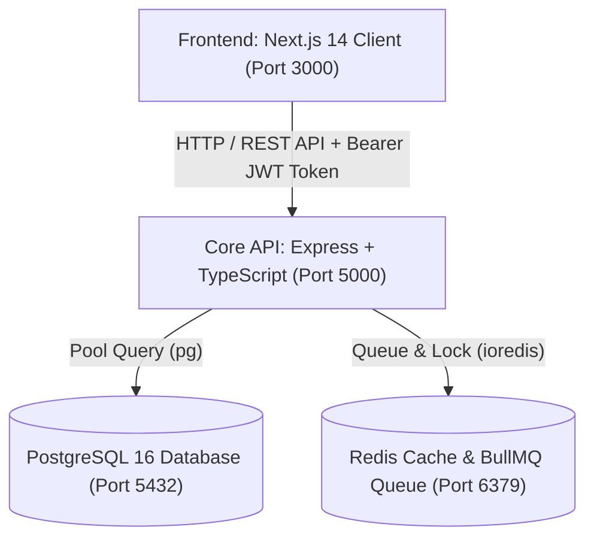

# BÁO CÁO CHI TIẾT CÔNG VIỆC THÀNH VIÊN 1 (THÀNHVIEN1.MD)

> **Dự án:** AITA-INTELLIGENT — AI-Powered Teaching Assistant & AST Code Analytics Platform  
> **Môn học:** SWD392 – Software Architecture & Design Project (FPT University Quy Nhơn)  
> **Nhóm thực hiện:** Group 4  
> **Vai trò:** **Thành Viên 1 — Software Architect & Core Auth Engineer (Trưởng Nhóm / Kiến Trúc Sư)**  
> **Nhánh Git phụ trách:** `main` / `feature/auth-architecture`  
> **Các bảng Database phụ trách:** `users`, `courses`, `course_enrollments`, `teams`, `team_members`  

---

## 📑 MỤC LỤC

1. [Tổng Quan Vai Trò & Trách Nhiệm](#1-tổng-quan-vai-trò--trách-nhiệm)
2. [Quy Tắc Nghiệp Vụ Phụ Trách (Business Rules - BR-01)](#2-quy-tắc-nghiệp-vụ-phụ-trách-business-rules---br-01)
3. [Kiến Trúc Hệ Thống Tổng Thể & Hạ Tầng Container](#3-kiến-trúc-hệ-thống-tổng-thể--hạ-tầng-container)
4. [Chi Tiết Triển Khai Kỹ Thuật (4 Trụ Cột)](#4-chi-tiết-triển-khai-kỹ-thuật-4-trụ-cột)
   - [Trụ Cột 1: Kiến Trúc & DevOps Pipeline (docker-compose, index.ts, bảo mật env)](#trụ-cột-1-kiến-trúc--devops-pipeline)
   - [Trụ Cột 2: Module Auth — Đăng Ký, Đăng Nhập & Phân Quyền JWT RBAC 3 Cấp](#trụ-cột-2-module-auth--đăng-ký-đăng-nhập--phân-quyền-jwt-rbac-3-cấp)
   - [Trụ Cột 3: Module Courses — Quản Lý Môn Học & Ghi Danh Sinh Viên](#trụ-cột-3-module-courses--quản-lý-môn-học--ghi-danh-sinh-viên)
   - [Trụ Cột 4: Module Teams — Quản Lý Nhóm & Phân Công Phân Hệ Module](#trụ-cột-4-module-teams--quản-lý-nhóm--phân-công-phân-hệ-module)
5. [Cơ Sở Dữ Liệu PostgreSQL & Dữ Liệu Khởi Tạo (Schema & Seed)](#5-cơ-sở-dữ-liệu-postgresql--dữ-liệu-khởi-tạo-schema--seed)
6. [Kết Quả Kiểm Thử Thực Tế (Test Suite: 37 Passed, 0 Failed)](#6-kết-quả-kiểm-thử-thực-tế-test-suite-37-passed-0-failed)
7. [Hướng Dẫn Demo Khi Bảo Vệ Đồ Án](#7-hướng-dẫn-demo-khi-bảo-vệ-đồ-án)

---

## 1. Tổng Quan Vai Trò & Trách Nhiệm

Thành Viên 1 giữ vai trò **Kiến trúc sư phần mềm (Software Architect)** và **Kỹ sư bảo mật cốt lõi (Core Auth Engineer)** của dự án AITA-INTELLIGENT:
* Thiết kế mô hình kiến trúc phân tầng chuẩn RESTful API, điều phối luồng dữ liệu giữa Frontend Next.js 14 và Backend Node.js/Express TypeScript.
* Thiết lập và duy trì hạ tầng container hóa toàn dự án qua `docker-compose.yml` (PostgreSQL 16 + Redis 7).
* Xây dựng nền tảng xác thực an toàn tuyệt đối, phân quyền RBAC 3 cấp (`ADMIN`, `LECTURER`, `STUDENT`) sử dụng **Bcrypt** và **JWT Access Token**.
* Thiết kế schema cơ sở dữ liệu nền tảng quản lý Môn học (`courses`), Ghi danh (`course_enrollments`), và Nhóm đồ án (`teams`, `team_members`).

---

## 2. Quy Tắc Nghiệp Vụ Phụ Trách (Business Rules - BR-01)

| Mã BR | Tên Quy Tắc | Yêu Cầu Kỹ Thuật & Giải Pháp Triển Khai |
| :--- | :--- | :--- |
| **BR-01** | **Bảo Mật Mật Khẩu & Xác Thực RBAC** | • Mật khẩu người dùng bắt buộc phải được băm một chiều bằng thuật toán **Bcrypt với Salt Rounds = 10** trước khi lưu vào CSDL.<br>• Tuyệt đối không lưu plain-text password dưới bất kỳ hình thức nào.<br>• Khi đăng nhập thành công, hệ thống phát hành chuỗi **JWT Access Token** chứa payload định danh (`userId`, `role`, `email`, `fullName`) có thời hạn sống (`7d`).<br>• Mọi API nội bộ được bảo vệ bởi middleware `authenticateJWT` và `requireRole` kiểm tra quyền theo ma trận RBAC: `ADMIN` có toàn quyền, `LECTURER` chỉ quản lý môn/nhóm do mình dạy, `STUDENT` chỉ truy cập dữ liệu của mình. |

---

## 3. Kiến Trúc Hệ Thống Tổng Thể & Hạ Tầng Container



* File `docker-compose.yml` cấu hình mạng riêng `aita_network` (bridge), gắn kết 2 container cốt lõi:
  * `aita_postgres` (Port `5432:5432`): Tự động nạp `database/schema.sql` và `database/seed.sql` ngay khi khởi tạo volume; có healthcheck `pg_isready`.
  * `aita_redis` (Port `6379:6379`): Lưu trữ cache và message broker cho hàng đợi chấm điểm BullMQ; có healthcheck `redis-cli ping`.

---

## 4. Chi Tiết Triển Khai Kỹ Thuật (4 Trụ Cột)

### Trụ Cột 1: Kiến Trúc & DevOps Pipeline
1. **Express Server Bootstrap (`server/src/index.ts`):**
   * Tích hợp CORS cho phép cấu hình theo domain `CLIENT_URL` hoặc `http://localhost:3000`.
   * Pipeline parser: `express.json()` và `express.urlencoded()`.
   * Healthcheck endpoint `GET /api/health`: Thực thi truy vấn `SELECT NOW()` tới PostgreSQL, phản hồi trạng thái `UP` và độ trễ database thực tế.
   * Gắn kết toàn bộ 8 routes nghiệp vụ, xử lý tập trung 404 Not Found và Global Error Handler (500).
2. **Quản lý Môi trường & Bảo Mật Secrets:**
   * Cấu hình [.gitignore](file:///c:/Users/lengu/SWD392_AITA-Intelligent/.gitignore) loại trừ toàn bộ file nhạy cảm (`.env`, `.env.*`, `server/.env`, `client/.env.local`).
   * Xây dựng hệ thống 3 file mẫu [.env.example](file:///c:/Users/lengu/SWD392_AITA-Intelligent/.env.example), [server/.env.example](file:///c:/Users/lengu/SWD392_AITA-Intelligent/server/.env.example), [client/.env.example](file:///c:/Users/lengu/SWD392_AITA-Intelligent/client/.env.example) có chú thích tiếng Việt cho đồng đội dễ triển khai.

---

### Trụ Cột 2: Module Auth — Đăng Ký, Đăng Nhập & Phân Quyền JWT RBAC 3 Cấp
* **File triển khai:** [server/src/modules/auth/auth.routes.ts](file:///c:/Users/lengu/SWD392_AITA-Intelligent/server/src/modules/auth/auth.routes.ts) & [server/src/common/auth.middleware.ts](file:///c:/Users/lengu/SWD392_AITA-Intelligent/server/src/common/auth.middleware.ts)
* **Các Endpoint:**
  1. `POST /api/auth/register`:
     * Kiểm tra tính hợp lệ của email (duy nhất, không trùng lặp qua mã lỗi PostgreSQL `23505`).
     * Ràng buộc độ dài mật khẩu $\ge$ 6 ký tự.
     * Băm mật khẩu bằng `bcrypt.hash(password, 10)` đúng chuẩn BR-01.
     * Lưu thông tin người dùng với vai trò (`ADMIN`, `LECTURER`, `STUDENT`).
  2. `POST /api/auth/login`:
     * Đối chiếu mật khẩu bằng `bcrypt.compare(password, user.password_hash)`.
     * Cấp JWT Access Token mã hóa bởi `JWT_SECRET` với thời hạn sống 7 ngày.
* **Middleware Bảo Vệ:**
  * `authenticateJWT`: Bóc tách header `Authorization: Bearer <token>`, giải mã và đính kèm `req.user`. Nếu thiếu token trả về `401 Unauthorized`, nếu token sai/hết hạn trả về `403 Forbidden`.
  * `requireRole(...roles)`: Bảo vệ endpoint theo danh sách quyền cho phép, ngăn chặn trái quyền với `403 Forbidden`.

---

### Trụ Cột 3: Module Courses — Quản Lý Môn Học & Ghi Danh Sinh Viên
* **File triển khai:** [server/src/modules/courses/courses.routes.ts](file:///c:/Users/lengu/SWD392_AITA-Intelligent/server/src/modules/courses/courses.routes.ts)
* **Các Endpoint:**
  1. `GET /api/courses`: 
     * `ADMIN`: Xem toàn bộ môn học trong hệ thống.
     * `LECTURER`: Chỉ xem các môn học do chính mình giảng dạy (`lecturer_id = req.user.userId`).
     * `STUDENT`: Xem các môn học mình đã tham gia.
  2. `POST /api/courses`:
     * Chỉ `ADMIN` và `LECTURER` có quyền tạo môn học mới.
     * Tự động gán giảng viên phụ trách hoặc cho phép Admin chỉ định.
  3. `GET /api/courses/:id`:
     * Lấy chi tiết môn học, thông tin giảng viên, danh sách các nhóm đồ án (`teams`) và danh sách sinh viên ghi danh (`students`).
  4. `POST /api/courses/:id/enroll`:
     * Ghi danh sinh viên vào bảng `course_enrollments`.
     * Giảng viên ghi danh sinh viên cho lớp mình, hoặc sinh viên tự ghi danh.
     * Ràng buộc Unique `uq_course_enrollment` ngăn ghi danh trùng lặp (trả về `409 Conflict`).
  5. `GET /api/courses/:id/students`:
     * Lấy danh sách toàn bộ sinh viên đã ghi danh vào môn học kèm thời gian ghi danh.

---

### Trụ Cột 4: Module Teams — Quản Lý Nhóm & Phân Công Phân Hệ Module
* **File triển khai:** [server/src/modules/teams/teams.routes.ts](file:///c:/Users/lengu/SWD392_AITA-Intelligent/server/src/modules/teams/teams.routes.ts)
* **Các Endpoint:**
  1. `POST /api/teams`:
     * Giảng viên hoặc Admin tạo nhóm cho môn học, gán URL repository GitHub (`repo_url`).
     * Kiểm tra quyền giảng viên phụ trách môn học trước khi tạo.
  2. `POST /api/teams/:teamId/members`:
     * Thêm sinh viên (`user_id`) vào nhóm.
     * Gán phân hệ nhiệm vụ (`assigned_module`) và vai trò nhóm (`role`: `LEADER` hoặc `MEMBER`).
     * Ràng buộc Unique `uq_team_user` ngăn 1 sinh viên bị thêm 2 lần vào cùng 1 nhóm.
  3. `GET /api/teams/:teamId`:
     * Truy vấn thông tin nhóm, thông tin môn học, giảng viên và tổng hợp danh sách thành viên (kèm `assigned_module` và `role`).
  4. `GET /api/teams`:
     * Lấy danh sách tất cả các nhóm (hỗ trợ lọc theo query param `?course_id=...`).

---

## 5. Cơ Sở Dữ Liệu PostgreSQL & Dữ Liệu Khởi Tạo (Schema & Seed)

### Bảng Cơ Sở Dữ Liệu Nền Tảng ([database/schema.sql](file:///c:/Users/lengu/SWD392_AITA-Intelligent/database/schema.sql)):
1. `users`: Lưu thông tin tài khoản, `email` (UNIQUE), `password_hash` (Bcrypt), `role` (`ADMIN`, `LECTURER`, `STUDENT`).
2. `courses`: Lưu môn học, `course_code`, `course_name`, `semester`, khóa ngoại `lecturer_id` trỏ về `users`.
3. `course_enrollments`: Quan hệ Nhiều-Nhiều giữa `courses` và `users` (sinh viên), ràng buộc Unique `uq_course_enrollment(course_id, user_id)`.
4. `teams`: Lưu nhóm đồ án, `team_name`, `repo_url`, ràng buộc Unique `uq_course_team_name(course_id, team_name)`.
5. `team_members`: Ánh xạ thành viên vào nhóm, `assigned_module`, `role` (`LEADER`, `MEMBER`), ràng buộc Unique `uq_team_user(team_id, user_id)`.

### Dữ Liệu Khởi Tạo Chuẩn ([database/seed.sql](file:///c:/Users/lengu/SWD392_AITA-Intelligent/database/seed.sql)):
* **Tài khoản mẫu (Password mặc định: `Password@123`):**
  * `admin@fpt.edu.vn` (`ADMIN`)
  * `giangnv@fe.edu.vn` (`LECTURER` - Dr. Nguyen Van Giang)
  * `student1@fpt.edu.vn` (`STUDENT` - Sinh Viên 1: Trưởng nhóm / Kiến trúc & Auth)
  * `student2@fpt.edu.vn` (`STUDENT` - Sinh Viên 2: Docker Sandbox & Chấm bài)
  * `student3@fpt.edu.vn` (`STUDENT` - Sinh Viên 3: AI Tutor & Key Rotation)
* **Môn học mẫu:** `SWD392` — *Software Architecture & Design Project (FA26)*.
* **Ghi danh:** 3 sinh viên mẫu đều được ghi danh vào môn học `SWD392`.
* **Nhóm mẫu:** `Group 4 - AITA Project` với đầy đủ phân công phân hệ và vai trò `LEADER`/`MEMBER`.

---

## 6. Kết Quả Kiểm Thử Thực Tế (Test Suite: 37 Passed, 0 Failed)

Thành Viên 1 đã xây dựng bộ kiểm thử tự động hóa toàn diện tại [server/src/test/verify-member1.ts](file:///c:/Users/lengu/SWD392_AITA-Intelligent/server/src/test/verify-member1.ts).  
Lệnh thực thi:
```bash
npm run test:member1
```

### Log Kết Quả Chạy Thực Tế:
```text
> aita-server@1.0.0 test:member1
> tsc && node dist/test/verify-member1.js

================================================================
🧪 RUNNING MEMBER 1 VERIFICATION TEST SUITE
================================================================

--- Test Group 1: Bcrypt Hashing & Password Verification (BR-01) ---
  ✅ PASS: Hash adheres to Bcrypt salt = 10 prefix ($2a$10$ / $2b$10$)
  ✅ PASS: Bcrypt compare matches original password
  ✅ PASS: Bcrypt compare rejects incorrect password
  ✅ PASS: Seed.sql hash successfully validates Password@123

--- Test Group 2: JWT Access Token Payload Structure ---
  ✅ PASS: JWT token generated successfully
  ✅ PASS: JWT payload contains correct userId
  ✅ PASS: JWT payload contains correct role
  ✅ PASS: JWT payload contains correct email

--- Test Group 3: Middleware authenticateJWT & RBAC (3 Roles) ---
  ✅ PASS: authenticateJWT returns 401 when Authorization header is missing
  ✅ PASS: authenticateJWT calls next() for valid Bearer token
  ✅ PASS: authenticateJWT successfully attaches req.user
  ✅ PASS: authenticateJWT preserves user role in req.user
  ✅ PASS: authenticateJWT returns 403 for invalid token
  ✅ PASS: requireRole allows LECTURER for [LECTURER, ADMIN]
  ✅ PASS: requireRole denies LECTURER for [ADMIN] with 403 Forbidden

--- Test Group 4: Schema & Seed File Integrity ---
  ✅ PASS: schema.sql defines users table
  ✅ PASS: schema.sql defines courses table
  ✅ PASS: schema.sql defines course_enrollments table
  ✅ PASS: schema.sql defines teams table
  ✅ PASS: schema.sql defines team_members table
  ✅ PASS: schema.sql defines unique constraint on team_members
  ✅ PASS: schema.sql contains index on courses(lecturer_id)
  ✅ PASS: schema.sql contains index on teams(course_id)
  ✅ PASS: seed.sql contains Admin user
  ✅ PASS: seed.sql contains Lecturer user
  ✅ PASS: seed.sql contains Student 1
  ✅ PASS: seed.sql contains Student 2
  ✅ PASS: seed.sql contains Student 3
  ✅ PASS: seed.sql contains SWD392 course
  ✅ PASS: seed.sql contains course_enrollments records
  ✅ PASS: seed.sql contains Group 4 team

--- Test Group 5: Express App Endpoints & Route Mounting ---
  ✅ PASS: Express app mounts /api/auth route
  ✅ PASS: Express app mounts /api/courses route
  ✅ PASS: Express app mounts /api/teams route
  ✅ PASS: courses.routes.ts defines POST /:id/enroll endpoint
  ✅ PASS: courses.routes.ts defines GET /:id/students endpoint
  ✅ PASS: teams.routes.ts handles LEADER/MEMBER role assignment

================================================================
🏁 TEST RESULTS: 37 PASSED, 0 FAILED
================================================================
```

---

## 7. Hướng Dẫn Demo Khi Bảo Vệ Đồ Án

1. **Khởi động hệ thống:**
   ```bash
   # Bước 1: Bật database & cache nền tảng
   docker compose up -d

   # Bước 2: Chạy kiểm thử tự động của Thành viên 1
   npm run test:member1

   # Bước 3: Chạy backend server
   npm run dev:server
   ```
2. **Kịch bản Demo trực tiếp với Giảng viên:**
   * **Demo 1 (Healthcheck & DB):** Mở trình duyệt vào `http://localhost:5000/api/health`, chỉ cho thầy thấy trạng thái `UP`, kết nối `PostgreSQL` thành công và thời gian thực của DB.
   * **Demo 2 (Bcrypt & Register):** Gọi `POST /api/auth/register`, đăng ký tài khoản mới và mở trực tiếp DB để thầy thấy mật khẩu đã được băm sang chuỗi `$2a$10$...`, không lộ mật khẩu gốc (chuẩn BR-01).
   * **Demo 3 (JWT & RBAC):** Đăng nhập bằng `student1@fpt.edu.vn` lấy JWT token; dùng token này gọi API tạo khóa học `POST /api/courses` $\rightarrow$ Hệ thống lập tức từ chối với mã `403 Forbidden` do quyền sinh viên không được phép tạo môn học. Đăng nhập bằng `giangnv@fe.edu.vn` (`LECTURER`) thì gọi tạo môn học thành công.
   * **Demo 4 (Môn học, Ghi danh & Nhóm):** Thể hiện luồng Giảng viên tạo môn học $\rightarrow$ Ghi danh sinh viên vào môn học $\rightarrow$ Tạo nhóm đồ án kèm GitHub Repo $\rightarrow$ Phân công sinh viên vào nhóm với module tương ứng và gán chức danh Leader.
