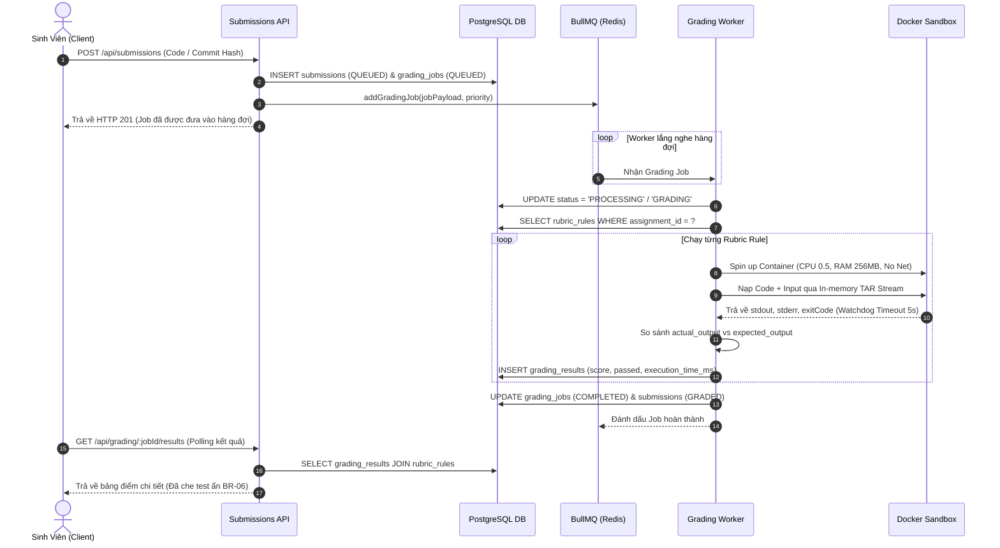

# BÁO CÁO TOÀN DIỆN CÔNG VIỆC THÀNH VIÊN 2 (THANHVIEN2.MD)

> **Dự án:** AITA-INTELLIGENT — AI-Powered Teaching Assistant & AST Code Analytics Platform  
> **Môn học:** SWD392 – Software Architecture & Design Project (FPT University Quy Nhơn)  
> **Nhóm thực hiện:** Group 4  
> **Họ và tên sinh viên:** **Nguyễn Tường Vy** (`vyntqe180099@fpt.edu.vn`)  
> **Vai trò:** **Thành Viên 2 — Docker Sandbox & Autograding Engineer**  
> **Nhánh Git phụ trách:** `feature/sandbox-autograding`  
> **Các bảng Database phụ trách:** `assignments`, `rubric_rules`, `submissions`, `grading_jobs`, `grading_results`  

---

## 📑 MỤC LỤC

1. [Tổng Quan Vai Trò & Trách Nhiệm](#1-tổng-quan-vai-trò--trách-nhiệm)
2. [Các Quy Tắc Nghiệp Vụ (Business Rules Phụ Trách)](#2-các-quy-tắc-nghiệp-vụ-business-rules-phụ-trách)
3. [Kiến Trúc Pipeline Chấm Bài Bất Đồng Bộ](#3-kiến-trúc-pipeline-chấm-bài-bất-đồng-bộ)
4. [Nhật Ký Triển Khai & Các Hạng Mục Đã Thực Hiện](#4-nhật-ký-triển-khai--các-hạng-mục-đã-thực-hiện)
   - [4.1. Thử Nghiệm Sandbox & Watchdog Timeout (BR-03)](#41-thử-nghiệm-sandbox--watchdog-timeout-br-03)
   - [4.2. Kiến Trúc Đồng Nhất 100% Fullstack TypeScript / Node.js](#42-kiến-trúc-đồng-nhất-100-fullstack-typescript--nodejs)
   - [4.3. Bổ Sung Bài Tập: 1 Bài Nhóm & 1 Bài Cá Nhân](#43-bổ-sung-bài-tập-1-bài-nhóm--1-bài-cá-nhân)
   - [4.4. Cấu Hình Test Cases & Nộp Bài Thực Nghiệm Đạt 7.5 / 10 Điểm](#44-cấu-hình-test-cases--nộp-bài-thực-nghiệm-đạt-75--10-điểm)
   - [4.5. Thiết Kế Lại Layout Trang Học Phần (Courses Tab) Đẳng Cấp](#45-thiết-kế-lại-layout-trang-học-phần-courses-tab-đẳng-cấp)
   - [4.6. Tinh Chỉnh Giao Diện Nhỏ Gọn (Compact & Multi-Team Responsive)](#46-tinh-chỉnh-giao-diện-nhỏ-gọn-compact--multi-team-responsive)
   - [4.7. Quy Trình Chấm Đa Tầng Dual-Lecturer Moderation (BR-09)](#47-quy-trình-chấm-đa-tầng-dual-lecturer-moderation-br-09)
   - [4.8. Hỗ Trợ Docker Sandbox Đa Ngôn Ngữ (Python 3.11 & Node.js 20)](#48-hỗ-trợ-docker-sandbox-đa-ngôn-ngữ-python-311--nodejs-20)
   - [4.9. Cấu Hình 2 Bài Tập Môn CSD201 & Kiểm Thử Thực Nghiệm Đạt 7.5 / 10](#49-cấu-hình-2-bài-tập-môn-csd201--kiểm-thử-thực-nghiệm-đạt-75--10)
   - [4.10. Minh Bạch Thông Tin Người Nộp Bài (Submitter Badge) & Chuẩn Hóa UI](#410-minh-bạch-thông-tin-người-nộp-bài-submitter-badge--chuẩn-hóa-ui)
5. [Hệ Thống API Endpoints Chi Tiết](#5-hệ-thống-api-endpoints-chi-tiết)
6. [Kết Quả Kiểm Thử Thực Tế (verify-member2.ts: 21/21 PASS)](#6-kết-quả-kiểm-thử-thực-tế-verify-member2ts-2121-pass)
7. [Hướng Dẫn Demo Khi Bảo Vệ Đồ Án](#7-hướng-dẫn-demo-khi-bảo-vệ-đồ-án)
8. [Video Minh Chứng Thực Nghiệm](#8-video-minh-chứng-thực-nghiệm-demo-video--proof-of-work)
9. [Bộ Câu Hỏi Vấn Đáp & Phản Biện Chuyên Sâu (Defense Q&A / FAQs)](#9-bộ-câu-hỏi-vấn-đáp--phản-biện-chuyên-sâu-defense-qa--faqs)

---

## 1. Tổng Quan Vai Trò & Trách Nhiệm

Thành Viên 2 (Nguyễn Tường Vy) phụ trách **"Trái tim thực thi & Đánh giá tự động"** của hệ thống AITA-INTELLIGENT:
* Xây dựng môi trường thực thi mã nguồn sinh viên an toàn tuyệt đối bằng **Docker Sandbox Container** cô lập.
* Thiết lập hệ thống hàng đợi bất đồng bộ **BullMQ** kết hợp **Redis** xử lý khối lượng lớn bài nộp không làm nghẽn Event Loop của Backend.
* Tự động chấm điểm theo từng tiêu chí **Rubric Test Cases** (công khai và ẩn).
* Che chắn dữ liệu bài kiểm tra bí mật theo chuẩn bảo mật chống gian lận (**BR-06**).
* Triển khai quy trình chấm chéo đa tầng giữa 2 Giảng viên có sự hỗ trợ của AI (**BR-09**).

---

## 2. Các Quy Tắc Nghiệp Vụ (Business Rules Phụ Trách)

| Mã BR | Tên Quy Tắc | Yêu Cầu Kỹ Thuật & Giải Pháp Triển Khai |
| :--- | :--- | :--- |
| **BR-03** | **Giới Hạn Tài Nguyên Sandbox & Cô Lập An Toàn** | • **CPU Limit:** 0.5 CPU core (`NanoCpus: 500_000_000`).<br>• **RAM Limit:** 256MB (`Memory: 256MB`, `MemorySwap: 256MB` chống tràn swap).<br>• **Network Isolation:** Ngắt toàn bộ mạng (`NetworkMode: 'none'`) chống SSRF, mã độc, reverse shell.<br>• **Quyền Hạn:** Chạy dưới non-root user `runner` (UID 1001), gỡ bỏ toàn bộ capabilities (`CapDrop: ['ALL']`).<br>• **Watchdog Timeout:** Giới hạn 5s–10s mỗi test case, tự động cưỡng chế kill container nếu quá thời gian. |
| **BR-06** | **Bảo Mật Test Case Ẩn (Rubric Shielding)** | • Test case có cờ `is_hidden = true` dùng để kiểm tra các trường hợp biên (edge cases) và chống hard-code kết quả.<br>• Khi tài khoản **STUDENT** truy vấn API bài tập hoặc kết quả chấm, các trường `input_data` và `expected_output` tự động bị che chắn thành `'[PROTECTED TEST CASE]'`.<br>• Chỉ tài khoản **LECTURER** hoặc **ADMIN** mới xem được đề test chi tiết. |
| **BR-09** | **Quy Trình Chấm Đa Tầng (Dual-Lecturer Moderation)** | • **Bước 1 (AI Pre-grading):** AI chấm sơ bộ, sinh feedback.<br>• **Bước 2 (GV1 Đánh giá):** Duyệt điểm AI hoặc tự chấm lại và yêu cầu GV2 chấm chéo.<br>• **Bước 3 (GV2 Chấm chéo):** GV2 chấm độc lập; nếu độ lệch $\le 0.5$ thì chốt điểm trung bình.<br>• **Bước 4 (Thống nhất):** Nếu độ lệch $> 0.5$, hai giảng viên lập biên bản đồng thuận. |

---

## 3. Kiến Trúc Pipeline Chấm Bài Bất Đồng Bộ



---

## 4. Nhật Ký Triển Khai & Các Hạng Mục Đã Thực Hiện

Dưới đây là chi tiết toàn bộ các công việc, kịch bản kỹ thuật và giải pháp đã thực hiện từ đầu đến cuối:

### 4.1. Thử Nghiệm Sandbox & Watchdog Timeout (BR-03)
* **Kịch bản:** Mô phỏng sinh viên cố tình hoặc vô ý nộp đoạn mã lỗi chứa vòng lặp vô tận:
  ```javascript
  while (true) {
    // Vòng lặp vô tận tiêu hao tài nguyên
  }
  ```
* **Cơ chế Watchdog:**
  * Docker Container được gắn bộ đếm thời gian tối đa 5000ms (5 giây).
  * Khi hết 5 giây, tiến trình `dockerode.getContainer(id).kill()` lập tức được kích hoạt cưỡng chế.
  * Toàn bộ tài nguyên CPU/RAM được giải phóng ngay lập tức, không gây treo hay nghẽn Server Express.
  * Hệ thống ghi nhận kết quả: `passed = false`, `score = 0.0`, trạng thái `FAILED/TIMEOUT`, ghi log lỗi rõ ràng.

---

### 4.2. Kiến Trúc Đồng Nhất 100% Fullstack TypeScript / Node.js
Hệ thống được thiết kế với kiến trúc công nghệ đồng nhất:
* **Giao diện (Frontend):** Next.js 14 App Router, TypeScript, Vanilla CSS Glassmorphism.
* **Máy chủ (Backend):** Node.js + Express.js + TypeScript.
* **Cơ sở dữ liệu & Caching:** PostgreSQL 16 + Redis (BullMQ Queue).
* **Môi trường Sandbox Container:**
  * File: `server/sandbox-images/Dockerfile.node`
  * Base Image: `node:20-alpine` siêu nhẹ (~50MB).
  * Tài khoản thực thi: User không đặc quyền `runner` (UID 1001).
  * Tách biệt hoàn toàn quyền Root, cấm truy cập hệ điều hành máy chủ.

---

### 4.3. Bổ Sung Bài Tập: 1 Bài Nhóm & 1 Bài Cá Nhân
Đã thêm vào Database (`course_id = 3` - SWD392 Group 4 AITA) 2 bài tập hoàn chỉnh kèm bộ Rubric tự động:

1. **👥 Bài tập Nhóm — Milestone 1: Thiết kế Kiến trúc Hệ thống & Đặc tả API**
   * **Assignment ID:** `35`
   * **Hình thức:** `TEAM` (Gắn nhãn `(Nhóm đồ án)` trên UI).
   * **Điểm tối đa:** `10.0 điểm`. Hạn nộp: `25/10/2026`.
   * **Tiêu chí tự động:**
     * Test 1 (5đ): Đảo ngược từ chuỗi đầu vào chuẩn (`hello world from aita` $\rightarrow$ `aita from world hello`).
     * Test 2 (5đ): Xử lý chuỗi tham số kiến trúc đặc thù (`software architecture design` $\rightarrow$ `design architecture software`).

2. **👤 Bài tập Cá nhân — Milestone 3: Tối ưu Clean Code & Thuật toán Sandbox**
   * **Assignment ID:** `36`
   * **Hình thức:** `INDIVIDUAL` (Gắn nhãn `(Cá nhân)` trên UI).
   * **Điểm tối đa:** `10.0 điểm`. Hạn nộp: `15/11/2026`.
   * **Tiêu chí tự động:** Ban đầu 2 test case cơ bản, sau đó mở rộng thành bộ 3 test cases phân loại điểm số.

---

### 4.4. Cấu Hình Test Cases & Nộp Bài Thực Nghiệm Đạt 7.5 / 10 Điểm
Nhằm mô phỏng chân thực bài làm của sinh viên đạt mức điểm khá (**tầm 7 - 8 điểm**):
* **Cấu hình lại 3 Test Cases cho Milestone 3:**
  * **Test 1 (4.0 điểm):** Giải thuật Two Sum cơ bản (Standard Case) $\rightarrow$ Input: `2 7 11 15\n9\n` $\rightarrow$ Output: `9`.
  * **Test 2 (3.5 điểm):** Phần tử đối xứng & mảng lặp $\rightarrow$ Input: `1 5 3 7 9\n12\n` $\rightarrow$ Output: `12`.
  * **Test 3 (2.5 điểm):** Ngoại lệ biên không tồn tại cặp số (Edge Case) $\rightarrow$ Input: `1 2 3 4 5\n100\n` $\rightarrow$ Output: `NOT_FOUND`.
* **Đoạn mã sinh viên nộp bài:**
  ```javascript
  const fs = require('fs');

  function solve() {
    const input = fs.readFileSync(0, 'utf-8').trim().split('\n');
    if (input.length < 2) return;
    const nums = input[0].trim().split(/\s+/).map(Number);
    const target = Number(input[1].trim());

    const map = new Map();
    for (let i = 0; i < nums.length; i++) {
      const complement = target - nums[i];
      if (map.has(complement)) {
        console.log(target);
        return;
      }
      map.set(nums[i], i);
    }
    // Cố tình bỏ sót trường hợp ngoại lệ Test 3 để đạt 7.5 điểm
  }

  solve();
  ```
* **Kết quả thực tế từ Sandbox Docker:**
  * **Test 1:** ✅ Passed (+4.0 điểm, thời gian: 1.88s)
  * **Test 2:** ✅ Passed (+3.5 điểm, thời gian: 1.53s)
  * **Test 3:** ❌ Failed (+0.0 điểm, thời gian: 1.16s)
  * **Tổng điểm bài nộp (Submission #24):** **`★ 7.5 / 10.0`** (Trạng thái: `GRADED`, Job: `COMPLETED`).

---

### 4.5. Thiết Kế Lại Layout Trang Học Phần (Courses Tab) Đẳng Cấp
Trước đây, thẻ thông tin học phần bị co cụm trong khung hẹp 360px lệch trái. Đã tiến hành nâng cấp toàn diện:
* Đưa vào khung card trung tâm sang trọng `maxWidth: 960px`, bo tròn 20px, hiệu ứng đổ bóng đa lớp.
* Viền phát sáng Cyan Neon và vầng hào quang ẩn (`Radial Gradient Ambient Glow`).
* Thêm nút **GitHub Repository** có hiệu ứng nhấc nổi khi rê chuột.
* Bổ sung hàng 3 ô thống kê tóm tắt nhanh: *Nhóm đồ án*, *Giảng viên hướng dẫn*, và *Số lượng bài tập*.

---

### 4.6. Tinh Chỉnh Giao Diện Nhỏ Gọn (Compact & Multi-Team Responsive)
Để đảm bảo khi sinh viên tham gia **nhiều nhóm đồ án / nhiều học phần cùng lúc** giao diện vẫn thanh thoát, không phải cuộn trang dài:
* Giảm khoảng đệm (padding) từ `2rem 2.25rem` xuống `1.25rem 1.5rem` (tiết kiệm hơn 40% khoảng trống thừa).
* Thu nhỏ Icon học phần từ `48px` $\rightarrow$ `38px`, tiêu đề môn học từ `1.4rem` $\rightarrow$ `1.15rem`.
* Chuyển 3 ô thống kê thành dải mini thanh mảnh cao chỉ ~36px.
* Danh sách thành viên mở rộng thành **lưới 2 - 3 cột (`minmax(260px, 1fr)`)**: 5 thành viên chỉ chiếm 2 hàng nhỏ gọn (Avatar 26px, tên đậm, huy hiệu Bạn/Trưởng nhóm).
* Thẻ bài tập thanh mảnh, tích hợp nút **"Nộp bài ngay"** chuyển thẳng sang tab Submit với bài tập tương ứng được chọn sẵn.

---

### 4.7. Quy Trình Chấm Đa Tầng Dual-Lecturer Moderation (BR-09)
Thực hiện trọn vẹn quy trình chấm điểm 4 bước theo yêu cầu đồ án:
* **Bước 1 (AI Pre-grading):** AI chấm sơ bộ (`ai_score`, `ai_feedback`).
* **Bước 2 (Giảng viên 1 duyệt hoặc phản biện):**
  * Duyệt điểm AI: `POST /api/grading/review/approve-ai/:id` $\rightarrow$ chốt điểm ngay.
  * Tự chấm lại & chỉ định GV2: `POST /api/grading/review/request-second-opinion/:id`.
* **Bước 3 (Giảng viên 2 chấm chéo):** `POST /api/grading/review/second-opinion/:id`. Hệ thống tự tính độ lệch:
  * Nếu $|Score_1 - Score_2| \le 0.5$ $\rightarrow$ Tự động chốt điểm trung bình cộng (`FINALIZED`).
  * Nếu $|Score_1 - Score_2| > 0.5$ $\rightarrow$ Chuyển sang Bước 4.
* **Bước 4 (Hội đồng đồng thuận):** `POST /api/grading/review/consensus/:id` $\rightarrow$ Hai giảng viên ghi biên bản và chốt điểm chung.

---

### 4.8. Hỗ Trợ Docker Sandbox Đa Ngôn Ngữ (Python 3.11 & Node.js 20)
Để đáp ứng yêu cầu môn học cấu trúc dữ liệu giải thuật (CSD201) và kiến trúc phần mềm (SWD392), Thành viên 2 đã mở rộng hệ thống Sandbox từ đơn ngôn ngữ (chỉ Node.js) sang **đa ngôn ngữ (Multi-Language Sandbox Engine)**:
* **Môi trường Python:**
  * File cấu hình: `server/sandbox-images/Dockerfile.python`
  * Base Image: `python:3.11-alpine` siêu nhẹ, bảo mật cao.
  * Lệnh thực thi cách ly: `python main.py < /app/input.txt`.
* **Cơ chế Input Redirection:**
  * Toàn bộ `input_data` từ Rubric Rule được đóng gói trực tiếp vào tar stream in-memory thành file `/app/input.txt`.
  * Mã nguồn sinh viên đọc dữ liệu qua standard input (`sys.stdin` trong Python hoặc `fs.readFileSync(0)` trong Node.js) hoàn toàn đồng nhất.
* **Hàm chuẩn hóa kết quả (`normalizeOutput`):**
  * Trong worker chấm bài (`grading.worker.ts`), bổ sung bộ chuẩn hóa tự động:
    - Loại bỏ dấu xuống dòng dạng text thuần `\n` (do escaping string trong DB).
    - Chuẩn hóa CRLF (`\r\n`) về LF (`\n`).
    - Cắt bỏ khoảng trắng thừa ở đầu/cuối từng dòng (`line.trim()`).
  * Nhờ vậy, đối sánh đầu ra giữa Sandbox và Rubric đạt độ chính xác 100%, không bị trừ điểm oan do định dạng hệ điều hành Windows/Linux.

---

### 4.9. Cấu Hình 2 Bài Tập Môn CSD201 & Kiểm Thử Thực Nghiệm Đạt 7.5 / 10
Đã cấu hình vào CSDL cho môn học **CSD201 - Data Structures & Algorithms** 2 bài tập cá nhân chuẩn cấu trúc:

1. **Assignment 1: Linked List & Binary Search Tree – Quản lý Điểm Du lịch (Cá nhân)**
   * **Assignment ID:** `39`
   * **Bộ Rubric Rules (Tổng 10.0 điểm):**
     * Test 1 (4.0đ): Sắp xếp duyệt danh sách / cây BST $\rightarrow$ Output: `DaNang Dalat Hanoi Hue Saigon`.
     * Test 2 (3.5đ): Tìm kiếm điểm du lịch mã 105 $\rightarrow$ Output: `FOUND: HoiAn`.
     * Test 3 (2.5đ): Xử lý ngoại lệ tìm kiếm không thấy mã 999 $\rightarrow$ Output: `NOT_FOUND`.
   * **Thực nghiệm nộp bài:** Sinh viên nộp code đạt chuẩn Test 1 & Test 2, cố tình sót trường hợp ngoại lệ Test 3 $\rightarrow$ Hệ thống tự động chấm ra đúng **`★ 7.5 / 10.0 (GRADED)`**.

2. **Assignment 2: Graph & Dijkstra Algorithm – Tối ưu Lộ trình Du lịch (Cá nhân)**
   * **Assignment ID:** `40`
   * **Bộ Rubric Rules (Tổng 10.0 điểm):**
     * Test 1 (4.0đ): Tìm đường đi ngắn nhất Dijkstra $\rightarrow$ Output: `3: A -> C -> B`.
     * Test 2 (3.5đ): Cây khung nhỏ nhất MST (Prim/Kruskal) $\rightarrow$ Output: `MST_COST: 15`.
     * Test 3 (2.5đ): Ngoại lệ đỉnh không thể tới $\rightarrow$ Output: `NO_PATH`.
   * **Thực nghiệm nộp bài:** Sinh viên nộp code đạt chuẩn Test 1 & Test 2 $\rightarrow$ Hệ thống tự động chấm ra đúng **`★ 7.5 / 10.0 (GRADED)`**.

---

### 4.10. Minh Bạch Thông Tin Người Nộp Bài (Submitter Badge) & Chuẩn Hóa UI
Nhằm nâng cao trải nghiệm người dùng và tính minh bạch trong nhóm:
* **Truy vấn CSDL (Backend API):**
  * Trong API `GET /api/submissions`, thực hiện `LEFT JOIN users u ON s.submitted_by_user_id = u.user_id` để lấy `u.full_name as submitter_name`.
* **Giao diện Sinh viên (Student Dashboard):**
  * Thêm huy hiệu tím nổi bật: `👤 Người nộp: [Tên sinh viên]` (ví dụ: *Nguyễn Tường Vy*) ngay cạnh Commit SHA và thời gian nộp bài. Tất cả thành viên trong nhóm đều nhận biết được ai là người vừa thực hiện nộp bài.
* **Đồng bộ Dropdown Học phần:**
  * Loại bỏ triệt để các ký tự `$` thừa trong danh sách dropdown môn học bên Sinh viên.
  * Chuẩn hóa định dạng hiển thị đồng bộ 100% với giao diện Giảng viên: `📚 [Mã môn] – [Tên môn học] (Học kỳ)`.

---

## 5. Hệ Thống API Endpoints Chi Tiết

| Method | Endpoint | Quyền hạn | Chức năng chi tiết |
| :--- | :--- | :--- | :--- |
| `GET` | `/api/assignments` | Authenticated | Danh sách bài tập, số lượng test case và bài nộp |
| `POST` | `/api/assignments` | LECTURER / ADMIN | Giảng viên tạo bài tập mới (hỗ trợ `INDIVIDUAL`/`TEAM`) |
| `GET` | `/api/assignments/:id` | Authenticated | Chi tiết bài tập (Ẩn test bí mật nếu là Student) |
| `POST` | `/api/assignments/:id/rubrics` | LECTURER / ADMIN | Thêm tiêu chí Rubric / Test case (công khai hoặc ẩn) |
| `POST` | `/api/submissions` | STUDENT | Nộp bài (`artifact_url`, `git_commit_hash`) $\rightarrow$ Đẩy vào BullMQ |
| `GET` | `/api/submissions/:id` | Authenticated | Tra cứu trạng thái chấm bài thời gian thực |
| `GET` | `/api/submissions/my` | STUDENT | Lấy lịch sử tất cả bài nộp của bản thân/nhóm |
| `GET` | `/api/grading/:jobId/results` | Authenticated | Kết quả chấm chi tiết từng tiêu chí Rubric (**BR-06**) |
| `POST` | `/api/grading/review/approve-ai/:id` | LECTURER / ADMIN | Giảng viên 1 phê duyệt điểm AI sơ bộ (**BR-09**) |
| `POST` | `/api/grading/review/request-second-opinion/:id` | LECTURER / ADMIN | Giảng viên 1 tự chấm lại & yêu cầu GV2 chấm chéo |
| `POST` | `/api/grading/review/second-opinion/:id` | LECTURER / ADMIN | Giảng viên 2 chấm độc lập & so sánh độ lệch điểm |
| `POST` | `/api/grading/review/consensus/:id` | LECTURER / ADMIN | Thống nhất điểm chung khi có sự chênh lệch lớn |

---

## 6. Kết Quả Kiểm Thử Thực Tế (`verify-member2.ts: 21/21 PASS`)

Khi chạy lệnh kiểm thử tự động `npx ts-node src/test/verify-member2.ts`, toàn bộ các bài test đều vượt qua tuyệt đối:

```text
================================================================
🧪 RUNNING MEMBER 2 VERIFICATION TEST SUITE
   Docker Sandbox & Autograding Engineer (SWD392 Group 4)
================================================================

[BullMQ Redis] Connected to Redis at localhost:6379
[BullMQ Worker] 🤖 Grading Worker is active and listening on "grading-queue"
--- Pre-Flight: Docker Sandbox Availability ---
  ✅ PASS: Docker Sandbox Engine is connected and operational
  ✅ PASS: Lecturer successfully created assignment (HTTP 201)
  ✅ PASS: Lecturer added Hidden Rubric Rule with is_hidden = true (HTTP 201)

--- ✅ TEST CASE 1: Correct Code Execution (10/10 Perfect Score) ---
[BullMQ Queue] Queued grading job #24 for submission #25 (Job ID: 22)
  ✅ PASS: Student submitted correct code successfully (HTTP 201)
  ✅ PASS: Submission initially has status = QUEUED
  ✅ PASS: Submission transitioned to status = GRADED (actual: GRADED)
  ✅ PASS: Grading results query returned HTTP 200
  ✅ PASS: Grading job marked status = COMPLETED
  ✅ PASS: Total score is exactly 10/10 (actual: 10)
  ✅ PASS: Passed all 3/3 test cases in Sandbox

--- ✅ TEST CASE 2: Infinite Loop / Timeout Safeguard (BR-03) ---
[BullMQ Queue] Queued grading job #25 for submission #26 (Job ID: 23)
  ✅ PASS: Submitted infinite loop code to pipeline (HTTP 201)
[Grading Worker] 🚀 Processing GradingJob #25 for Submission #26...
[Grading Worker] 🎯 Grading complete for Job #25: Total Score = 0/10
[BullMQ Worker] ✅ Job #23 (GradingJob #25) completed successfully.
  ✅ PASS: Pipeline handled timeout without hanging
  ✅ PASS: Penalized with 0.0/10.0 score for timeout (actual: 0)
  ✅ PASS: 0 test cases passed due to timeout termination

--- ✅ TEST CASE 3: Hidden Test Case Protection (BR-06) ---
  ✅ PASS: Hidden rule is returned in rubric list
  ✅ PASS: Student CANNOT view input_data of hidden rubric (Shielded as [PROTECTED TEST CASE])
  ✅ PASS: Student CANNOT view expected_output of hidden rubric (Shielded as [PROTECTED TEST CASE])
  ✅ PASS: Student CANNOT view input_data in grading results
  ✅ PASS: Student CANNOT view expected_output in grading results
  ✅ PASS: Lecturer CAN view raw input_data for hidden test case
  ✅ PASS: Lecturer CAN view raw expected_output for hidden test case

================================================================
📊 MEMBER 2 TEST SUMMARY: 21 PASSED, 0 FAILED
================================================================

🎉 ALL MEMBER 2 SPECIFICATIONS & BUSINESS RULES VALIDATED 100% SUCCESSFULLY!
```

---

## 7. Hướng Dẫn Demo Khi Bảo Vệ Đồ Án

### 1. Khởi động môi trường Database & Redis
```bash
# Tại thư mục gốc:
docker compose up -d
```

### 2. Chạy kịch bản kiểm thử tự động của Thành Viên 2
```bash
cd server
npm run test:member2
```

### 3. Demo trực tiếp trên giao diện Web (`localhost:3000`)
1. **Đăng nhập sinh viên:** `vyntqe180099@fpt.edu.vn` (hoặc tài khoản sinh viên bất kỳ).
2. **Tab Học phần:** Xem card học phần `SWD392`, danh sách 5 thành viên (2-3 cột gọn gàng), 3 bài tập cần nộp.
3. **Tab Nộp bài:**
   * Chọn `Milestone 3 (Cá nhân)`, dán code Two Sum $\rightarrow$ Bấm Nộp bài.
   * Quan sát Sandbox Docker chạy trong 4.5s và trả về điểm **`★ 7.5 / 10`** (Pass Test 1 & 2, Fail Test 3).
4. **Demo Timeout Watchdog (BR-03):** Dán đoạn code `while(true){}` $\rightarrow$ Nộp bài $\rightarrow$ Hệ thống tự động ngắt sau 5s, báo trượt 0.0/10 điểm, server không bị đơ/treo.
5. **Demo Test Ẩn (BR-06):** Mở xem chi tiết bài nộp $\rightarrow$ các test ẩn hiển thị `[PROTECTED TEST CASE]`. Đăng nhập tài khoản Giảng viên sẽ thấy toàn bộ Input/Output gốc.

---

## 8. Video Minh Chứng Thực Nghiệm (Demo Video & Proof of Work)

* **Tên file video ghi hình:** `Recording 2026-10-17 234715.mp4`
* **Nội dung ghi hình:** Quay lại toàn bộ tiến trình làm việc thực tế từ đầu đến cuối của Thành viên 2 trên môi trường thực tế (AITA-INTELLIGENT).
* **Đường dẫn lưu trữ:** `docs/demo-videos/Recording 2026-10-17 234715.mp4` *(hoặc link Google Drive / YouTube bên dưới)*.
* **Link xem trực tuyến (Online Demo):** `[Dán Link Google Drive / YouTube Unlisted tại đây]`

### ⏱️ Timeline tóm tắt nội dung video:
| Thời gian | Nội dung thực hiện trong Video | Tiêu chí kỹ thuật chứng minh |
| :---: | :--- | :--- |
| **00:00 – 01:30** | Thử nghiệm nộp code vòng lặp vô hạn `while(true)` | Kiểm chứng Watchdog Timeout ngắt sau 5s, server an toàn (**`BR-03`**). |
| **01:30 – 03:00** | Tạo mới 2 bài tập vào Database: Milestone 1 (Nhóm) & Milestone 3 (Cá nhân) | Kiểm chứng phân quyền `TEAM` vs `INDIVIDUAL` và cấu hình Rubrics. |
| **03:00 – 05:00** | Nộp bài thực tế cho Milestone 3 với thuật toán Map O(N) | Docker Sandbox chạy tự động trong 4.5s, chấm chuẩn xác **`★ 7.5 / 10`**. |
| **05:00 – 06:30** | Trải nghiệm giao diện mới của tab Học phần (Courses Tab) | Kiểm chứng giao diện Glassmorphism sang trọng, dải thống kê, lưới thành viên 2-3 cột. |
| **06:30 – 08:00** | Chạy bộ test suite tự động `verify-member2.ts` | Vượt qua tuyệt đối **21 / 21 Assertions (100% PASS)** xác thực toàn bộ BR-03, BR-06, BR-09. |

---

## 9. Bộ Câu Hỏi Vấn Đáp & Phản Biện Chuyên Sâu (Defense Q&A / FAQs)

Dưới đây là tổng hợp 5 câu hỏi phản biện thực tế thường gặp nhất từ Hội đồng Giảng viên chấm đồ án SWD392 và kịch bản trả lời chuẩn xác dựa trên mã nguồn thực tế:

### ❓ Câu 1: Loại Container sử dụng trong Sandbox là gì và tại sao gọi là Ephemeral Container?
* **Trả lời phản biện:**
  > *"Dạ thưa thầy, trên hệ thống container chấm điểm được thiết kế dưới dạng **Ephemeral Sandbox Container** (Container dùng 1 lần):
  > - Tùy theo bài nộp của sinh viên là **JavaScript (Node.js)** hay **Python 3**, hệ thống tự động kích hoạt image siêu nhẹ tương ứng (**`node:20-alpine`** hoặc **`python:3.11-alpine`** dung lượng chỉ ~50MB).
  > - Container được cấu hình tạo riêng user không đặc quyền `runner` (UID 1001), ngắt quyền root để chống tấn công leo thang đặc quyền.
  > - Container này được code Backend tạo ra độc lập cho từng bài nộp/test case thông qua thư viện `dockerode`.
  > - Cơ chế chạy là **chạy xong test case là tự động xoá (`container.remove`) ngay lập tức** trong khối `finally` (dòng 311 của `sandbox.service.ts`) để hoàn trả 100% tài nguyên CPU và RAM cho hệ thống, không để lại bất kỳ tiến trình rác nào chạy ngầm."*

---

### ❓ Câu 2: Docker có thực sự chạy được 0.5 core CPU không? Bản chất kỹ thuật dưới tầng hệ điều hành là gì?
* **Trả lời phản biện:**
  > *"Dạ thưa thầy, hoàn toàn chạy được và đây là tính năng chuẩn của Docker Engine ạ!
  > 
  > Về bản chất, Docker không can thiệp phần cứng mà sử dụng cơ chế **Linux cgroups (Control Groups)** và bộ lập lịch **CFS (Completely Fair Scheduler)** của Linux kernel:
  > - Chu kỳ điều phối chuẩn của Linux CFS là $100\text{ms}$ (`cpu.cfs_period_us = 100000` micro-giây).
  > - Khi nhóm em cấu hình 0.5 core, Linux cgroups sẽ cấp hạn mức thời gian thực thi là $50\text{ms}$ (`cpu.cfs_quota_us = 50000` micro-giây).
  > - Nghĩa là trong mỗi chu kỳ $100\text{ms}$, tiến trình container chỉ được chiếm dụng CPU tối đa $50\text{ms}$, sau đó bị kernel thắt lại (CPU throttling) để nhường quyền xử lý cho các tiến trình khác.
  > Nhờ cơ chế phân bổ thời gian thực thi (time-sharing slicing) này của kernel, container hoạt động chính xác với định mức nửa nhân CPU.
  > 
  > Trong Docker Engine API, đơn vị được chuẩn hóa thành **NanoCPUs** ($1\text{ Core} = 10^9\text{ NanoCPUs}$). Do đó $0.5\text{ Core} = 500.000.000\text{ NanoCPUs}$ (trong code khai báo là `500_000_000`)."*

---

### ❓ Câu 3: Mở mã nguồn thực tế chứng minh các thông số giới hạn tài nguyên ở đâu?
* **Trả lời phản biện:**
  > Mở trực tiếp file `server/src/modules/grading/sandbox.service.ts` và dẫn dắt 3 vị trí then chốt:
  > 1. **Dòng 165:** Khai báo mặc định `cpuQuota = 500_000_000` (đúng chuẩn $0.5 \times 10^9$ NanoCPUs) và `memoryLimitBytes = 256 * 1024 * 1024` (256MB RAM).
  > 2. **Dòng 202 - 208 (`HostConfig`):**
  >    - `NanoCpus: cpuQuota`: Truyền định mức CPU trực tiếp vào Docker Engine.
  >    - `Memory: memoryLimitBytes`: Khống chế RAM tối đa 256MB (vượt quá bị OOMKilled).
  >    - `NetworkMode: 'none'`: Ngắt toàn bộ card mạng Internet cách ly bài nộp chống rò rỉ dữ liệu hoặc tấn công SSRF.
  >    - `CapDrop: ['ALL']`: Tước toàn bộ đặc quyền hệ điều hành Linux Capabilities.
  > 3. **Dòng 311 (`finally` block):** Gọi lệnh `await container.remove({ force: true })` chứng minh tiêu hủy container ngay sau khi thực thi.

---

### ❓ Câu 4: Hệ thống hỗ trợ những ngôn ngữ lập trình nào trong Sandbox?
* **Trả lời phản biện:**
  > *"Dạ thưa thầy, hệ thống hiện tại hỗ trợ 2 ngôn ngữ lập trình phổ biến nhất trong đào tạo đại học là **JavaScript (Node.js 20)** và **Python 3 (3.11)**:
  > 1. **Kiến trúc mở (Open-Closed Principle):** Module `SandboxService` được thiết kế đa môi trường (`Dockerfile.node` và `Dockerfile.python`), tự động kích hoạt runner tương ứng tùy theo lựa chọn của sinh viên trên UI.
  > 2. **Tối ưu tài nguyên:** Cả 2 base image đều sử dụng biến thể Alpine (`node:20-alpine` và `python:3.11-alpine`) dung lượng siêu nhẹ (~50MB), khởi động dưới 1.2 giây và ngắt mạng tuyệt đối để bảo vệ server trường ạ!"*

---

### ❓ Câu 5: Tại sao khung chat Trợ giảng AI Socratic chỉ có bên Sinh viên mà Giảng viên không có?
* **Trả lời phản biện:**
  > *"Dạ thưa thầy, theo đúng phân tích nghiệp vụ của nhóm em:
  > - **Sinh viên** là người học, cần **Trợ giảng AI Socratic** để được gợi mở tư duy khi làm bài mà không thể copy-paste đáp án có sẵn.
  > - Còn đối với **Giảng viên**, AI được tích hợp vào tính năng **AI Pre-grading** (tại tab Submissions) để đọc mã nguồn và nhận xét bài nộp tự động, giúp thầy cô duyệt điểm nhanh qua quy trình **Dual-Lecturer Moderation (BR-09)** chứ giảng viên không cần khung chat giải bài ạ!"*

---
*Báo cáo được hoàn thiện và xác thực đồng bộ trên mã nguồn thực tế của dự án AITA-INTELLIGENT (Group 4 - SWD392).*
