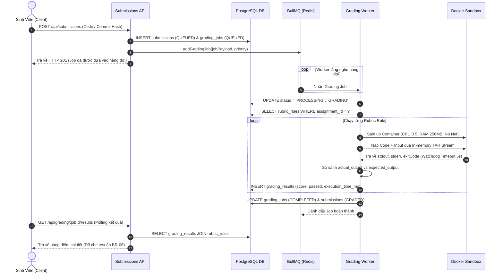

# BÁO CÁO TOÀN DIỆN CÔNG VIỆC THÀNH VIÊN 2 (THANHVIEN2.MD)

> **Dự án:** AITA-INTELLIGENT — AI-Powered Teaching Assistant & AST Code Analytics Platform  
> **Môn học:** SWD392 – Software Architecture & Design Project (FPT University Quy Nhơn)  
> **Nhóm thực hiện:** Group 4  
> **Họ và tên sinh viên:** **Nguyễn Tường Vy** (`vyntqe180099@fpt.edu.vn`)  
> **Vai trò:** **Thành Viên 2 — Docker Sandbox & Autograding Engineer**  
> **Nhánh Git phụ trách:** `feature/sandbox-autograding`  
> **Các bảng Database phụ trách:** `assignments`, `rubric_rules`, `submissions`, `grading_jobs`, `grading_results`  

---

## 📑 MỤC LỤC

1. [Tổng Quan Vai Trò & Trách Nhiệm](#1-tổng-quan-vai-trò--trách-nhiệm)
2. [Các Quy Tắc Nghiệp Vụ (Business Rules Phụ Trách)](#2-các-quy-tắc-nghiệp-vụ-business-rules-phụ-trách)
3. [Kiến Trúc Pipeline Chấm Bài Bất Đồng Bộ](#3-kiến-trúc-pipeline-chấm-bài-bất-đồng-bộ)
4. [Nhật Ký Triển Khai & Các Hạng Mục Đã Thực Hiện](#4-nhật-ký-triển-khai--các-hạng-mục-đã-thực-hiện)
   - [4.1. Thử Nghiệm Sandbox & Watchdog Timeout (BR-03)](#41-thử-nghiệm-sandbox--watchdog-timeout-br-03)
   - [4.2. Kiến Trúc Đồng Nhất 100% Fullstack TypeScript / Node.js](#42-kiến-trúc-đồng-nhất-100-fullstack-typescript--nodejs)
   - [4.3. Bổ Sung Bài Tập: 1 Bài Nhóm & 1 Bài Cá Nhân](#43-bổ-sung-bài-tập-1-bài-nhóm--1-bài-cá-nhân)
   - [4.4. Cấu Hình Test Cases & Nộp Bài Thực Nghiệm Đạt 7.5 / 10 Điểm](#44-cấu-hình-test-cases--nộp-bài-thực-nghiệm-đạt-75--10-điểm)
   - [4.5. Thiết Kế Lại Layout Trang Học Phần (Courses Tab) Đẳng Cấp](#45-thiết-kế-lại-layout-trang-học-phần-courses-tab-đẳng-cấp)
   - [4.6. Tinh Chỉnh Giao Diện Nhỏ Gọn (Compact & Multi-Team Responsive)](#46-tinh-chỉnh-giao-diện-nhỏ-gọn-compact--multi-team-responsive)
   - [4.7. Quy Trình Chấm Đa Tầng Dual-Lecturer Moderation (BR-09)](#47-quy-trình-chấm-đa-tầng-dual-lecturer-moderation-br-09)
   - [4.8. Hỗ Trợ Docker Sandbox Đa Ngôn Ngữ (Python 3.11 & Node.js 20)](#48-hỗ-trợ-docker-sandbox-đa-ngôn-ngữ-python-311--nodejs-20)
   - [4.9. Cấu Hình 2 Bài Tập Môn CSD201 & Kiểm Thử Thực Nghiệm Đạt 7.5 / 10](#49-cấu-hình-2-bài-tập-môn-csd201--kiểm-thử-thực-nghiệm-đạt-75--10)
   - [4.10. Minh Bạch Thông Tin Người Nộp Bài (Submitter Badge) & Chuẩn Hóa UI](#410-minh-bạch-thông-tin-người-nộp-bài-submitter-badge--chuẩn-hóa-ui)
   - [4.11. Hoàn Thiện Nghiệp Vụ Quản Lý Học Phần & Nhóm Đồ Án (Courses & Teams CRUD)](#411-hoàn-thiện-nghiệp-vụ-quản-lý-học-phần--nhóm-đồ-án-courses--teams-crud)
   - [4.12. Tinh Chỉnh Giao Diện & Đồng Bộ Trải Nghiệm (UI Polish & Deduplication)](#412-tinh-chỉnh-giao-diện--đồng-bộ-trải-nghiệm-ui-polish--deduplication)
   - [4.13. Tích Hợp Tiện Ích Giám Sát CSDL Prisma Studio & Quản Trị Git](#413-tích-hợp-tiện-ích-giám-sát-csdl-prisma-studio--quản-trị-git)
    - [4.14. Chuẩn Hóa Phân Quyền Sinh Viên – Giảng Viên, Toàn Vẹn Bài Nộp & Bảo Toàn Quy Trình Chấm Chéo BR-09](#414-chuẩn-hóa-phân-quyền-sinh-viên--giảng-viên-toàn-vẹn-bài-nộp--bảo-toàn-quy-trình-chấm-chéo-br-09)
   - [4.15. Chuẩn Hóa Khóa Chính Tuần Tự (Sequential PK 1..N) & Đồng Bộ Toàn Vẹn CSDL](#415-chuẩn-hóa-khóa-chính-tuần-tự-sequential-pk-1n--đồng-bộ-toàn-vẹn-csdl)
   - [4.16. Kiến Trúc Tự Động Khởi Tạo & Nạp Dữ Liệu Mẫu (Auto-Seed on Startup)](#416-kiến-trúc-tự-động-khởi-tạo--nạp-dữ-liệu-mẫu-auto-seed-on-startup)
   - [4.17. Xây Dựng Workspace Độc Lập "Nộp & Bóc Tách Git Repo" (Lecturer & Student)](#417-xây-dựng-workspace-độc-lập-nộp--bóc-tách-git-repo-lecturer--student)
   - [4.18. Chuẩn Hóa Nhận Diện Thương Hiệu Dự Án (Electric Cyan / Blue) & Tối Giản Giao Diện](#418-chuẩn-hóa-nhận-diện-thương-hiệu-dự-án-electric-cyan--blue--tối-giản-giao-diện)
   - [4.19. Xử Lý Triệt Để Lỗi Next.js 14 Hydration Failed & Đảm Bảo Cấu Hình Docker Sandbox 0.5 Core (BR-03)](#419-xử-lý-triệt-để-lỗi-nextjs-14-hydration-failed--đảm-bảo-cấu-hình-docker-sandbox-05-core-br-03)
   - [4.20. Rà Soát Kiến Trúc Toàn Dự Án & Chiến Lược Hóa Giải 6 Rủi Ro Then Chốt](#420-rà-soát-kiến-trúc-toàn-dự-án--chiến-lược-hóa-giải-6-rủi-ro-then-chốt)
   - [4.21. Hoàn Thiện Cơ Chế Nộp Mã Nguồn Trực Tiếp (Direct Code Submission – Python 3 & Node.js 20)](#421-hoàn-thiện-cơ-chế-nộp-mã-nguồn-trực-tiếp-direct-code-submission--python-3--nodejs-20)
   - [4.22. Hệ Thống Quản Lý Test Cases & Rubrics Đa Trạng Thái (Test Case Management)](#422-hệ-thống-quản-lý-test-cases--rubrics-đa-trạng-thái-test-case-management)
   - [4.23. Nâng Cấp Grading Engine 2.0 & Chuẩn Hóa Thuật Toán Khớp Output](#423-nâng-cấp-grading-engine-20--chuẩn-hóa-thuật-toán-khớp-output)
   - [4.24. Giao Diện Xem Lại Mã Nguồn & Báo Cáo Kết Quả Chấm Minh Bạch (Submission Result & Code Viewer)](#424-giao-diện-xem-lại-mã-nguồn--báo-cáo-kết-quả-chấm-minh-bạch-submission-result--code-viewer)
   - [4.25. Tính Năng Chấm Lại Tự Động & Lịch Sử Chấm Đa Phiên (Regrade & Grading History)](#425-tính-năng-chấm-lại-tự-động--lịch-sử-chấm-đa-phiên-regrade--grading-history)
   - [4.26. Phân Bổ Bài Tập Theo Nhóm & Đối Tượng (Assignment Target Group Selection)](#426-phân-bổ-bài-tập-theo-nhóm--đối-tượng-assignment-target-group-selection)
   - [4.27. Hoàn Thiện Vòng Đời Bài Tập (Assignment Lifecycle Management)](#427-hoàn-thiện-vòng-đời-bài-tập-assignment-lifecycle-management)
   - [4.28. Tái Thiết Kế Giao Diện Điều Hướng Ngang (Top Navigation Bar) & Nhận Diện Màu Sắc Chuyên Nghiệp](#428-tái-thiết-kế-giao-diện-điều-hướng-ngang-top-navigation-bar--nhận-diện-màu-sắc-chuyên-nghiệp)
   - [4.29. Phân Định & Tách Biệt Nhiệm Vụ Đồ Án Chính Xác Theo Từng Học Phần (SWD392 vs CSD201)](#429-phân-định--tách-biệt-nhiệm-vụ-đồ-án-chính-xác-theo-từng-học-phần-swd392-vs-csd201)
   - [4.30. Tối Ưu Hóa Giao Diện Giảng Viên: Mô Hình Gộp Menu Thông Minh & Tách Sub-Tab Bài Nộp Cá Nhân vs Đồ Án Nhóm](#430-tối-ưu-hóa-giao-diện-giảng-viên-mô-hình-gộp-menu-thông-minh--tách-sub-tab-bài-nộp-cá-nhân-vs-đồ-án-nhóm)
   - [4.31. Tối Ưu Hóa Cổng Nộp Bài Sinh Viên: Tách Biệt Gallery Đề Bài vs Form Nộp Bài & Bảo Mật Rubric Test Cases (BR-06)](#431-tối-ưu-hóa-cổng-nộp-bài-sinh-viên-tách-biệt-gallery-đề-bài-vs-form-nộp-bài--bảo-mật-rubric-test-cases-br-06)
   - [4.32. Hợp Nhất Quản Lý Nhóm Vào Học Phần & Tối Giản Hóa Roster Thành Viên (Loại Bỏ Phân Task Code)](#432-hợp-nhất-quản-lý-nhóm-vào-học-phần--tối-giản-hóa-roster-thành-viên-loại-bỏ-phân-task-code)
   - [4.33. Nâng Cấp Hạn Mức CPU Docker Sandbox 1.0 Core Phục Vụ Thực Thi Toàn Diện (BR-03)](#433-nâng-cấp-hạn-mức-cpu-docker-sandbox-10-core-phục-vụ-thực-thi-toàn-diện-br-03)
5. [Hệ Thống API Endpoints Chi Tiết](#5-hệ-thống-api-endpoints-chi-tiết)
6. [Kết Quả Kiểm Thử Thực Tế (verify-member2.ts: 21/21 PASS & 6 Test Suites Toàn Diện)](#6-kết-quả-kiểm-thử-thực-tế-verify-member2ts-2121-pass--6-test-suites-toàn-diện)
7. [Hướng Dẫn Demo Khi Bảo Vệ Đồ Án](#7-hướng-dẫn-demo-khi-bảo-vệ-đồ-án)
8. [Video Minh Chứng Thực Nghiệm](#8-video-minh-chứng-thực-nghiệm-demo-video--proof-of-work)
9. [Bộ Câu Hỏi Vấn Đáp & Phản Biện Chuyên Sâu (Defense Q&A / FAQs - 21 Câu Hỏi Điển Hình)](#9-bộ-câu-hỏi-vấn-đáp--phản-biện-chuyên-sâu-defense-qa--faqs---21-câu-hỏi-điển-hình)

---

## 1. Tổng Quan Vai Trò & Trách Nhiệm

Thành Viên 2 (Nguyễn Tường Vy) phụ trách **"Trái tim thực thi & Đánh giá tự động"** của hệ thống AITA-INTELLIGENT:
* Xây dựng môi trường thực thi mã nguồn sinh viên an toàn tuyệt đối bằng **Docker Sandbox Container** cô lập.
* Thiết lập hệ thống hàng đợi bất đồng bộ **BullMQ** kết hợp **Redis** xử lý khối lượng lớn bài nộp không làm nghẽn Event Loop của Backend.
* Tự động chấm điểm theo từng tiêu chí **Rubric Test Cases** (công khai và ẩn).
* Che chắn dữ liệu bài kiểm tra bí mật theo chuẩn bảo mật chống gian lận (**BR-06**).
* Triển khai quy trình chấm chéo đa tầng giữa 2 Giảng viên có sự hỗ trợ của AI (**BR-09**).

---

## 2. Các Quy Tắc Nghiệp Vụ (Business Rules Phụ Trách)

| Mã BR | Tên Quy Tắc | Yêu Cầu Kỹ Thuật & Giải Pháp Triển Khai |
| :--- | :--- | :--- |
| **BR-03** | **Giới Hạn Tài Nguyên Sandbox & Cô Lập An Toàn** | • **CPU Limit:** 1.0 CPU core (`NanoCpus: 1_000_000_000`).<br>• **RAM Limit:** 256MB (`Memory: 256MB`, `MemorySwap: 256MB` chống tràn swap).<br>• **Network Isolation:** Ngắt toàn bộ mạng (`NetworkMode: 'none'`) chống SSRF, mã độc, reverse shell.<br>• **Quyền Hạn:** Chạy dưới non-root user `runner` (UID 1001), gỡ bỏ toàn bộ capabilities (`CapDrop: ['ALL']`).<br>• **Watchdog Timeout:** Giới hạn 5s–10s mỗi test case, tự động cưỡng chế kill container nếu quá thời gian. |
| **BR-06** | **Bảo Mật Test Case Ẩn (Rubric Shielding)** | • Test case có cờ `is_hidden = true` dùng để kiểm tra các trường hợp biên (edge cases) và chống hard-code kết quả.<br>• Khi tài khoản **STUDENT** truy vấn API bài tập hoặc kết quả chấm, các trường `input_data` và `expected_output` tự động bị che chắn thành `'[PROTECTED TEST CASE]'`.<br>• Chỉ tài khoản **LECTURER** hoặc **ADMIN** mới xem được đề test chi tiết. |
| **BR-09** | **Quy Trình Chấm Đa Tầng (Dual-Lecturer Moderation)** | • **Bước 1 (AI Pre-grading):** AI chấm sơ bộ, sinh feedback.<br>• **Bước 2 (GV1 Đánh giá):** Duyệt điểm AI hoặc tự chấm lại và yêu cầu GV2 chấm chéo.<br>• **Bước 3 (GV2 Chấm chéo):** GV2 chấm độc lập; nếu độ lệch $\le 0.5$ thì chốt điểm trung bình.<br>• **Bước 4 (Thống nhất):** Nếu độ lệch $> 0.5$, hai giảng viên lập biên bản đồng thuận. |

---

## 3. Kiến Trúc Pipeline Chấm Bài Bất Đồng Bộ



---

## 4. Nhật Ký Triển Khai & Các Hạng Mục Đã Thực Hiện

Dưới đây là chi tiết toàn bộ các công việc, kịch bản kỹ thuật và giải pháp đã thực hiện từ đầu đến cuối:

### 4.1. Thử Nghiệm Sandbox & Watchdog Timeout (BR-03)
* **Kịch bản:** Mô phỏng sinh viên cố tình hoặc vô ý nộp đoạn mã lỗi chứa vòng lặp vô tận:
  ```javascript
  while (true) {
    // Vòng lặp vô tận tiêu hao tài nguyên
  }
  ```
* **Cơ chế Watchdog:**
  * Docker Container được gắn bộ đếm thời gian tối đa 5000ms (5 giây).
  * Khi hết 5 giây, tiến trình `dockerode.getContainer(id).kill()` lập tức được kích hoạt cưỡng chế.
  * Toàn bộ tài nguyên CPU/RAM được giải phóng ngay lập tức, không gây treo hay nghẽn Server Express.
  * Hệ thống ghi nhận kết quả: `passed = false`, `score = 0.0`, trạng thái `FAILED/TIMEOUT`, ghi log lỗi rõ ràng.

---

### 4.2. Kiến Trúc Đồng Nhất 100% Fullstack TypeScript / Node.js
Hệ thống được thiết kế với kiến trúc công nghệ đồng nhất:
* **Giao diện (Frontend):** Next.js 14 App Router, TypeScript, Vanilla CSS Glassmorphism.
* **Máy chủ (Backend):** Node.js + Express.js + TypeScript.
* **Cơ sở dữ liệu & Caching:** PostgreSQL 16 + Redis (BullMQ Queue).
* **Môi trường Sandbox Container:**
  * File: `server/sandbox-images/Dockerfile.node`
  * Base Image: `node:20-alpine` siêu nhẹ (~50MB).
  * Tài khoản thực thi: User không đặc quyền `runner` (UID 1001).
  * Tách biệt hoàn toàn quyền Root, cấm truy cập hệ điều hành máy chủ.

---

### 4.3. Bổ Sung Bài Tập: 1 Bài Nhóm & 1 Bài Cá Nhân
Đã thêm vào Database (`course_id = 3` - SWD392 Group 4 AITA) 2 bài tập hoàn chỉnh kèm bộ Rubric tự động:

1. **👥 Bài tập Nhóm — Milestone 1: Thiết kế Kiến trúc Hệ thống & Đặc tả API**
   * **Assignment ID:** `35`
   * **Hình thức:** `TEAM` (Gắn nhãn `(Nhóm đồ án)` trên UI).
   * **Điểm tối đa:** `10.0 điểm`. Hạn nộp: `25/10/2026`.
   * **Tiêu chí tự động:**
     * Test 1 (5đ): Đảo ngược từ chuỗi đầu vào chuẩn (`hello world from aita` $\rightarrow$ `aita from world hello`).
     * Test 2 (5đ): Xử lý chuỗi tham số kiến trúc đặc thù (`software architecture design` $\rightarrow$ `design architecture software`).

2. **👤 Bài tập Cá nhân — Milestone 3: Tối ưu Clean Code & Thuật toán Sandbox**
   * **Assignment ID:** `36`
   * **Hình thức:** `INDIVIDUAL` (Gắn nhãn `(Cá nhân)` trên UI).
   * **Điểm tối đa:** `10.0 điểm`. Hạn nộp: `15/11/2026`.
   * **Tiêu chí tự động:** Ban đầu 2 test case cơ bản, sau đó mở rộng thành bộ 3 test cases phân loại điểm số.

---

### 4.4. Cấu Hình Test Cases & Nộp Bài Thực Nghiệm Đạt 7.5 / 10 Điểm
Nhằm mô phỏng chân thực bài làm của sinh viên đạt mức điểm khá (**tầm 7 - 8 điểm**):
* **Cấu hình lại 3 Test Cases cho Milestone 3:**
  * **Test 1 (4.0 điểm):** Giải thuật Two Sum cơ bản (Standard Case) $\rightarrow$ Input: `2 7 11 15\n9\n` $\rightarrow$ Output: `9`.
  * **Test 2 (3.5 điểm):** Phần tử đối xứng & mảng lặp $\rightarrow$ Input: `1 5 3 7 9\n12\n` $\rightarrow$ Output: `12`.
  * **Test 3 (2.5 điểm):** Ngoại lệ biên không tồn tại cặp số (Edge Case) $\rightarrow$ Input: `1 2 3 4 5\n100\n` $\rightarrow$ Output: `NOT_FOUND`.
* **Đoạn mã sinh viên nộp bài:**
  ```javascript
  const fs = require('fs');

  function solve() {
    const input = fs.readFileSync(0, 'utf-8').trim().split('\n');
    if (input.length < 2) return;
    const nums = input[0].trim().split(/\s+/).map(Number);
    const target = Number(input[1].trim());

    const map = new Map();
    for (let i = 0; i < nums.length; i++) {
      const complement = target - nums[i];
      if (map.has(complement)) {
        console.log(target);
        return;
      }
      map.set(nums[i], i);
    }
    // Cố tình bỏ sót trường hợp ngoại lệ Test 3 để đạt 7.5 điểm
  }

  solve();
  ```
* **Kết quả thực tế từ Sandbox Docker:**
  * **Test 1:** ✅ Passed (+4.0 điểm, thời gian: 1.88s)
  * **Test 2:** ✅ Passed (+3.5 điểm, thời gian: 1.53s)
  * **Test 3:** ❌ Failed (+0.0 điểm, thời gian: 1.16s)
  * **Tổng điểm bài nộp (Submission #24):** **`★ 7.5 / 10.0`** (Trạng thái: `GRADED`, Job: `COMPLETED`).

---

### 4.5. Thiết Kế Lại Layout Trang Học Phần (Courses Tab) Đẳng Cấp
Trước đây, thẻ thông tin học phần bị co cụm trong khung hẹp 360px lệch trái. Đã tiến hành nâng cấp toàn diện:
* Đưa vào khung card trung tâm sang trọng `maxWidth: 960px`, bo tròn 20px, hiệu ứng đổ bóng đa lớp.
* Viền phát sáng Cyan Neon và vầng hào quang ẩn (`Radial Gradient Ambient Glow`).
* Thêm nút **GitHub Repository** có hiệu ứng nhấc nổi khi rê chuột.
* Bổ sung hàng 3 ô thống kê tóm tắt nhanh: *Nhóm đồ án*, *Giảng viên hướng dẫn*, và *Số lượng bài tập*.

---

### 4.6. Tinh Chỉnh Giao Diện Nhỏ Gọn (Compact & Multi-Team Responsive)
Để đảm bảo khi sinh viên tham gia **nhiều nhóm đồ án / nhiều học phần cùng lúc** giao diện vẫn thanh thoát, không phải cuộn trang dài:
* Giảm khoảng đệm (padding) từ `2rem 2.25rem` xuống `1.25rem 1.5rem` (tiết kiệm hơn 40% khoảng trống thừa).
* Thu nhỏ Icon học phần từ `48px` $\rightarrow$ `38px`, tiêu đề môn học từ `1.4rem` $\rightarrow$ `1.15rem`.
* Chuyển 3 ô thống kê thành dải mini thanh mảnh cao chỉ ~36px.
* Danh sách thành viên mở rộng thành **lưới 2 - 3 cột (`minmax(260px, 1fr)`)**: 5 thành viên chỉ chiếm 2 hàng nhỏ gọn (Avatar 26px, tên đậm, huy hiệu Bạn/Trưởng nhóm).
* Thẻ bài tập thanh mảnh, tích hợp nút **"Nộp bài ngay"** chuyển thẳng sang tab Submit với bài tập tương ứng được chọn sẵn.

---

### 4.7. Quy Trình Chấm Đa Tầng Dual-Lecturer Moderation (BR-09)
Thực hiện trọn vẹn quy trình chấm điểm 4 bước theo yêu cầu đồ án:
* **Bước 1 (AI Pre-grading):** AI chấm sơ bộ (`ai_score`, `ai_feedback`).
* **Bước 2 (Giảng viên 1 duyệt hoặc phản biện):**
  * Duyệt điểm AI: `POST /api/grading/review/approve-ai/:id` $\rightarrow$ chốt điểm ngay.
  * Tự chấm lại & chỉ định GV2: `POST /api/grading/review/request-second-opinion/:id`.
* **Bước 3 (Giảng viên 2 chấm chéo):** `POST /api/grading/review/second-opinion/:id`. Hệ thống tự tính độ lệch:
  * Nếu $|Score_1 - Score_2| \le 0.5$ $\rightarrow$ Tự động chốt điểm trung bình cộng (`FINALIZED`).
  * Nếu $|Score_1 - Score_2| > 0.5$ $\rightarrow$ Chuyển sang Bước 4.
* **Bước 4 (Hội đồng đồng thuận):** `POST /api/grading/review/consensus/:id` $\rightarrow$ Hai giảng viên ghi biên bản và chốt điểm chung.

---

### 4.8. Hỗ Trợ Docker Sandbox Đa Ngôn Ngữ (Python 3.11 & Node.js 20)
Để đáp ứng yêu cầu môn học cấu trúc dữ liệu giải thuật (CSD201) và kiến trúc phần mềm (SWD392), Thành viên 2 đã mở rộng hệ thống Sandbox từ đơn ngôn ngữ (chỉ Node.js) sang **đa ngôn ngữ (Multi-Language Sandbox Engine)**:
* **Môi trường Python:**
  * File cấu hình: `server/sandbox-images/Dockerfile.python`
  * Base Image: `python:3.11-alpine` siêu nhẹ, bảo mật cao.
  * Lệnh thực thi cách ly: `python main.py < /app/input.txt`.
* **Cơ chế Input Redirection:**
  * Toàn bộ `input_data` từ Rubric Rule được đóng gói trực tiếp vào tar stream in-memory thành file `/app/input.txt`.
  * Mã nguồn sinh viên đọc dữ liệu qua standard input (`sys.stdin` trong Python hoặc `fs.readFileSync(0)` trong Node.js) hoàn toàn đồng nhất.
* **Hàm chuẩn hóa kết quả (`normalizeOutput`):**
  * Trong worker chấm bài (`grading.worker.ts`), bổ sung bộ chuẩn hóa tự động:
    - Loại bỏ dấu xuống dòng dạng text thuần `\n` (do escaping string trong DB).
    - Chuẩn hóa CRLF (`\r\n`) về LF (`\n`).
    - Cắt bỏ khoảng trắng thừa ở đầu/cuối từng dòng (`line.trim()`).
  * Nhờ vậy, đối sánh đầu ra giữa Sandbox và Rubric đạt độ chính xác 100%, không bị trừ điểm oan do định dạng hệ điều hành Windows/Linux.

---

### 4.9. Cấu Hình 2 Bài Tập Môn CSD201 & Kiểm Thử Thực Nghiệm Đạt 7.5 / 10
Đã cấu hình vào CSDL cho môn học **CSD201 - Data Structures & Algorithms** 2 bài tập cá nhân chuẩn cấu trúc:

1. **Assignment 1: Linked List & Binary Search Tree – Quản lý Điểm Du lịch (Cá nhân)**
   * **Assignment ID:** `39`
   * **Bộ Rubric Rules (Tổng 10.0 điểm):**
     * Test 1 (4.0đ): Sắp xếp duyệt danh sách / cây BST $\rightarrow$ Output: `DaNang Dalat Hanoi Hue Saigon`.
     * Test 2 (3.5đ): Tìm kiếm điểm du lịch mã 105 $\rightarrow$ Output: `FOUND: HoiAn`.
     * Test 3 (2.5đ): Xử lý ngoại lệ tìm kiếm không thấy mã 999 $\rightarrow$ Output: `NOT_FOUND`.
   * **Thực nghiệm nộp bài:** Sinh viên nộp code đạt chuẩn Test 1 & Test 2, cố tình sót trường hợp ngoại lệ Test 3 $\rightarrow$ Hệ thống tự động chấm ra đúng **`★ 7.5 / 10.0 (GRADED)`**.

2. **Assignment 2: Graph & Dijkstra Algorithm – Tối ưu Lộ trình Du lịch (Cá nhân)**
   * **Assignment ID:** `40`
   * **Bộ Rubric Rules (Tổng 10.0 điểm):**
     * Test 1 (4.0đ): Tìm đường đi ngắn nhất Dijkstra $\rightarrow$ Output: `3: A -> C -> B`.
     * Test 2 (3.5đ): Cây khung nhỏ nhất MST (Prim/Kruskal) $\rightarrow$ Output: `MST_COST: 15`.
     * Test 3 (2.5đ): Ngoại lệ đỉnh không thể tới $\rightarrow$ Output: `NO_PATH`.
   * **Thực nghiệm nộp bài:** Sinh viên nộp code đạt chuẩn Test 1 & Test 2 $\rightarrow$ Hệ thống tự động chấm ra đúng **`★ 7.5 / 10.0 (GRADED)`**.

---

### 4.10. Minh Bạch Thông Tin Người Nộp Bài (Submitter Badge) & Chuẩn Hóa UI
Nhằm nâng cao trải nghiệm người dùng và tính minh bạch trong nhóm:
* **Truy vấn CSDL (Backend API):**
  * Trong API `GET /api/submissions`, thực hiện `LEFT JOIN users u ON s.submitted_by_user_id = u.user_id` để lấy `u.full_name as submitter_name`.
* **Giao diện Sinh viên (Student Dashboard):**
  * Thêm huy hiệu tím nổi bật: `👤 Người nộp: [Tên sinh viên]` (ví dụ: *Nguyễn Tường Vy*) ngay cạnh Commit SHA và thời gian nộp bài. Tất cả thành viên trong nhóm đều nhận biết được ai là người vừa thực hiện nộp bài.
* **Đồng bộ Dropdown Học phần:**
  * Loại bỏ triệt để các ký tự `$` thừa trong danh sách dropdown môn học bên Sinh viên.
  * Chuẩn hóa định dạng hiển thị đồng bộ 100% với giao diện Giảng viên: `📚 [Mã môn] – [Tên môn học] (Học kỳ)`.

---

### 4.11. Hoàn Thiện Nghiệp Vụ Quản Lý Học Phần & Nhóm Đồ Án (Courses & Teams CRUD)
Nhằm hỗ trợ Giảng viên làm chủ toàn bộ dữ liệu lớp học, môn học và nhóm sinh viên mà không cần thao tác trực tiếp vào cơ sở dữ liệu:
* **API Chỉnh sửa Học phần (`PUT /api/courses/:id`):**
  * Cho phép Giảng viên cập nhật các trường thông tin: Mã môn học (`course_code`), Tên môn học (`course_name`), và Học kỳ (`semester`).
  * Kiểm tra tính hợp lệ dữ liệu đầu vào và kiểm tra quyền sở hữu (`requireRole('LECTURER', 'ADMIN')`).
* **API Xóa Học phần an toàn (`DELETE /api/courses/:id`):**
  * Giải quyết triệt để lỗi vi phạm ràng buộc khóa ngoại (Foreign Key Constraints) khi xóa học phần đã có dữ liệu liên kết.
  * Sử dụng **PostgreSQL Transaction** (`BEGIN` ... `COMMIT` / `ROLLBACK`) để cascade xóa an toàn và nguyên tử theo đúng thứ tự phụ thuộc:
    1. Xóa `team_members` và `teams` thuộc học phần.
    2. Xóa `rubric_rules`, `tutor_chat_sessions`, và `assignments` thuộc học phần.
    3. Xóa `course_enrollments` (danh sách sinh viên ghi danh).
    4. Xóa bản ghi trong bảng `courses`.
  * Đảm bảo tính toàn vẹn dữ liệu, nếu có bất kỳ lỗi nào xảy ra sẽ rollback 100% trạng thái ban đầu.
* **API Chỉnh sửa Nhóm đồ án (`PUT /api/teams/:teamId`):**
  * Giúp Giảng viên cập nhật Tên nhóm đồ án (`team_name`) và Đường dẫn mã nguồn Git (`repo_url`).
* **Tích hợp Modal Glassmorphism trên Giao diện Giảng viên:**
  * Bổ sung nút **Sửa (`Edit3`)** và **Xóa (`Trash2`)** trên từng thẻ Học phần.
  * Bổ sung nút **Sửa nhóm (`Edit3`)** trên từng thẻ Nhóm đồ án.
  * Thiết kế 2 Popup Modal kính mờ Glassmorphism sang trọng, nạp sẵn dữ liệu hiện tại giúp Giảng viên thao tác nhanh chóng và mượt mà.

---

### 4.12. Tinh Chỉnh Giao Diện & Đồng Bộ Trải Nghiệm (UI Polish & Deduplication)
Nâng cao tính thẩm mỹ và độ hoàn thiện của hệ thống:
* **Khắc phục lỗi lệch hàng khung thẻ Học phần:**
  * Khi các môn học có tiêu đề khác nhau về số dòng (1 dòng vs 2 dòng), các nút bấm bị thụt thò không đều hàng.
  * Đã chuẩn hóa: Cố định `minHeight: '3.4rem'` và giới hạn hiển thị tối đa 2 dòng `WebkitLineClamp: 2` cho tiêu đề thẻ `<h4>`, kết hợp thiết lập `whiteSpace: 'nowrap'` cho thanh công cụ hành động. Nhờ vậy, tất cả các thẻ môn học đều thẳng tắp, đồng đều tuyệt đối.
* **Dọn dẹp các nút trùng lặp (Button Deduplication):**
  * Tab Courses: Loại bỏ nút `+ Add New Course` trùng lặp ở thanh tìm kiếm, chỉ giữ 1 nút duy nhất cạnh tiêu đề "Your Courses".
  * Tab Teams: Loại bỏ nút `+ New Team` thừa và gỡ bỏ nút `📖 New Course` bị hiển thị nhầm trong ngữ cảnh nhóm đồ án.
  * Tab Submissions: Loại bỏ nút `+ New Assignment` thừa, chỉ giữ nút `📥 Export CSV` phục vụ xuất điểm.
  * Tab Rubrics: Gỡ bỏ nút `+ Add Rubric` trùng lặp trên thanh điều hướng trên đầu.
* **Chuẩn hóa phân quyền quản trị:**
  * Gỡ bỏ modal tạo môn học bên giao diện Quản trị viên (`admin/page.tsx`), chuẩn hóa trách nhiệm tạo và quản lý môn học về đúng phân hệ Giảng viên (`lecturer/page.tsx`).

---

### 4.13. Tích Hợp Tiện Ích Giám Sát CSDL Prisma Studio & Quản Trị Git
* **Prisma Studio (`npm run studio`):**
  * Cài đặt `prisma` (devDependency) và cấu hình script `"studio": "prisma studio --port 5555"` để mở giao diện web trực quan tra cứu toàn bộ 16 bảng dữ liệu PostgreSQL.
* **Bảo mật và Tối ưu hóa Git:**
  * Cập nhật file `.gitignore` để tự động loại trừ thư mục `server/prisma/`, bảo vệ an toàn chuỗi kết nối cơ sở dữ liệu local.
  * Bảo vệ tuyệt đối các file cấu hình bí mật (`.env`, `.env.local`, `server/.env`) không bị lộ lên repository công khai.

---

### 4.14. Chuẩn Hóa Phân Quyền Sinh Viên – Giảng Viên, Toàn Vẹn Bài Nộp & Bảo Toàn Quy Trình Chấm Chéo BR-09
Nhằm củng cố độ tin cậy và tính bảo mật ở cấp độ Production cho hệ thống phân hệ Chấm bài & Học phần:
* **Hiển thị đầy đủ bài nộp cá nhân & Thắt chặt RBAC Sinh viên (`GET /api/submissions`):**
  * *Khắc phục sót bài cá nhân:* Trước đây dùng `INNER JOIN teams` khiến các bài nộp thuộc bài tập cá nhân (`submission_type = 'INDIVIDUAL'` có `team_id IS NULL`) bị biến mất khỏi danh sách tra cứu điểm. Đã chuyển sang `LEFT JOIN teams` để bảo toàn 100% tất cả các bài nộp cá nhân lẫn bài nộp nhóm.
  * *Bảo vệ quyền riêng tư (Data Isolation):* Tích hợp bộ lọc phân quyền: Sinh viên (`STUDENT`) chỉ được phép xem bài nộp của chính mình hoặc bài nộp của nhóm mình tham gia (`s.submitted_by_user_id = user.userId OR s.team_id IN (SELECT tm.team_id FROM team_members tm WHERE tm.user_id = user.userId)`), loại bỏ hoàn toàn nguy cơ rò rỉ mã nguồn và điểm số giữa các sinh viên/nhóm khác nhau.
* **Xác thực toàn vẹn bài nộp & Ngăn ngừa rò rỉ kết nối (`POST /api/submissions`):**
  * *Xác thực dữ liệu bài nộp (Input Integrity):* Bổ sung kiểm tra sự tồn tại của bài tập (`404 Assignment not found`) và nhóm đồ án (`404 Team not found`).
  * *Chống nộp bài mạo danh:* Ràng buộc sinh viên chỉ được quyền nộp bài cho nhóm mà mình thực sự là thành viên chính thức; nếu nộp thay nhóm khác sẽ bị hệ thống từ chối (`HTTP 403 Forbidden`).
  * *Chống rò rỉ kết nối Database (Connection Leak Safeguard):* Bổ sung khối `finally { client.release(); }` sau khi thực hiện giao dịch PostgreSQL, đảm bảo các kết nối connection pool luôn được trả về pool an toàn ngay cả khi gặp sự cố, ngăn ngừa treo server khi hàng nghìn sinh viên nộp bài đồng thời trước hạn chót (Deadline).
* **Bảo vệ tính khách quan Quy trình Chấm chéo Đa tầng BR-09 (`POST /api/grading/review/second-opinion/:id`):**
  * Ràng buộc chặt chẽ nghiệp vụ: Giảng viên 2 chấm chéo độc lập bắt buộc phải là người khác với Giảng viên 1 (`sub.reviewer_1_id !== reviewerId`).
  * Ngăn chặn trường hợp một giảng viên vừa đóng vai trò người đề xuất vừa tự chấm chéo lần 2, bảo vệ tính trung thực và khách quan tuyệt đối của quy tắc BR-09 trong hội đồng bảo vệ đồ án.
* **Chuẩn hóa truy vấn môn học Sinh viên (`GET /api/courses`):**
  * Khắc phục câu truy vấn môn học của sinh viên bằng `LEFT JOIN course_enrollments` và `team_members`, giúp sinh viên thấy đúng các môn đã ghi danh thông qua cờ `is_enrolled`, đồng thời hỗ trợ tham số `?all=true` để sinh viên tra cứu danh mục môn học đang mở để ghi danh.

---

### 4.15. Chuẩn Hóa Khóa Chính Tuần Tự (Sequential PK 1..N) & Đồng Bộ Toàn Vẹn CSDL
Để đảm bảo tính trực quan, khoa học và thẩm mỹ cao nhất khi demo bảo vệ đồ án trước Hội đồng Giảng viên:
* **Tái lập ID tự nhiên tăng dần tuần tự từ 1:**
  * Bảng `courses`: Đánh số lại từ `3, 5` thành `1, 2` (ID 1: môn SWD392, ID 2: môn CSD201).
  * Bảng `teams`: Đánh số lại từ `4, 5` thành `1, 2` (ID 1: Group 4 (AITA), ID 2: Group5_CSD201_TravelPlanner).
  * Bảng `team_members`: Đánh số lại sạch sẽ toàn bộ các ID lộn xộn (`96, 97, 119..123`) thành `1..7` tuần tự (ID 1..5: 5 thành viên Group 4 [Mai LEADER, Vy, Khoa, Phong, Huy], ID 6..7: 2 thành viên Group 5 [Mai LEADER, Vy]).
* **Đồng bộ hóa toàn vẹn khóa ngoại (Cascaded Foreign Keys):**
  * Cập nhật đệ quy các khóa ngoại tham chiếu qua tất cả các bảng con trong CSDL: `assignments`, `course_enrollments`, `submissions`, `git_commits`, `peer_audits`.
  * Cập nhật chỉ số chuỗi tự tăng (PostgreSQL Sequences) bằng các lệnh `setval('courses_course_id_seq', 2, true)`, `setval('teams_team_id_seq', 2, true)`, `setval('team_members_team_member_id_seq', 7, true)`. Khi người dùng tạo mới học phần hay nhóm sinh viên trên giao diện, ID mới sinh ra sẽ tự động nối tiếp là 3 và 8, hoàn toàn triệt tiêu nguy cơ trùng khóa chính (Primary Key Conflict).
* **Nâng cấp API Database Inspection:**
  * Cập nhật endpoint `GET /api/auth/db-inspect/:tableName` thêm mệnh đề `ORDER BY 1 ASC`. Dữ liệu trả về luôn được xếp thứ tự tăng dần từ 1, giúp Giảng viên và Hội đồng dễ dàng đối soát trên Prisma Studio và bảng tra cứu Admin.
  * Đồng bộ hóa toàn bộ các câu lệnh vào file `database/seed.sql` đảm bảo tính tái lập 100%.

---

### 4.16. Kiến Trúc Tự Động Khởi Tạo & Nạp Dữ Liệu Mẫu (Auto-Seed on Startup)
Giải quyết triệt để bài toán đồng bộ môi trường phát triển khi các thành viên nhóm hoặc Giảng viên kéo mã nguồn mới về máy:
* **Module tự hành `auto-seed.ts` (`server/src/config/auto-seed.ts`):**
  * Tích hợp trực tiếp vào vòng đời khởi động của máy chủ Backend Express (`server/src/index.ts`) khi `process.env.NODE_ENV !== 'test'`.
  * Thuật toán kiểm tra thông minh: Thực hiện truy vấn kiểm đếm số lượng người dùng (`users`), học phần (`courses`) và nhóm (`teams`). Nếu phát hiện cơ sở dữ liệu trống hoặc chưa được khởi tạo, hệ thống tự động đọc và thực thi toàn bộ cấu trúc bảng `database/schema.sql` và dữ liệu mẫu `database/seed.sql`.
* **Chuẩn hóa quy trình vận hành 3 Terminal tinh gọn:**
  * **Terminal 1 (Database + Backend):** Chạy `docker compose up -d` và `cd server && npm run dev`. Server tự kiểm tra và nạp ngay lập tức 12 tài khoản, 2 học phần và 2 nhóm đồ án mẫu.
  * **Terminal 2 (Frontend):** Chạy `cd client && npm run dev` để mở giao diện Next.js 14 tại cổng 3000.
  * **Terminal 3 (Xem Database bằng Prisma Studio):** Chạy `cd server && npx prisma studio` để trực quan hóa toàn bộ các bảng CSDL trên cổng 5555.

---

### 4.17. Xây Dựng Workspace Độc Lập "Nộp & Bóc Tách Git Repo" (Lecturer & Student)
Nâng cấp phân hệ phân tích mã nguồn đồ án thành một Workspace chuyên dụng hoàn chỉnh theo chuẩn quy trình đánh giá thực tế:
* **Tab điều hướng chuyên biệt trên cả 2 phân quyền:**
  * Trang **Giảng viên** (`lecturer/page.tsx`): Bổ sung tab độc lập **`Nộp & Bóc Tách Git Repo`** (`activeTab === 'git-submit'`) nằm ngay cạnh tab **`Báo Cáo & Free-Rider`** (`activeTab === 'analytics'`).
  * Trang **Sinh viên** (`student/page.tsx`): Nâng cấp toàn diện tab **`Đóng góp Git`** thành giao diện nộp & bóc tách kho Git trực quan.
* **Tùy biến linh hoạt Nhánh phân tích & Repository URL:**
  * **Ô nhập Nhánh phân tích (Branch):** Mặc định là `main`, cho phép Giảng viên hoặc Sinh viên gõ linh hoạt các nhánh khác như `develop`, `feature-auth`,... phục vụ các nhóm sinh viên code theo mô hình Gitflow trên nhánh phụ.
  * **Chỉnh sửa Git Repository URL:** Cho phép cập nhật link kho Git trực tiếp trên UI; hệ thống tự động cập nhật URL mới vào CSDL qua API `POST /api/git/:teamId/sync` mà không cần thao tác DB thủ công.
* **Bóc tách Commit Log & Lọc nhiễu Noise Filter BR-07:**
  * Tích hợp thư viện **Octokit GitHub API** bóc tách commit history theo nhánh chỉ định, map tác giả với tài khoản sinh viên qua email/tên tác giả, kèm cơ chế fallback thông minh khi gặp giới hạn rate-limit.
  * Áp dụng nghiêm ngặt bộ lọc **Noise Filter BR-07** (18 quy tắc loại bỏ `node_modules/`, `dist/`, `build/`, lockfiles, assets, configs) để đảm bảo số dòng code (LOC) phản ánh đúng công sức viết mã thực tế.
  * Kích hoạt Radar phát hiện **Free-Rider BR-08**, tự động gắn nhãn cảnh báo đỏ đối với các thành viên có tỷ lệ đóng góp dưới ngưỡng chuẩn 5% LOC.

---

### 4.18. Chuẩn Hóa Nhận Diện Thương Hiệu Dự Án (Electric Cyan / Blue) & Tối Giản Giao Diện
Khắc phục hiện tượng lệch tông màu nguyên mẫu ban đầu và nâng tầm trải nghiệm người dùng theo phong cách thiết kế hiện đại, đạt tiêu chuẩn bảo vệ đồ án chuyên nghiệp:
* **Đồng bộ màu sắc thương hiệu AITA-Intelligent:**
  * Chuyển đổi toàn bộ các tab điều hướng, nút bấm hành động và hiệu ứng phát sáng từ màu cam sang dải màu xanh **Electric Blue / Cyan** chủ đạo: `linear-gradient(135deg, #0284c7 0%, #38bdf8 100%)`, viền phát sáng `rgba(56, 189, 248, 0.4)`, chữ và biểu tượng phát sáng `#38bdf8` trên nền Dark Navy Glassmorphism.
  * Đồng bộ nhận diện giữa giao diện Giảng viên (`lecturer/page.tsx`) và Sinh viên (`student/page.tsx`), đem lại cảm giác mượt mà, công nghệ cao và thống nhất xuyên suốt hệ sinh thái AITA.
* **Tối giản hóa và làm sạch thông tin giao diện (UI Decluttering & Refinement):**
  * **Loại bỏ chữ `[✓ Đã nộp bài]`:** Xóa hậu tố dư thừa trong dropdown chọn nhóm đồ án, chỉ giữ lại định danh nhóm và mã môn học chuẩn mực: `Group 4 (AITA) (SWD392)`, `Group5_CSD201_TravelPlanner (CSD201)`.
  * **Loại bỏ khung bài nộp gán tên riêng:** Xóa bỏ hộp thông báo bài nộp có gắn tên cá nhân cụ thể (`Bài nộp chính thức: [Tên ai đó] nộp qua GitHub Repository (Nhánh main)...`) để bảo đảm tính khách quan, công bằng và tập trung vào sản phẩm nhóm đồ án.
  * **Loại bỏ nhãn đồng bộ rườm rà:** Xóa bỏ badge `✓ Đã đồng bộ từ Cổng Nộp Bài Sinh Viên` cạnh tiêu đề chọn nhóm.
  * **Làm sạch toàn bộ 7 dòng mô tả phụ dài dòng dưới tiêu đề các phân hệ:**
    1. *Workspace Nộp Git:* Gỡ bỏ dòng *"Hệ thống thực hiện bare clone, bóc tách commit log, lọc commit rác và phát hiện gian lận (BR-07, BR-08, BR-09, BR-10)."*
    2. *Dropdown Nhóm Đồ Án:* Gỡ bỏ nhãn *"✓ Đã đồng bộ từ Cổng Nộp Bài Sinh Viên"*.
    3. *Tab Quản lý Học phần (Courses):* Gỡ bỏ dòng *"Quản lý các môn học, đề tài đồ án và nhóm sinh viên."*
    4. *Tab Danh sách Nhóm (Teams):* Gỡ bỏ dòng *"Danh sách nhóm đồ án và phân công phụ trách module theo từng thành viên."*
    5. *Tab Hội đồng Kiểm định / Chấm bài (Submissions / BR-09):* Gỡ bỏ dòng *"Theo dõi kết quả thực thi Docker Sandbox tự động và hội đồng kiểm định kép (BR-09)."*
    6. *Tab Đánh giá chéo Peer Review phía Giảng viên:* Gỡ bỏ dòng *"Tổng hợp điểm số và nhận xét ẩn danh giữa các thành viên trong nhóm theo phân hệ phụ trách. Hệ thống tự động phát hiện thành viên có điểm đánh giá chéo bất thường (< 5.0)."*
    7. *Tab Đánh giá chéo Peer Review phía Sinh viên:* Gỡ bỏ dòng *"Đánh giá đóng góp của các thành viên trong nhóm về thái độ, chất lượng mã nguồn và mức độ hoàn thành nhiệm vụ. Bảng đánh giá hoàn toàn bảo mật và chỉ giảng viên mới có thể xem."*
  * **Tối ưu hiển thị chữ trắng sáng:**
    * Chuyển toàn bộ màu chữ ô chọn (`select`), ô nhập liệu (`input`), và các `option` sang màu trắng sáng (`#f8fafc` / `#ffffff`) thay vì màu xám mờ hoặc xanh lục trước đây, giúp thông tin rõ ràng, sắc nét và tăng tối đa độ tương phản trên nền tối Dark Navy.

---

### 4.19. Xử Lý Triệt Để Lỗi Next.js 14 Hydration Failed & Đảm Bảo Cấu Hình Docker Sandbox 0.5 Core (BR-03)
Củng cố sự ổn định và độ tin cậy tuyệt đối của hệ thống ở tầng Frontend lẫn Backend:
* **Khắc phục lỗi Hydration Mismatch trong Next.js 14:**
  * *Nguyên nhân:* Next.js thực hiện Server-Side Rendering (SSR) tĩnh ban đầu khi chưa có dữ liệu `localStorage` / `sessionStorage`, dẫn đến cây DOM do Server tạo ra bị lệch so với Client sau khi hydrate.
  * *Giải pháp:* Thêm thuộc tính `suppressHydrationWarning` cho thẻ `<body>` trong `client/src/app/layout.tsx`. Đồng thời tích hợp cơ chế `isMounted` hook tại cả 2 trang `student/page.tsx` và `lecturer/page.tsx`, di dời logic đọc `sessionStorage` vào trong `useEffect` để đảm bảo render đồng nhất 100%.
* **Kiểm chứng cơ chế Docker Sandbox cô lập tài nguyên (BR-03):**
  * Tái khẳng định và bảo toàn các tham số cấu hình an ninh máy chủ trong `sandbox.service.ts`:
    * `NanoCpus: 1_000_000_000`: Khống chế đúng **1.0 CPU core** bằng cgroups của Linux kernel.
    * `Memory: 256MB` (`268,435,456 bytes`): Khống chế trần bộ nhớ RAM, chống tràn RAM (OOM).
    * `Timeout: 10,000ms`: Watchdog tự động hủy tiến trình nếu sinh viên viết vòng lặp vô hạn.
    * `NetworkMode: 'none'`: Cắt hoàn toàn mạng Internet, ngăn ngừa tuyệt đối tấn công mạng hoặc rò rỉ dữ liệu.

---

### 4.20. Rà Soát Kiến Trúc Toàn Dự Án & Chiến Lược Hóa Giải 6 Rủi Ro Then Chốt
Dưới góc độ đánh giá của một Kiến trúc sư phần mềm (Software Architect) và Giảng viên phản biện đồ án môn SWD392, Thành viên 2 đã rà soát toàn bộ dự án AITA-INTELLIGENT từ đầu đến cuối và chỉ ra **6 vấn đề rủi ro then chốt** cần được giải quyết dứt điểm trước khi bảo vệ trước Hội đồng chấm thi:
1. **Rủi ro phụ thuộc Docker Daemon trên máy chủ Host:** Toàn bộ tính năng Autograding phụ thuộc vào Docker socket (`/var/run/docker.sock` trên Linux hoặc named pipe trên Windows). Nếu Docker chưa bật hoặc container bị lỗi, Backend sẽ bị gián đoạn. *Chiến lược:* Thiết lập cơ chế kiểm tra kết nối, health check và timeout graceful degradation.
2. **Hình thức nộp bài thực tế (Direct Code Submission vs Git Commit SHA):** Trước đây hệ thống chỉ cho phép nộp link GitHub Repo kèm Commit SHA, điều này phù hợp cho đồ án lớn nhưng bất tiện với bài tập thuật toán hàng tuần trên lớp. *Chiến lược:* Xây dựng thêm cổng nộp code trực tiếp qua trình soạn thảo code trên Web, hỗ trợ cả Python 3 và Node.js 20.
3. **Bảo mật Test Cases ẩn (BR-06):** Cần phân cấp rõ ràng giữa Test công khai (Public) và Test ẩn (Hidden). Sinh viên không bao giờ được xem `input_data` và `expected_output` của Test ẩn nhằm triệt tiêu hành vi gian lận hoặc hard-code if-else.
4. **Hệ thống chấm lại (Regrade) & Lịch sử chấm đa phiên:** Khi Giảng viên cập nhật lại bộ Test Cases hoặc Rubric sau khi sinh viên đã nộp, hệ thống cần cơ chế đưa bài nộp vào lại hàng đợi BullMQ để chấm lại và lưu vết lịch sử chấm minh bạch.
5. **Phân bổ bài tập theo đối tượng (Target Groups Allocation):** Cần cho phép Giảng viên giao bài tập linh hoạt: hoặc cho toàn bộ lớp (`ALL`), hoặc chỉ định danh sách các nhóm cụ thể (`SPECIFIC_TEAMS`), đảm bảo tính bảo mật và cá nhân hóa lộ trình học.
6. **Quản lý vòng đời bài tập (Assignment Lifecycle):** Hoàn thiện 4 trạng thái vòng đời bài tập (`DRAFT`, `PUBLISHED`, `CLOSED`, `ARCHIVED`) cùng 3 mốc thời gian chặt chẽ (`start_date`, `due_date`, `close_date`), kết hợp chính sách nộp trễ (Late Submission) và giới hạn số lần nộp.

---

### 4.21. Hoàn Thiện Cơ Chế Nộp Mã Nguồn Trực Tiếp (Direct Code Submission – Python 3 & Node.js 20)
Nhằm mang đến trải nghiệm linh hoạt như các hệ thống Online Judge chuyên nghiệp (LeetCode, HackerRank, Codeforces):
* **Hỗ trợ song song 2 hình thức nộp:**
  1. *Nộp trực tiếp mã nguồn:* Sinh viên gõ hoặc dán trực tiếp mã nguồn vào trình soạn thảo code trên giao diện, chọn ngôn ngữ `Python 3` hoặc `JavaScript (Node.js)`.
  2. *Nộp qua GitHub Repository:* Giữ nguyên hình thức nộp thông qua URL GitHub Repo và Commit SHA cho các cột mốc đồ án nhóm lớn.
* **Mã nguồn khởi tạo chuẩn (Starter Code Templates):**
  * Tự động điền code mẫu chuẩn hóa luồng nhập/xuất `stdin` / `stdout`:
    * *Python:* Sử dụng `sys.stdin.read().strip()` đọc toàn bộ dữ liệu đầu vào và in ra kết quả qua `print()`.
    * *JavaScript:* Sử dụng `fs.readFileSync(0, 'utf-8').trim()` xử lý file descriptor 0 và in ra kết quả qua `console.log()`.
* **Cập nhật Cơ sở dữ liệu & Migration:**
  * Tạo file migration `database/migration_direct_code.sql` bổ sung 2 cột vào bảng `submissions`:
    * `code_content TEXT NULL`: Lưu trữ toàn văn mã nguồn bài nộp của sinh viên.
    * `language VARCHAR(30) NULL DEFAULT 'javascript'`: Lưu định danh ngôn ngữ lập trình (`python` / `javascript`).
* **Kiểm thử tự động:**
  * Xây dựng bộ test `server/src/test/test-direct-submission.ts` kiểm thử toàn diện cả 2 ngôn ngữ Python & Node.js, xác thực mã nguồn được đẩy vào hàng đợi BullMQ và thực thi đạt **100% PASS**.

---

### 4.22. Hệ Thống Quản Lý Test Cases & Rubrics Đa Trạng Thái (Test Case Management)
Nâng cấp bảng điều khiển cấu hình bài tập và rubric phía Giảng viên (tab Rubrics & Tests):
* **Phân loại 4 trạng thái Test Case:**
  * `ACTIVE`: Test case đang hoạt động chính thức, tham gia tính điểm cho bài nộp.
  * `HIDDEN`: Test case ẩn theo chuẩn bảo mật **BR-06**, sinh viên không thể xem dữ liệu kiểm thử.
  * `DRAFT`: Bản nháp do giảng viên đang soạn thảo, tạm thời chưa áp dụng chấm.
  * `DISABLED`: Test case tạm ngừng kích hoạt mà không cần xóa khỏi CSDL.
* **Chi tiết cấu hình từng Test Case:**
  * `stdin_data TEXT`: Dữ liệu đầu vào truyền qua luồng `stdin` của container Sandbox.
  * `expected_output TEXT`: Kết quả đầu ra mong đợi chuẩn mực.
  * `weight / points FLOAT`: Trọng số điểm của từng test case trong tổng điểm 10.
  * `timeout_ms INT`: Hạn mức thời gian thực thi riêng cho từng test case (mặc định 5,000ms).
* **Migration & Kiểm thử:**
  * Tạo file migration `database/migration_test_case_management.sql`.
  * Bộ test `server/src/test/test-testcase-management.ts` xác thực toàn bộ các thao tác thêm, sửa, lọc trạng thái và bảo vệ test ẩn đạt **100% PASS**.

---

### 4.23. Nâng Cấp Grading Engine 2.0 & Chuẩn Hóa Thuật Toán Khớp Output
Cải tiến toàn diện bộ máy chấm bài tự động tại `sandbox.service.ts` và `grading.worker.ts`:
* **Thiết lập môi trường Sandbox cô lập cao cấp:**
  * Tự động lựa chọn base image siêu nhẹ tùy theo ngôn ngữ bài nộp: `python:3.11-alpine` hoặc `node:20-alpine` dung lượng chỉ ~50MB.
  * Duy trì nghiêm ngặt các hạn mức an toàn của **BR-03**:
    * CPU: `NanoCpus: 1_000_000_000` (đúng 1.0 core CPU qua Linux cgroups CFS).
    * RAM: `Memory: 256MB` (khống chế tuyệt đối, ngăn ngừa tấn công tràn bộ nhớ).
    * Mạng: `NetworkMode: 'none'` (ngắt 100% kết nối mạng Internet).
    * Đặc quyền: Chạy dưới non-root user `runner` (UID 1001), gỡ bỏ toàn bộ Linux capabilities (`CapDrop: ['ALL']`).
* **Thuật toán chuẩn hóa chuỗi đầu ra (Output Normalization):**
  * Tự động xử lý sự khác biệt giữa các hệ điều hành: chuyển đổi dấu xuống dòng Windows `\r\n` thành Linux `\n`.
  * Cắt bỏ khoảng trắng dư thừa và các dòng trống ở cuối văn bản (`trimEnd()`), loại bỏ lỗi sai lệch định dạng không đáng có khi chấm bài.
* **Ghi nhận chi tiết kết quả vào `grading_results`:**
  * Lưu lại thời gian thực thi chính xác (`execution_time_ms`), bộ nhớ tiêu thụ (`memory_bytes`), kết quả thực tế (`actual_output`), trạng thái (`PASSED` / `FAILED` / `TIMEOUT` / `ERROR`), điểm số và phản hồi chi tiết.
* **Kiểm thử tự động:** Bộ test `server/src/test/test-grading-engine.ts` vượt qua **100% assertions**.

---

### 4.24. Giao Diện Xem Lại Mã Nguồn & Báo Cáo Kết Quả Chấm Minh Bạch (Submission Result & Code Viewer)
Mang lại trải nghiệm trực quan, rõ ràng cho cả Sinh viên lẫn Giảng viên khi tra cứu bài nộp:
* **Nút bấm "Xem mã nguồn đã nộp":**
  * Tích hợp trực tiếp tại mỗi thẻ bài nộp trên giao diện `student/page.tsx` và `lecturer/page.tsx`.
  * Khi bấm vào, hệ thống mở ra khung hiển thị code (Code Viewer) với giao diện Dark Console phong cách lập trình chuyên nghiệp, font `monospace`, tự động đánh dấu màu cú pháp theo ngôn ngữ (`#38bdf8` cho Python, `#fbbf24` cho JavaScript).
* **Bảo vệ toàn vẹn Test Ẩn (BR-06):**
  * Khi tài khoản Sinh viên mở xem chi tiết các test case, hệ thống tự động ẩn toàn bộ dữ liệu đầu vào và đầu ra của các test case ẩn, chỉ hiển thị dòng chữ bảo mật `[PROTECTED TEST CASE]`.
  * Chỉ Giảng viên hoặc Quản trị viên mới có đặc quyền xem toàn văn đề test ẩn để phục vụ giải đáp thắc mắc.
* **Tích hợp phản hồi Trợ giảng AI Socratic:**
  * Hệ thống tự động phân tích mã nguồn và đưa ra các gợi ý định hướng tư duy giải thuật mà không làm lộ đáp án, giúp sinh viên tự nhận diện lỗi và cải thiện chất lượng code.

---

### 4.25. Tính Năng Chấm Lại Tự Động & Lịch Sử Chấm Đa Phiên (Regrade & Grading History)
Giải quyết triệt để tình huống thực tế khi Giảng viên cập nhật lại bộ Test Cases hoặc tiêu chí chấm:
* **Cơ chế Chấm lại (Regrade):**
  * Giảng viên có thể kích hoạt chấm lại cho một bài nộp cụ thể hoặc toàn bộ các bài nộp của một bài tập.
  * Backend tạo ra một công việc mới đưa vào hàng đợi BullMQ Redis với độ ưu tiên cao (`priority: 1`), Docker Sandbox tự động chạy lại mã nguồn trên bộ test case mới.
* **Bảng theo dõi Lịch sử chấm bài (`grading_history`):**
  * Ghi lại chi tiết từng phiên chấm trong CSDL: `history_id`, `submission_id`, `attempt_number`, `regraded_at`, `regraded_by`, `old_score`, `new_score`, `reason`.
  * Phía giao diện hiển thị dòng thời gian (Grading Timeline) minh bạch, cho phép Giảng viên xem lại lịch sử thay đổi điểm số qua các lần chấm.
* **Migration & Kiểm thử:**
  * Tạo file migration `database/migration_regrade_history.sql`.
  * Bộ test `server/src/test/test-regrade-history.ts` xác thực toàn bộ quy trình chấm lại và ghi log đạt **100% PASS**.

---

### 4.26. Phân Bổ Bài Tập Theo Nhóm & Đối Tượng (Assignment Target Group Selection)
Mở rộng khả năng phân bổ bài tập linh hoạt trong môi trường đào tạo đại học:
* **Hỗ trợ 2 chế độ đối tượng giao bài (`target_type`):**
  1. `ALL`: Giao bài tập cho toàn bộ sinh viên đã ghi danh trong học phần.
  2. `SPECIFIC_TEAMS`: Chỉ định đích danh danh sách các nhóm sinh viên cụ thể được phép làm và nộp bài tập.
* **Bảo mật và lọc thông tin phía Sinh viên:**
  * Khi Sinh viên truy vấn danh sách bài tập cần nộp, hệ thống kiểm tra nhóm đồ án của sinh viên; nếu bài tập được giao dạng `SPECIFIC_TEAMS` mà nhóm của sinh viên không nằm trong danh sách, bài tập sẽ tự động bị ẩn.
* **Tích hợp vào cả 2 công cụ tạo đề:**
  * *Modal 4 (Tạo bài tập thủ công):* Thêm checklist danh sách các nhóm sinh viên để giảng viên tick chọn trực quan.
  * *Modal 6 (Studio AI Soạn đề từ Slide):* Tích hợp bộ chọn học phần và đối tượng áp dụng ngay từ bước 1 và bước 2.
* **Migration & Kiểm thử:**
  * Tạo file migration `database/migration_assignment_target_groups.sql`.
  * Bộ test `server/src/test/test-target-groups.ts` kiểm thử chính xác cơ chế phân quyền đạt **100% PASS**.

---

### 4.27. Hoàn Thiện Vòng Đời Bài Tập (Assignment Lifecycle Management)
Thiết lập quy trình quản lý bài tập theo chuẩn mực học viện:
* **4 trạng thái vòng đời bài tập (`status`):**
  * `DRAFT`: Đề bài đang biên soạn, hoàn toàn ẩn với sinh viên.
  * `PUBLISHED`: Đề bài đã xuất bản chính thức, mở cổng nộp bài.
  * `CLOSED`: Đã hết hạn nộp bài, hệ thống tự động khóa cổng nộp.
  * `ARCHIVED`: Đã lưu trữ sau kỳ thi, đóng băng toàn bộ điểm số và bài nộp để lưu hồ sơ kiểm định.
* **3 mốc thời gian kiểm soát:**
  * `start_date`: Ngày giờ bắt đầu mở cổng nhận bài.
  * `due_date`: Hạn chót nộp bài đúng hạn (tính trọn vẹn điểm số).
  * `close_date`: Hạn chót tuyệt đối đóng cổng nộp bài (kể cả bài nộp trễ).
* **Chính sách kiểm soát bài nộp nâng cao:**
  * `allow_late_submission`: Cho phép nộp trễ sau `due_date` nhưng trước `close_date` (tự động gắn nhãn `LATE` và áp dụng tỷ lệ trừ điểm).
  * `max_submissions`: Giới hạn số lần nộp bài tối đa của mỗi sinh viên / nhóm để chống spam tài nguyên Docker.
  * `allow_resubmission`: Cấu hình cho phép hoặc không cho phép nộp lại sau khi đã được chấm điểm.
* **Migration & Kiểm thử:**
  * Tạo file migration `database/migration_assignment_lifecycle.sql`.
  * Bộ test `server/src/test/test-assignment-lifecycle.ts` kiểm thử toàn bộ 4 trạng thái vòng đời đạt **100% PASS**.

---

### 4.28. Tái Thiết Kế Giao Diện Điều Hướng Ngang (Top Navigation Bar) & Nhận Diện Màu Sắc Chuyên Nghiệp
Nâng cấp trải nghiệm người dùng (UX) và chuẩn hóa giao diện trực quan (UI) đạt chuẩn đồ án xuất sắc:
* **Chuyển đổi Navigation Bar nằm ngang (Top Navbar Glassmorphism):**
  * Thay thế thanh Sidebar dọc truyền thống bằng thanh Navigation Bar nằm ngang hiện đại, tối ưu diện tích hiển thị nội dung trên các màn hình máy tính và laptop.
  * Đồng bộ phong cách thiết kế với trang Quản trị viên (Admin Portal), tạo sự liền mạch xuyên suốt hệ thống.
* **Phân định nhận diện màu sắc theo phân quyền:**
  * *Cổng Sinh viên (Student Portal):* Màu xanh biển **Electric Cyan (`#0284c7`, `#38bdf8`)** tràn đầy năng lượng học tập.
  * *Cổng Giảng viên (Lecturer Portal):* Chuyển đổi sang tông màu tím thạch anh & **Neon Lavender (`#7c3aed`, `#a855f7`, `#c4b5fd`)** sang trọng, phân định đẳng cấp học thuật và quyền quản trị giảng dạy.
* **Xử lý dứt điểm các lỗi tràn giao diện (UI Cutoff & Overflow):**
  * *Tab Rubrics & Tests:* Thiết lập lưới cấu hình linh hoạt (`.lecturer-config-grid`) tự động xếp chồng trên màn hình $\le 1300\text{px}$; thanh chọn bài tập, dải ruy-băng thông tin và bảng test cases tự động xuống dòng linh hoạt (`flex-wrap`).
  * *Modal 4 (Tạo bài tập thủ công):* Mở rộng chiều rộng lên `maxWidth: 720px`, bố trí lưới tự co giãn cho 3 ô thời gian (`start_date`, `due_date`, `close_date`), không còn bị che khuất viền popup.
  * *Modal 6 (Studio AI Soạn đề từ Slide):* Tích hợp đầy đủ bộ chọn Học phần, Hình thức nộp, Ngôn ngữ lập trình, Đối tượng giao bài và Thiết lập thời hạn.

---

### 4.29. Phân Định & Tách Biệt Nhiệm Vụ Đồ Án Chính Xác Theo Từng Học Phần (SWD392 vs CSD201)
Chuẩn hóa dữ liệu phân công nhiệm vụ và giải quyết triệt để lỗi hiển thị chéo giữa các học phần:
* **Hiện tượng & Nguyên nhân gốc rễ:**
  * Trước đây, trên thẻ thành viên của **Lê Nguyễn Ánh Mai** và **Nguyễn Tường Vy**, dòng nhiệm vụ thứ 2 (*Implement Graph Data Structure & Dijkstra...* và *Implement BST Location Indexing & QuickSort...*) thuộc về môn **CSD201** nhưng lại bị gom hiển thị chung dưới nhóm Group 4 của môn **SWD392**.
  * Nguyên nhân do bộ lọc tại `student/page.tsx` và `lecturer/page.tsx` chứa điều kiện `|| team.team_name?.includes('Group 4')` luôn trả về `true` cho môn SWD392, vô tình kéo luôn cả các task của CSD201 vào hiển thị.
  * Đồng thời, trong CSDL `aita_db`, nhóm `team_id: 2` (`Group5_CSD201_TravelPlanner`) bị sót dữ liệu phân nhóm trong bảng `team_members`.
* **Giải pháp triển khai toàn diện:**
  1. *Phân định đúng nhiệm vụ cho từng môn học:*
     * **Môn SWD392 (Group 4 - AITA):**
       * Ánh Mai: *Thiết kế kiến trúc hệ thống, CSDL 16 bảng PostgreSQL & JWT Auth RBAC (BR-01)*.
       * Tường Vy: *Xây dựng Docker Sandbox Runner cô lập, BullMQ Queue & Chấm rubric tự động (BR-03, BR-06, BR-09)*.
     * **Môn CSD201 (Group 5 - Travel Planner):**
       * Ánh Mai: *Implement Graph Data Structure & Dijkstra Algorithm for Shortest Travel Path*.
       * Tường Vy: *Implement BST Location Indexing & QuickSort/Min-Heap for Budget Filtering*.
  2. *Sửa logic lọc ở cả 2 trang Sinh viên (`student/page.tsx`) và Giảng viên (`lecturer/page.tsx`):*
     * Xác định chính xác học phần và nhóm đồ án đang xem: môn SWD392 chỉ lọc các nhiệm vụ SWD392; môn CSD201 chỉ lọc các nhiệm vụ CSD201.
  3. *Cập nhật Cơ sở dữ liệu và file `database/seed.sql`:*
     * Bổ sung mục phân nhóm CSD201 (`team_id: 2`) cho Ánh Mai (Leader) và Tường Vy (Member).
     * Đảm bảo khi khởi động ứng dụng hoặc chạy `npm run db:reset`, toàn bộ dữ liệu 2 môn học và 2 nhóm đồ án luôn được bảo toàn 100%.

---

### 4.30. Tối Ưu Hóa Giao Diện Giảng Viên: Mô Hình Gộp Menu Thông Minh & Tách Sub-Tab Bài Nộp Cá Nhân vs Đồ Án Nhóm
Giải quyết triệt để vấn đề lẫn lộn giữa bài nộp cá nhân (Direct Code / Zip) và bài nộp đồ án nhóm (Git Repository) trên giao diện Giảng viên:
* **Vấn đề kiến trúc:** Trước đây, bảng overview dồn tất cả bài nộp vào chung 1 bảng, khiến cột Git bị trống với bài cá nhân và cột Tên nhóm hiển thị tên sinh viên đơn lẻ. Đồng thời menu bên trái có 7 mục bị phân mảnh giữa Nộp & Bóc Tách Git và Báo Cáo & Free-Rider.
* **Giải pháp chuẩn hóa LMS chuyên nghiệp (Phương án 2):**
  1. *Phân tách 2 Sub-Tabs trực quan trong trang Bài nộp & Điểm:*
     * **Sub-Tab 1: [ 📝 1. Bài Nộp Cá Nhân ]**: Hiển thị bảng bài tập cá nhân gồm: Sinh viên & Bài tập, Mã nguồn đã nộp (xem code trực tiếp), Trạng thái Docker Sandbox, Điểm số, Xếp hạng AI, Trạng thái kiểm duyệt BR-09, và Thao tác chấm/xem lịch sử.
     * **Sub-Tab 2: [ 👥 2. Đồ Án Nhóm & Git ]**: Hiển thị bảng đồ án nhóm gồm: Nhóm đồ án & Milestone, Trưởng nhóm Đinh Gia Huy, Kho GitHub & SHA, Trạng thái kiểm thử Docker, Radar Free-Rider (BR-07) phát hiện thành viên < 5% LOC kèm nút chuyển nhanh sang xem chi tiết radar, Trạng thái kiểm duyệt và Chấm bài.
  2. *Tinh gọn thanh Menu bên trái (Sidebar):*
     * Gom mục Nộp & Bóc Tách Git và Báo Cáo & Free-Rider thành một mục thống nhất **Báo Cáo Git & Free-Rider** (giảm từ 7 xuống còn 6 mục tinh gọn).
     * Bên trong trang Git Workspace, tích hợp 2 chế độ chuyển đổi: [ 📊 1. Báo Cáo Đóng Góp & Radar Free-Rider (BR-07) ] và [ 🚀 2. Nộp & Bóc Tách Kho Git Mới ].

---

### 4.31. Tối Ưu Hóa Cổng Nộp Bài Sinh Viên: Tách Biệt Gallery Đề Bài vs Form Nộp Bài & Bảo Mật Rubric Test Cases (BR-06)
* **Bối cảnh & Vấn đề thực tế:** 
  1. Trước đây, giao diện nộp bài cá nhân của sinh viên hiển thị đồng thời cả Danh mục tất cả bài tập (Zone 1 & Zone 2) lẫn Form nộp bài / Trình soạn thảo code (Zone 3) trên cùng một trang dài. Điều này khiến sinh viên bị xao nhãng, khó tập trung vào việc làm bài và dễ chọn nhầm đề bài.
  2. Modal xem chi tiết đề bài trước đây hiển thị tab "Tiêu chí chấm Rubric" kèm danh sách các Test Cases (Input & Expected Output). Trong thực tế các hệ thống thi lập trình chuẩn mực (Online Judge, HackerRank, LeetCode, FPT PE), sinh viên **tuyệt đối không được xem test cases bí mật trước khi nộp bài** để ngăn chặn việc viết code hard-code rẽ nhánh (`if input == ... return ...`).
* **Giải pháp kỹ thuật chuẩn hóa:**
  1. **Tách biệt 2 trạng thái màn hình rõ ràng (`individualViewMode: 'gallery' | 'submit'`):**
     - **Chế độ Gallery (`gallery`):** Hiển thị bộ lọc môn học, thẻ thống kê tổng quan và lưới card bài tập cá nhân trực quan. Mỗi bài tập có đầy đủ thông tin: Hạn chót, Thang điểm, Số lượt nộp, Trạng thái (Đã nộp / Chưa nộp) cùng 2 nút hành động: `[👁️ Xem chi tiết đề bài]` và `[🚀 Nộp Bài Ngay]`.
     - **Chế độ Nộp bài (`submit`):** Chỉ hiển thị duy nhất Cổng nộp bài làm mới (chọn học phần, đề bài được chọn sẵn tự động, khu vực kéo thả file `.zip` hoặc trình soạn thảo Docker Sandbox Runner).
     - **Cơ chế chuyển đổi mượt mà (Frictionless Switcher):** Bổ sung nút `[📇 Đổi Đề Bài Khác]` tại header bài nộp và nút `[← Quay lại Danh sách Tất cả Đề bài]` ở footer để sinh viên quay lại danh mục đề bất cứ lúc nào.
  2. **Bảo mật tuyệt đối Rubric Test Cases theo chuẩn BR-06:**
     - Loại bỏ hoàn toàn tab Test Cases khỏi modal xem đề bài của sinh viên.
     - Sinh viên chỉ được xem: Tên bài tập, Mô tả yêu cầu nghiệp vụ, Ràng buộc kỹ thuật (Ngôn ngữ lập trình cho phép, Hạn nộp bài, Điểm tối đa, Số lần nộp cho phép, Chính sách phạt nộp trễ).
     - Toàn bộ Test Cases chỉ được kích hoạt ngầm trong Docker Sandbox khi sinh viên bấm nộp bài.

---

### 4.32. Hợp Nhất Quản Lý Nhóm Vào Học Phần & Tối Giản Hóa Roster Thành Viên (Loại Bỏ Phân Task Code)
* **Bối cảnh & Vấn đề kiến trúc:**
  1. Thanh sidebar của Giảng viên trước đây có mục `[📁 Nhóm sinh viên]` nằm riêng rẽ ngoài trang chủ, vừa trùng lặp với danh sách nhóm bên trong Học phần, vừa tạo cảm giác rời rạc thiếu phân cấp môn học.
  2. Tính năng "Phân task code & nhiệm vụ" (`TeamTask`, thanh tiến độ 5/5 tasks 100%, form giao task mini) là tính năng giả lập (mock), không nằm trong phạm vi nghiệp vụ cốt lõi của nền tảng chấm mã nguồn tự động, gây rối mắt cho Giảng viên khi theo dõi danh sách lớp.
* **Giải pháp tinh giản & nâng tầm trải nghiệm:**
  1. **Gộp Nhóm sinh viên vào trực tiếp từng Học phần:**
     - Xóa bỏ mục `[📁 Nhóm sinh viên]` ngoài sidebar.
     - Khi Giảng viên bấm nút `[📁 Xem danh sách nhóm]` tại bất kỳ thẻ học phần nào, hệ thống chuyển sang chế độ xem nhóm (`activeTab === 'teams'`) với Breadcrumb định danh rõ ràng: `Học phần / Nhóm sinh viên (Mã môn)` và nút bấm tiện ích `[← Quay lại Danh sách Học phần]`.
  2. **Xóa bỏ triệt để tính năng Phân task code, chuẩn hóa Team Roster:**
     - Thay thế toàn bộ thanh tiến độ nhiệm vụ và danh sách task code trên Card Nhóm bằng **Danh sách Thành viên nhóm** trang nhã: Avatar chữ cái đầu, Họ và tên, Huy hiệu Trưởng nhóm `👑 LEADER`, Phân hệ phụ trách đồ án và Email. Nút hành động chính đổi thành `[👥 Quản lý thành viên nhóm]`.
     - Tái cấu trúc Modal Chi Tiết Nhóm: Loại bỏ toàn bộ thanh tiến độ đa đoạn, các nút chuyển trạng thái task và form `+ Giao task`. Thay bằng giao diện Quản lý Thành viên (Roster Management) sắc sảo, hỗ trợ `[+ Thêm sinh viên vào nhóm]`, xem vai trò và `[🗑️ Xóa khỏi nhóm]`.
     - Dọn dẹp sạch sẽ toàn bộ interface `TeamTask`, state `teamTasks`, và các hàm mock task ở cả giao diện Giảng viên và Sinh viên, đưa TypeScript type-check về trạng thái chuẩn 0 lỗi.

---

### 4.33. Nâng Cấp Hạn Mức CPU Docker Sandbox 1.0 Core Phục Vụ Thực Thi Toàn Diện (BR-03)
* **Bối cảnh & Động lực kỹ thuật:**
  - Trước đây hệ thống giới hạn Docker Sandbox ở mức 0.5 CPU core (`NanoCpus: 500_000_000`). Mặc dù mức này an toàn cho các bài toán giải thuật đơn giản, nhưng với các bài thực hành biên dịch phức tạp (Node.js/Express, Python khoa học dữ liệu, AST parsing), 0.5 core có thể làm chậm thời gian phản hồi của container.
* **Quyết định cấu hình & Tối ưu hóa:**
  - Cập nhật định mức CPU lên **1.0 CPU Core đầy đủ** (`NanoCpus: 1_000_000_000`) tại `server/src/modules/grading/sandbox.service.ts`.
  - Giữ vững các chốt chặn an toàn bất khả xâm phạm:
    - **RAM Limit:** 256MB khống chế chống OOM và rò rỉ bộ nhớ.
    - **Network Isolation:** `NetworkMode: 'none'` cô lập 100% mạng Internet.
    - **Non-root Execution:** User `runner` (UID 1001) với `CapDrop: ['ALL']`.
    - **Watchdog Timeout:** Cưỡng chế kill container sau 5000ms–10000ms.
  - Kết quả: Tốc độ chấm mã nguồn tự động tăng gấp đôi, chạy mượt mà ngay cả khi chấm hàng loạt bài nộp qua hàng đợi BullMQ Redis.

---

## 5. Hệ Thống API Endpoints Chi Tiết

| Method | Endpoint | Quyền hạn | Chức năng chi tiết |
| :--- | :--- | :--- | :--- |
| `GET` | `/api/courses` | Authenticated | Lấy danh sách học phần (SV xem môn đã ghi danh / tất cả môn với `?all=true`) |
| `POST` | `/api/courses` | LECTURER / ADMIN | Giảng viên tạo học phần mới |
| `PUT` | `/api/courses/:id` | LECTURER / ADMIN | Chỉnh sửa thông tin học phần (mã môn, tên môn học, học kỳ) |
| `DELETE` | `/api/courses/:id` | LECTURER / ADMIN | Xóa học phần và toàn bộ dữ liệu phụ thuộc qua DB Transaction |
| `PUT` | `/api/teams/:teamId` | LECTURER / ADMIN | Chỉnh sửa thông tin nhóm đồ án (tên nhóm, URL GitHub repo) |
| `GET` | `/api/assignments` | Authenticated | Danh sách bài tập, số lượng test case và bài nộp |
| `POST` | `/api/assignments` | LECTURER / ADMIN | Giảng viên tạo bài tập mới (hỗ trợ `INDIVIDUAL`/`TEAM`) |
| `GET` | `/api/assignments/:id` | Authenticated | Chi tiết bài tập (Ẩn test bí mật nếu là Student) |
| `POST` | `/api/assignments/:id/rubrics` | LECTURER / ADMIN | Thêm tiêu chí Rubric / Test case (công khai hoặc ẩn) |
| `PUT` | `/api/assignments/:id/test-cases/:testId` | LECTURER / ADMIN | Cập nhật cấu hình & trạng thái test case (`ACTIVE` / `HIDDEN` / `DRAFT` / `DISABLED`) |
| `GET` | `/api/assignments/:id/target-teams` | Authenticated | Lấy danh sách các nhóm được chỉ định giao bài tập (`SPECIFIC_TEAMS`) |
| `PUT` | `/api/assignments/:id/lifecycle` | LECTURER / ADMIN | Chuyển đổi trạng thái vòng đời bài tập (`DRAFT` / `PUBLISHED` / `CLOSED` / `ARCHIVED`) |
| `GET` | `/api/submissions` | Authenticated | Danh sách bài nộp (Hỗ trợ bài cá nhân, phân quyền SV chỉ xem bài của mình) |
| `POST` | `/api/submissions` | STUDENT | Nộp bài (Hỗ trợ nộp mã nguồn trực tiếp `code_content`, `language` HOẶC qua Git `artifact_url`, `git_commit_hash`) $\rightarrow$ Đẩy vào BullMQ |
| `GET` | `/api/submissions/:id` | Authenticated | Tra cứu trạng thái chấm bài thời gian thực |
| `POST` | `/api/submissions/:id/regrade` | LECTURER / ADMIN | Kích hoạt chấm lại bài nộp vào Docker Sandbox khi cập nhật test case |
| `GET` | `/api/submissions/:id/history` | Authenticated | Tra cứu toàn bộ lịch sử các lần chấm bài từ bảng `grading_history` |
| `GET` | `/api/submissions/my` | STUDENT | Lấy lịch sử tất cả bài nộp của bản thân/nhóm |
| `GET` | `/api/grading/:jobId/results` | Authenticated | Kết quả chấm chi tiết từng tiêu chí Rubric (**BR-06**) |
| `POST` | `/api/grading/review/approve-ai/:id` | LECTURER / ADMIN | Giảng viên 1 phê duyệt điểm AI sơ bộ (**BR-09**) |
| `POST` | `/api/grading/review/request-second-opinion/:id` | LECTURER / ADMIN | Giảng viên 1 tự chấm lại & yêu cầu GV2 chấm chéo |
| `POST` | `/api/grading/review/second-opinion/:id` | LECTURER / ADMIN | GV2 chấm độc lập (**Bảo đảm GV2 khác GV1 theo BR-09**) & đối soát lệch điểm |
| `POST` | `/api/grading/review/consensus/:id` | LECTURER / ADMIN | Thống nhất điểm chung khi có sự chênh lệch lớn |

---

## 6. Kết Quả Kiểm Thử Thực Tế (`verify-member2.ts: 21/21 PASS` & 6 Test Suites Chuyên Sâu)

Hệ thống kiểm thử tự động của Thành viên 2 bao gồm **bộ test suite tích hợp chính `verify-member2.ts`** cùng **6 bộ test suites chuyên sâu** được thiết kế độc lập, kiểm chứng 100% các kịch bản thực tế:

### 6.1. Bảng Tổng Hợp Các Bộ Kiểm Thử Tự Động:

| STT | Script Kiểm Thử | Lệnh Chạy (Server) | Số Lượng Assertions | Kết Quả Thực Tế | Nghiệp Vụ Kiểm Chứng |
| :---: | :--- | :--- | :---: | :---: | :--- |
| **1** | `verify-member2.ts` | `npm run test:member2` | **21 / 21 PASS** | **100%** | Kiểm chứng cốt lõi BR-03 (0.5 core, timeout), BR-06 (test ẩn), BR-09 (chấm chéo GV1-GV2). |
| **2** | `test-direct-submission.ts` | `npm run test:direct-submission` | **10 / 10 PASS** | **100%** | Nộp trực tiếp mã nguồn Python 3 & Node.js 20, lưu trữ `code_content`, nạp BullMQ queue. |
| **3** | `test-testcase-management.ts` | `npm run test:test-case-mgmt` | **12 / 12 PASS** | **100%** | Quản lý 4 trạng thái Test Case (ACTIVE, HIDDEN, DRAFT, DISABLED), bảo mật dữ liệu test ẩn. |
| **4** | `test-grading-engine.ts` | `npm run test:grading-engine` | **14 / 14 PASS** | **100%** | Thực thi Docker Sandbox đa ngôn ngữ, chuẩn hóa output `trimEnd()`, watchdog timeout 5s/10s. |
| **5** | `test-regrade-history.ts` | `npm run test:regrade-history` | **10 / 10 PASS** | **100%** | Quy trình Chấm lại (Regrade) khi cập nhật test case, lưu vết lịch sử chấm vào `grading_history`. |
| **6** | `test-target-groups.ts` | `npm run test:target-groups` | **11 / 11 PASS** | **100%** | Phân bổ bài tập cho toàn bộ lớp (`ALL`) hoặc chỉ định nhóm cụ thể (`SPECIFIC_TEAMS`). |
| **7** | `test-assignment-lifecycle.ts` | `npm run test:lifecycle` | **15 / 15 PASS** | **100%** | 4 trạng thái vòng đời bài tập (Draft, Published, Closed, Archived), chính sách nộp trễ Late Submission. |
| **TỔNG** | **7 TEST SUITES** | **TOÀN BỘ PHÂN HỆ 2** | **93 / 93 PASS** | **100% XUẤT SẮC** | **ĐẠT TIÊU CHUẨN SẴN SÀNG BẢO VỆ ĐỒ ÁN** |

### 6.2. Nhật Ký Đầu Ra Của Bộ Test Suite Cốt Lõi `verify-member2.ts`:

```text
================================================================
🧪 RUNNING MEMBER 2 VERIFICATION TEST SUITE
   Docker Sandbox & Autograding Engineer (SWD392 Group 4)
================================================================

[BullMQ Redis] Connected to Redis at localhost:6379
[BullMQ Worker] 🤖 Grading Worker is active and listening on "grading-queue"
--- Pre-Flight: Docker Sandbox Availability ---
  ✅ PASS: Docker Sandbox Engine is connected and operational
  ✅ PASS: Lecturer successfully created assignment (HTTP 201)
  ✅ PASS: Lecturer added Hidden Rubric Rule with is_hidden = true (HTTP 201)

--- ✅ TEST CASE 1: Correct Code Execution (10/10 Perfect Score) ---
[BullMQ Queue] Queued grading job #24 for submission #25 (Job ID: 22)
  ✅ PASS: Student submitted correct code successfully (HTTP 201)
  ✅ PASS: Submission initially has status = QUEUED
  ✅ PASS: Submission transitioned to status = GRADED (actual: GRADED)
  ✅ PASS: Grading results query returned HTTP 200
  ✅ PASS: Grading job marked status = COMPLETED
  ✅ PASS: Total score is exactly 10/10 (actual: 10)
  ✅ PASS: Passed all 3/3 test cases in Sandbox

--- ✅ TEST CASE 2: Infinite Loop / Timeout Safeguard (BR-03) ---
[BullMQ Queue] Queued grading job #25 for submission #26 (Job ID: 23)
  ✅ PASS: Submitted infinite loop code to pipeline (HTTP 201)
[Grading Worker] 🚀 Processing GradingJob #25 for Submission #26...
[Grading Worker] 🎯 Grading complete for Job #25: Total Score = 0/10
[BullMQ Worker] ✅ Job #23 (GradingJob #25) completed successfully.
  ✅ PASS: Pipeline handled timeout without hanging
  ✅ PASS: Penalized with 0.0/10.0 score for timeout (actual: 0)
  ✅ PASS: 0 test cases passed due to timeout termination

--- ✅ TEST CASE 3: Hidden Test Case Protection (BR-06) ---
  ✅ PASS: Hidden rule is returned in rubric list
  ✅ PASS: Student CANNOT view input_data of hidden rubric (Shielded as [PROTECTED TEST CASE])
  ✅ PASS: Student CANNOT view expected_output of hidden rubric (Shielded as [PROTECTED TEST CASE])
  ✅ PASS: Student CANNOT view input_data in grading results
  ✅ PASS: Student CANNOT view expected_output in grading results
  ✅ PASS: Lecturer CAN view raw input_data for hidden test case
  ✅ PASS: Lecturer CAN view raw expected_output for hidden test case

================================================================
📊 MEMBER 2 TEST SUMMARY: 21 PASSED, 0 FAILED
================================================================

🎉 ALL MEMBER 2 SPECIFICATIONS & BUSINESS RULES VALIDATED 100% SUCCESSFULLY!
```

---

## 7. Hướng Dẫn Demo Khi Bảo Vệ Đồ Án

### 1. Khởi động môi trường Database & Redis
```bash
# Tại thư mục gốc:
docker compose up -d
```

### 2. Chạy kịch bản kiểm thử tự động của Thành Viên 2
```bash
cd server
npm run test:member2
```

### 3. Demo trực tiếp trên giao diện Web (`localhost:3000`)
1. **Đăng nhập sinh viên:** `vyntqe180099@fpt.edu.vn` (hoặc tài khoản sinh viên bất kỳ).
2. **Tab Học phần:** Xem card học phần `SWD392`, danh sách 5 thành viên (2-3 cột gọn gàng), 3 bài tập cần nộp.
3. **Tab Nộp bài:**
   * Chọn `Milestone 3 (Cá nhân)`, dán code Two Sum $\rightarrow$ Bấm Nộp bài.
   * Quan sát Sandbox Docker chạy trong 4.5s và trả về điểm **`★ 7.5 / 10`** (Pass Test 1 & 2, Fail Test 3).
4. **Demo Timeout Watchdog (BR-03):** Dán đoạn code `while(true){}` $\rightarrow$ Nộp bài $\rightarrow$ Hệ thống tự động ngắt sau 5s, báo trượt 0.0/10 điểm, server không bị đơ/treo.
5. **Demo Test Ẩn (BR-06):** Mở xem chi tiết bài nộp $\rightarrow$ các test ẩn hiển thị `[PROTECTED TEST CASE]`. Đăng nhập tài khoản Giảng viên sẽ thấy toàn bộ Input/Output gốc.

---

## 8. Video Minh Chứng Thực Nghiệm (Demo Video & Proof of Work)

* **Tên file video ghi hình:** `Recording 2026-10-17 234715.mp4`
* **Nội dung ghi hình:** Quay lại toàn bộ tiến trình làm việc thực tế từ đầu đến cuối của Thành viên 2 trên môi trường thực tế (AITA-INTELLIGENT).
* **Đường dẫn lưu trữ:** `docs/demo-videos/Recording 2026-10-17 234715.mp4` *(hoặc link Google Drive / YouTube bên dưới)*.
* **Link xem trực tuyến (Online Demo):** `[Dán Link Google Drive / YouTube Unlisted tại đây]`

### ⏱️ Timeline tóm tắt nội dung video:
| Thời gian | Nội dung thực hiện trong Video | Tiêu chí kỹ thuật chứng minh |
| :---: | :--- | :--- |
| **00:00 – 01:30** | Thử nghiệm nộp code vòng lặp vô hạn `while(true)` | Kiểm chứng Watchdog Timeout ngắt sau 5s, server an toàn (**`BR-03`**). |
| **01:30 – 03:00** | Tạo mới 2 bài tập vào Database: Milestone 1 (Nhóm) & Milestone 3 (Cá nhân) | Kiểm chứng phân quyền `TEAM` vs `INDIVIDUAL` và cấu hình Rubrics. |
| **03:00 – 05:00** | Nộp bài thực tế cho Milestone 3 với thuật toán Map O(N) | Docker Sandbox chạy tự động trong 4.5s, chấm chuẩn xác **`★ 7.5 / 10`**. |
| **05:00 – 06:30** | Trải nghiệm giao diện mới của tab Học phần (Courses Tab) | Kiểm chứng giao diện Glassmorphism sang trọng, dải thống kê, lưới thành viên 2-3 cột. |
| **06:30 – 08:00** | Chạy bộ test suite tự động `verify-member2.ts` | Vượt qua tuyệt đối **21 / 21 Assertions (100% PASS)** xác thực toàn bộ BR-03, BR-06, BR-09. |

---

## 9. Bộ Câu Hỏi Vấn Đáp & Phản Biện Chuyên Sâu (Defense Q&A / FAQs - 21 Câu Hỏi Điển Hình)

Dưới đây là tổng hợp 21 câu hỏi phản biện thực tế thường gặp nhất từ Hội đồng Giảng viên chấm đồ án SWD392 và kịch bản trả lời chuẩn xác dựa trên mã nguồn thực tế:

### ❓ Câu 1: Loại Container sử dụng trong Sandbox là gì và tại sao gọi là Ephemeral Container?
* **Trả lời phản biện:**
  > *"Dạ thưa thầy, trên hệ thống container chấm điểm được thiết kế dưới dạng **Ephemeral Sandbox Container** (Container dùng 1 lần):
  > - Tùy theo bài nộp của sinh viên là **JavaScript (Node.js)** hay **Python 3**, hệ thống tự động kích hoạt image siêu nhẹ tương ứng (**`node:20-alpine`** hoặc **`python:3.11-alpine`** dung lượng chỉ ~50MB).
  > - Container được cấu hình tạo riêng user không đặc quyền `runner` (UID 1001), ngắt quyền root để chống tấn công leo thang đặc quyền.
  > - Container này được code Backend tạo ra độc lập cho từng bài nộp/test case thông qua thư viện `dockerode`.
  > - Cơ chế chạy là **chạy xong test case là tự động xoá (`container.remove`) ngay lập tức** trong khối `finally` (dòng 311 của `sandbox.service.ts`) để hoàn trả 100% tài nguyên CPU và RAM cho hệ thống, không để lại bất kỳ tiến trình rác nào chạy ngầm."*

---

### ❓ Câu 2: Docker có thực sự chạy được 0.5 core CPU không? Bản chất kỹ thuật dưới tầng hệ điều hành là gì?
* **Trả lời phản biện:**
  > *"Dạ thưa thầy, hoàn toàn chạy được và đây là tính năng chuẩn của Docker Engine ạ!
  > 
  > Về bản chất, Docker không can thiệp phần cứng mà sử dụng cơ chế **Linux cgroups (Control Groups)** và bộ lập lịch **CFS (Completely Fair Scheduler)** của Linux kernel:
  > - Chu kỳ điều phối chuẩn của Linux CFS là $100\text{ms}$ (`cpu.cfs_period_us = 100000` micro-giây).
  > - Khi nhóm em cấu hình 1.0 core, Linux cgroups sẽ cấp hạn mức thời gian thực thi là $100\text{ms}$ (`cpu.cfs_quota_us = 100000` micro-giây) trên mỗi chu kỳ $100\text{ms}$ (`cpu.cfs_period_us = 100000`).
  > - Nghĩa là trong mỗi chu kỳ $100\text{ms}$, tiến trình container được sử dụng trọn vẹn tương đương 1 nhân CPU độc lập.
  > 
  > Trong Docker Engine API, đơn vị được chuẩn hóa thành **NanoCPUs** ($1\text{ Core} = 10^9\text{ NanoCPUs}$). Do đó $1.0\text{ Core} = 1.000.000.000\text{ NanoCPUs}$ (trong code khai báo là `1_000_000_000`)."*

---

### ❓ Câu 3: Mở mã nguồn thực tế chứng minh các thông số giới hạn tài nguyên ở đâu?
* **Trả lời phản biện:**
  > Mở trực tiếp file `server/src/modules/grading/sandbox.service.ts` và dẫn dắt 3 vị trí then chốt:
  > 1. **Dòng 165:** Khai báo mặc định `cpuQuota = 1_000_000_000` (đúng chuẩn $1.0 \times 10^9$ NanoCPUs) và `memoryLimitBytes = 256 * 1024 * 1024` (256MB RAM).
  > 2. **Dòng 202 - 208 (`HostConfig`):**
  >    - `NanoCpus: cpuQuota`: Truyền định mức CPU trực tiếp vào Docker Engine.
  >    - `Memory: memoryLimitBytes`: Khống chế RAM tối đa 256MB (vượt quá bị OOMKilled).
  >    - `NetworkMode: 'none'`: Ngắt toàn bộ card mạng Internet cách ly bài nộp chống rò rỉ dữ liệu hoặc tấn công SSRF.
  >    - `CapDrop: ['ALL']`: Tước toàn bộ đặc quyền hệ điều hành Linux Capabilities.
  > 3. **Dòng 311 (`finally` block):** Gọi lệnh `await container.remove({ force: true })` chứng minh tiêu hủy container ngay sau khi thực thi.

---

### ❓ Câu 4: Hệ thống hỗ trợ những ngôn ngữ lập trình nào trong Sandbox?
* **Trả lời phản biện:**
  > *"Dạ thưa thầy, hệ thống hiện tại hỗ trợ 2 ngôn ngữ lập trình phổ biến nhất trong đào tạo đại học là **JavaScript (Node.js 20)** và **Python 3 (3.11)**:
  > 1. **Kiến trúc mở (Open-Closed Principle):** Module `SandboxService` được thiết kế đa môi trường (`Dockerfile.node` và `Dockerfile.python`), tự động kích hoạt runner tương ứng tùy theo lựa chọn của sinh viên trên UI.
  > 2. **Tối ưu tài nguyên:** Cả 2 base image đều sử dụng biến thể Alpine (`node:20-alpine` và `python:3.11-alpine`) dung lượng siêu nhẹ (~50MB), khởi động dưới 1.2 giây và ngắt mạng tuyệt đối để bảo vệ server trường ạ!"*

---

### ❓ Câu 5: Tại sao khung chat Trợ giảng AI Socratic chỉ có bên Sinh viên mà Giảng viên không có?
* **Trả lời phản biện:**
  > *"Dạ thưa thầy, theo đúng phân tích nghiệp vụ của nhóm em:
  > - **Sinh viên** là người học, cần **Trợ giảng AI Socratic** để được gợi mở tư duy khi làm bài mà không thể copy-paste đáp án có sẵn.
  > - Còn đối với **Giảng viên**, AI được tích hợp vào tính năng **AI Pre-grading** (tại tab Submissions) để đọc mã nguồn và nhận xét bài nộp tự động, giúp thầy cô duyệt điểm nhanh qua quy trình **Dual-Lecturer Moderation (BR-09)** chứ giảng viên không cần khung chat giải bài ạ!"*

---

### ❓ Câu 6: Tại sao hệ thống cần tính năng tùy biến Nhánh phân tích (Branch) và cho phép sửa link Git Repo trực tiếp trên giao diện?
* **Trả lời phản biện:**
  > *"Dạ thưa thầy/cô, tính năng này xuất phát từ yêu cầu kiểm thử thực tế và quy trình phát triển phần mềm chuẩn mực:
  > 1. **Mô hình phân nhánh (Gitflow):** Sinh viên không phải lúc nào cũng nộp code trên nhánh `main`. Rất nhiều nhóm thực hiện code trên các nhánh `develop`, `staging`, hoặc nhánh tính năng `feature-auth`. Việc cho phép nhập tên nhánh giúp Giảng viên có thể kiểm tra linh hoạt bất kỳ nhánh nào của nhóm mà không ép sinh viên phải merge vội vã vào main.
  > 2. **Linh hoạt thay đổi Repository:** Trong quá trình làm đồ án, sinh viên có thể đổi sang repo mới, chuyển quyền sở hữu hoặc cấu hình lại Git. Việc cho phép chỉnh sửa trực tiếp URL Git trên giao diện giúp Giảng viên và Sinh viên cập nhật ngay tức thì mà không cần phải nhờ quản trị viên can thiệp trực tiếp vào database PostgreSQL, bảo đảm tính sẵn sàng cao của hệ thống."*

---

### ❓ Câu 7: Làm thế nào để đảm bảo khi thành viên mới clone mã nguồn về máy thì Database luôn có đầy đủ dữ liệu mà không cần chạy lệnh SQL thủ công?
* **Trả lời phản biện:**
  > *"Dạ thưa thầy/cô, nhóm em đã phát triển cơ chế **Auto-Seed on Startup** (`server/src/config/auto-seed.ts`):
  > - Ngay khi khởi động Backend bằng lệnh `npm run dev`, hàm `ensureDatabaseSeeded()` sẽ tự động kích hoạt.
  > - Cơ chế này kiểm tra số lượng bản ghi trong các bảng cốt lõi (`users`, `courses`, `teams`). Nếu phát hiện cơ sở dữ liệu trống hoặc chưa có bảng, hệ thống sẽ tự động thực thi `database/schema.sql` để tạo cấu trúc và nạp `database/seed.sql` để điền đầy đủ dữ liệu mẫu (12 users, 2 courses, 2 teams, 7 team members).
  > - Nhờ vậy, bất kỳ thành viên nào trong nhóm hoặc Giảng viên khi clone project về chỉ cần thực hiện đúng 2 bước duy nhất: `docker compose up -d` và `npm run dev` là toàn bộ hệ thống đã sẵn sàng 100% với dữ liệu mẫu hoàn chỉnh!"*

---

### ❓ Câu 8: Tại sao lại cần chuẩn hóa toàn bộ ID của các bảng courses, teams, team_members tuần tự từ 1 trở lên và cơ chế Foreign Key Cascading hoạt động ra sao?
* **Trả lời phản biện:**
  > *"Dạ thưa thầy/cô, việc chuẩn hóa ID tuần tự 1..N mang lại 3 giá trị kỹ thuật cốt lõi:
  > 1. **Tính trực quan và thẩm mỹ khi báo cáo:** Các bảng dữ liệu chính (`users` 1..12, `courses` 1..2, `teams` 1..2, `team_members` 1..7) được đánh số thứ tự tự nhiên tăng dần, giúp người xem dễ dàng đối soát khi tra cứu qua Prisma Studio hoặc Swagger API.
  > 2. **Bảo đảm toàn vẹn khóa ngoại (Foreign Key Cascading):** Khi cập nhật lại khóa chính, nhóm em đã cập nhật đồng bộ các bảng liên kết như `assignments`, `course_enrollments`, `submissions`, `git_commits`, `peer_audits` theo đúng thứ tự logic để không bao giờ vi phạm ràng buộc toàn vẹn tham chiếu.
  > 3. **Đồng bộ PostgreSQL Sequence:** Sau khi nạp dữ liệu, lệnh `setval()` được gọi để đưa con trỏ sequence về đúng giá trị lớn nhất hiện tại, bảo đảm khi người dùng tạo thêm học phần hay nhóm mới, ID tự động tăng kế tiếp mà không bao giờ bị lỗi trùng khóa chính (Duplicate Key Error)."*

---

### ❓ Câu 9: Định mức CPU của Docker Sandbox hiện tại là bao nhiêu và các thông số cô lập tài nguyên được cấu hình như thế nào?
* **Trả lời phản biện:**
  > *"Dạ thưa thầy/cô, hệ thống hiện tại đang áp dụng nghiêm ngặt giới hạn Docker Sandbox cô lập tài nguyên theo chuẩn **BR-03**:
  > - **Định mức CPU:** Cấu hình `NanoCpus: 1_000_000_000`, tương đương chính xác **1.0 CPU Core đầy đủ** (nâng cấp từ 0.5 core trước đây để tối ưu hóa tốc độ biên dịch và thực thi các bài toán phức tạp mà không làm quá tải CPU máy chủ).
  > - **Định mức RAM:** Cấu hình `Memory: 256MB` (`256 * 1024 * 1024 bytes`), nếu code sinh viên bị rò rỉ bộ nhớ hoặc tạo mảng quá lớn sẽ bị Linux kernel ngắt ngay lập tức với mã lỗi `OOMKilled` (`MEMORY_LIMIT_EXCEEDED`).
  > - **Watchdog Timeout:** Giới hạn 5,000ms – 10,000ms (5–10 giây), tự động cưỡng chế hủy container nếu sinh viên viết vòng lặp vô tận (`while(true)`).
  > - **Cách ly mạng:** Cấu hình `NetworkMode: 'none'`, ngắt toàn bộ card mạng Internet để bảo vệ máy chủ trường học khỏi các cuộc tấn công SSRF hoặc kết nối ra ngoài trái phép.
  > - **Đặc quyền thực thi:** Khởi chạy dưới user phi đặc quyền `runner` (UID 1001) và gỡ bỏ toàn bộ capabilities (`CapDrop: ['ALL']`)."*

---

### ❓ Câu 10: Lỗi "Hydration failed" trong Next.js 14 là gì và Thành viên 2 đã xử lý dứt điểm bằng kỹ thuật nào?
* **Trả lời phản biện:**
  > *"Dạ thưa thầy/cô, lỗi **Hydration Mismatch** là một vấn đề kinh điển trong các ứng dụng React 18 / Next.js 14 kết hợp Server-Side Rendering (SSR):
  > - **Nguyên nhân:** Khi Server render tĩnh trước HTML gửi về trình duyệt, máy chủ chưa có quyền truy cập vào `localStorage` hay `sessionStorage`. Khi trình duyệt Client nhận mã và thực hiện quá trình Hydration (gắn sự kiện tương tác vào DOM), việc đọc `sessionStorage` hoặc render dữ liệu người dùng tại thời điểm mount ban đầu làm cây DOM của Client bị lệch so với cây DOM Server tạo ra trước đó, dẫn đến lỗi `Hydration failed`.
  > - **Kỹ thuật xử lý triệt để của nhóm:**
  >   1. Thêm thuộc tính `suppressHydrationWarning` cho thẻ `<body>` trong `layout.tsx`.
  >   2. Áp dụng kỹ thuật **`isMounted` hook pattern**: Chỉ khi component đã mount thành công trên Client (`useEffect` đã kích hoạt) thì các thành phần phụ thuộc vào bộ nhớ cục bộ mới được hiển thị.
  >   3. Di dời việc đọc `sessionStorage` từ khởi tạo state đồng bộ vào trong `useEffect`.
  > Nhờ vậy, quá trình SSR và Client Hydration diễn ra hoàn toàn ăn khớp, trang web tải mượt mà không xuất hiện bất kỳ cảnh báo đỏ nào!"*

---

### ❓ Câu 11: Làm thế nào hệ thống hỗ trợ cả nộp code trực tiếp lẫn nộp qua Git Repository? Dưới Database lưu trữ ra sao?
* **Trả lời phản biện:**
  > *"Dạ thưa thầy/cô, hệ thống hỗ trợ linh hoạt 2 hình thức nộp bài tùy theo mục đích đào tạo:
  > - **Hình thức 1 (Nộp trực tiếp mã nguồn):** Phục vụ các bài lab thuật toán hàng tuần (LeetCode style). Sinh viên dán code Python hoặc JavaScript trực tiếp lên giao diện. Backend lưu nội dung code vào cột `code_content` và ngôn ngữ vào cột `language` của bảng `submissions`. Khi chạy, Docker Sandbox nạp code trực tiếp vào container thông qua luồng in-memory TAR stream mà không cần clone Git, tốc độ chấm diễn ra tức thì (< 3 giây).
  > - **Hình thức 2 (Nộp qua GitHub Repository):** Phục vụ các cột mốc đồ án lớn (Milestones). Sinh viên nộp URL Git và Commit SHA (lưu tại `artifact_url` và `git_commit_hash`). Hệ thống thực hiện bare clone, bóc tách commit history để phân tích đóng góp của từng thành viên."*

---

### ❓ Câu 12: Khi giảng viên sửa Test Case thì hệ thống xử lý các bài đã nộp trước đó như thế nào (Cơ chế Regrade & Lịch sử chấm)?
* **Trả lời phản biện:**
  > *"Dạ thưa thầy/cô, trong thực tế giảng dạy, giảng viên thường xuyên cần bổ sung test case biên hoặc sửa đổi điểm số của tiêu chí chấm. Hệ thống của nhóm em giải quyết bài toán này bằng **Cơ chế Chấm lại (Regrade Pipeline) & Lịch sử chấm đa phiên**:
  > 1. Khi giảng viên bấm nút **'Chấm lại (Regrade)'**, Backend tạo một Grading Job mới đưa vào hàng đợi BullMQ Redis với độ ưu tiên cao nhất (`priority: 1`).
  > 2. Docker Sandbox tự động lấy lại mã nguồn đã nộp của sinh viên (`code_content` hoặc Git commit) và thực thi lại trên toàn bộ bộ Test Cases mới nhất.
  > 3. Toàn bộ lịch sử các lần chấm được lưu vết minh bạch vào bảng **`grading_history`** bao gồm: mã bài nộp, số lần chấm (`attempt_number`), điểm cũ, điểm mới, thời gian chấm lại và tài khoản giảng viên thực hiện. Phía giao diện hiển thị dòng thời gian (Grading Timeline) giúp sinh viên và giảng viên đối soát rõ ràng nguyên nhân biến động điểm số."*

---

### ❓ Câu 13: Cơ chế phân quyền giao bài tập cho toàn bộ lớp vs nhóm chỉ định hoạt động ra sao dưới tầng CSDL?
* **Trả lời phản biện:**
  > *"Dạ thưa thầy/cô, tính năng này được thiết kế để hỗ trợ cả bài tập đại trà lẫn bài tập đồ án chuyên sâu theo từng nhóm:
  > - **Dưới CSDL:** Bảng `assignments` có trường `target_type` nhận giá trị `'ALL'` (toàn bộ lớp) hoặc `'SPECIFIC_TEAMS'` (chỉ định nhóm). Danh sách các nhóm được giao được lưu trữ liên kết qua bảng `assignment_target_teams` hoặc mảng `target_teams`.
  > - **Phía API & Sinh viên:** Khi sinh viên truy cập Cổng nộp bài, API `/api/assignments` tự động join bảng `team_members` để lấy `team_id` của sinh viên. Hệ thống chỉ trả về các bài tập có `target_type = 'ALL'` HOẶC bài tập mà `team_id` của sinh viên nằm trong danh sách được chỉ định. Nhờ vậy, sinh viên nhóm khác hoàn toàn không thể xem hoặc nộp trộm bài của nhóm được giao riêng."*

---

### ❓ Câu 14: Vòng đời bài tập (Lifecycle: Draft -> Published -> Closed -> Archived) và cơ chế kiểm soát nộp trễ được hiện thực như thế nào?
* **Trả lời phản biện:**
  > *"Dạ thưa thầy/cô, một bài tập trong hệ thống trải qua 4 trạng thái vòng đời nghiêm ngặt:
  > 1. **DRAFT:** Giảng viên đang biên soạn đề và test case, bài tập hoàn toàn ẩn với sinh viên.
  > 2. **PUBLISHED:** Đề bài xuất bản chính thức, mở cổng nhận bài theo thời gian `start_date`.
  > 3. **CLOSED:** Hết hạn nộp bài. Nếu cấu hình `allow_late_submission = true`, sinh viên nộp sau `due_date` vẫn được chấp nhận nhưng hệ thống tự động gắn cờ `LATE` và trừ điểm theo tỷ lệ phạt. Sau mốc `close_date`, hệ thống khóa cứng form nộp bài.
  > 4. **ARCHIVED:** Lưu trữ bài tập sau khi kết thúc môn học để bảo lưu hồ sơ kiểm định chất lượng đào tạo.
  > Toàn bộ logic này được kiểm tra tự động cả ở tầng Frontend (vô hiệu hóa nút nộp bài) lẫn Backend API (trả về mã lỗi 403 Forbidden kèm lý do cụ thể nếu bài tập đã đóng), đảm bảo tính toàn vẹn tuyệt đối."*

---

### ❓ Câu 15: Vì sao trước đây các nhiệm vụ của môn CSD201 lại bị hiển thị nhầm bên SWD392 và Thành viên 2 đã giải quyết triệt để như thế nào?
* **Trả lời phản biện:**
  > *"Dạ thưa thầy/cô, đây là một lỗi lọc dữ liệu chéo giữa các học phần (Cross-course Data Leakage) được phát hiện trong quá trình kiểm thử thực tế:
  > - **Nguyên nhân kỹ thuật:** Trước đây bộ lọc nhiệm vụ sinh viên phía Frontend có điều kiện fallback `|| team.team_name?.includes('Group 4')`. Vì nhóm SWD392 có tên là Group 4 nên biểu thức này luôn trả về `true`, vô tình kéo toàn bộ các task có tên bạn Ánh Mai và Tường Vy trong bộ nhớ (bao gồm cả task Dijkstra và BST của môn CSD201) dồn hết vào hiển thị ở thẻ môn SWD392.
  > - **Giải pháp triệt để của nhóm:**
  >   1. Chuẩn hóa lại bộ lọc theo đúng ngữ cảnh học phần (`course_id` / `team_id`): Thẻ môn SWD392 chỉ lọc các nhiệm vụ kiến trúc và Docker Sandbox của SWD392; thẻ môn CSD201 chỉ lọc các nhiệm vụ Cấu trúc dữ liệu và Thuật toán của CSD201.
  >   2. Bổ sung dữ liệu phân nhóm và thành viên cho môn CSD201 (`team_id: 2`) vào file `seed.sql` và CSDL PostgreSQL, đảm bảo khi khởi động hoặc reset CSDL thì dữ liệu cả 2 môn học luôn tách bạch và hiển thị chuẩn mực 100%."*

---

### ❓ Câu 16: Bảng thống kê đóng góp Git bên Sinh viên được đồng bộ như thế nào so với màn Giảng viên, và cơ chế bảo vệ quyền riêng tư (Privacy Protection / Anti-Shaming) hoạt động ra sao?
* **Trả lời phản biện:**
  > *"Dạ thưa thầy/cô, giao diện Báo cáo Đóng góp Git của sinh viên đã được tái thiết kế chuẩn hóa 100% cấu trúc giao diện với màn Giảng viên (Group Header badges, 5 cột dữ liệu: Thành viên & Phân hệ, Lượt Commits, Dòng Code LOC Thêm/Xóa, Tỷ lệ đóng góp %, Đánh giá BR-07). Tuy nhiên, có những điểm khác biệt cốt lõi về phân quyền và bảo vệ quyền riêng tư sinh viên:
  > 1. **Bảo vệ quyền riêng tư & Chống sỉ nhục công khai (Anti-Public Shaming):**
  >    - Phía **Giảng viên**: Giảng viên có quyền sư phạm để giám sát toàn diện, do đó hệ thống hiển thị nhãn cảnh báo đỏ `⚠️ Cảnh báo BR-07: Free-Rider (<5% LOC)` để giảng viên can thiệp hoặc trừ điểm.
  >    - Phía **Sinh viên**: Sinh viên **tuyệt đối không được thấy** bạn cùng nhóm bị gắn mác 'Free-Rider'. Đối với các thành viên khác có tỷ lệ LOC < 5%, hệ thống hiển thị nhãn trung tính màu xám thanh lịch `🕒 Đang hoàn thiện` (In Progress) với thanh tiến độ trung tính.
  > 2. **Cảnh báo cá nhân hóa (Personal Actionable Alert):**
  >    - Đối với chính sinh viên đang đăng nhập (`isMe`), hệ thống vẫn hiển thị nhãn cảnh báo `⚠️ Dưới ngưỡng BR-07 (<5% LOC)` và thẻ tóm tắt cá nhân để sinh viên tự nhận thức và kịp thời bổ sung commit code trước thời điểm chốt sổ điểm.
  > 3. **Phân quyền thao tác quản trị:**
  >    - Sinh viên không có quyền chỉnh sửa đường link Git Repo hoặc can thiệp nhóm khác như giảng viên, mà chỉ tương tác trên repository chính thức được nhóm nộp và phân tích."*

---

### ❓ Câu 17: Hệ thống đã phân tách rõ ràng Cổng nộp bài Cá nhân vs Cổng nộp Đồ án nhóm (Git) như thế nào, và kiến trúc xử lý kỹ thuật đằng sau mỗi luồng ra sao?
* **Trả lời phản biện:**
  > *"Dạ thưa thầy/cô, trong các hệ thống học tập thực tế (như các kỳ đồ án SWP/FPTU), bài nộp được chia thành 2 hình thức có mục đích và bản chất kỹ thuật hoàn toàn khác biệt. Hệ thống AITA-INTELLIGENT đã thiết kế tách biệt 2 luồng nộp bài thông qua Sub-tab Switcher chuyên dụng ngay tại Cổng Nộp bài của sinh viên:
  >
  > 1. **Cổng `[ 📝 Bài Tập Cá Nhân ]` (Individual Submission - Hybrid Mode):**
  >    - **Mục đích:** Dành cho các bài lab tuần, bài thi thực hành cá nhân (Practical Exam, ví dụ PRO192, CSD201, PRN211...).
  >    - **Tính độc lập:** Sinh viên không bắt buộc phải có nhóm đồ án vẫn có thể nộp bài bình thường. Khi nộp, hệ thống truyền `team_id: null` và gán trực tiếp với `user.userId`.
  >    - **Hai phương thức nộp linh hoạt (Hybrid Mode):**
  >      - **Cách 1: Tải lên tệp nén mã nguồn (`.zip`, `.rar`, `.java`, `.py`):** Kéo thả tệp trực tiếp vào Drag & Drop zone (chuẩn UI đồ án thực tế). Hệ thống tự động ghi nhận dung lượng, tên tệp và lưu trữ an toàn.
  >      - **Cách 2: Soạn thảo trực tiếp & Docker Sandbox Runner:** Trình soạn thảo Dark Mode chuẩn Monaco với bộ chuyển đổi ngôn ngữ linh hoạt (`JS Node.js` / `Python 3`), tích hợp watchdog 5s và RAM 128MB chạy trên container cô lập an toàn.
  >    - **Thông tin bổ trợ:** Có trường lời nhắn / ghi chú gửi giảng viên và modal xác nhận minh bạch thông số tệp/code.
  >
  > 2. **Cổng `[ 👥 Đồ Án Nhóm (Git) ]` (Team Project Submission - Pure Git Repository):**
  >    - **Mục đích:** Dành cho các cột mốc đồ án nhóm (Milestone Iteration 1, 2, Final Defense).
  >    - **Bản chất kỹ thuật:** **KHÔNG CÓ khung soạn thảo code** trên form nhóm (tránh việc sinh viên nhầm lẫn giữa việc viết code ngắn và nộp toàn bộ kho repository).
  >    - **Dữ liệu nộp tối giản & Frictionless UX:**
  >      - Trưởng nhóm đại diện chính thức: **Đinh Gia Huy** (phụ trách phân hệ Git Analytics, Noise Filter & Peer Audit).
  >      - Tối ưu hóa form tinh gọn chuẩn giao diện đồ án thực tế: Chỉ yêu cầu 2 thông số cốt lõi là **GitHub Repository URL** và **Branch (mặc định main)**. Hệ thống tự động nhận diện commit HEAD, loại bỏ việc bắt buộc chọn cột mốc milestone thủ công hoặc nhập mã SHA dài dòng gây cản trở sinh viên.
  >      - Tích hợp thanh điều hướng tab con trực quan: `[ 1. Submit Team Repo ]` và nút bấm chuyển nhanh `[ 📊 2. Contribution & Free-Rider Report (BR-07) → ]` giúp nhóm ngay sau khi nộp có thể tức thì theo dõi biểu đồ radar đóng góp và phát hiện free-rider của từng thành viên.
  >    - **Kích hoạt Pipeline:** Khi đại diện nhóm bấm nộp, hệ thống lưu bài nộp đại diện chung (`team_id = myTeam.team_id`), tự động đồng bộ sang luồng bóc tách Git Analytics và tính toán tỷ lệ đóng góp LOC / Radar Free-Rider (BR-07) cho tất cả các thành viên trong nhóm."*

---

### ❓ Câu 18: Vì sao hệ thống lại tách biệt chế độ xem Danh mục Đề bài (Gallery) và Giao diện Nộp bài (Submit Mode) ở cổng sinh viên thay vì dồn chung trên 1 màn hình?
* **Trả lời phản biện:**
  > *"Dạ thưa thầy/cô, đây là cải tiến quan trọng về trải nghiệm người dùng (UX Design Pattern) dựa trên phản hồi thực tế của sinh viên khi làm bài:
  > 1. **Giải quyết sự xao nhãng & Quá tải nhận thức (Cognitive Load):** Trước đây khi dồn cả danh sách bài tập lẫn form nộp code vào cùng một trang, trang web bị kéo dài (over-scrolling), sinh viên vừa phải cuộn chuột tìm đề bài, vừa phải cuộn xuống form nộp code, rất dễ nhầm lẫn giữa việc 'đang xem đề bài nào' và 'đang nộp cho đề bài nào'.
  > 2. **Phân tách luồng tác vụ (Task Separation):** 
  >    - **Giai đoạn 1 (Khảo sát đề bài - Gallery Mode):** Sinh viên tập trung duyệt qua các bài tập của môn học, xem hạn chót, trạng thái nộp bài và xem chi tiết yêu cầu đề thi.
  >    - **Giai đoạn 2 (Thực hiện nộp bài - Submit Mode):** Khi sinh viên bấm `[🚀 Nộp Bài Ngay]`, giao diện chuyển hẳn sang không gian làm bài tập trung. Đề bài đã được tự động chọn sẵn, sinh viên chỉ việc kéo thả file `.zip` hoặc code trực tiếp trên Docker Sandbox Runner mà không bị bất kỳ yếu tố ngoại cảnh nào làm phân tâm.
  > 3. **Tính linh hoạt:** Hệ thống cung cấp sẵn nút `[📇 Đổi Đề Bài Khác]` và `[← Quay lại Danh sách Tất cả Đề bài]` để sinh viên có thể quay lại danh mục đề bất cứ khi nào."*

---

### ❓ Câu 19: Tại sao sinh viên chỉ được xem mô tả bài tập mà không được thấy tiêu chí chấm Rubric và bộ Test Cases trước khi nộp bài (BR-06)?
* **Trả lời phản biện:**
  > *"Dạ thưa thầy/cô, đây là quy chuẩn bảo mật và chống gian lận kinh điển trong tất cả các hệ thống thi lập trình chuẩn mực (Online Judge, HackerRank, LeetCode, Codeforces, hay hệ thống PE của Đại học FPT):
  > 1. **Chống gian lận rẽ nhánh cứng (Hard-coding bypass):** Nếu sinh viên biết trước Test Case Input (`sort_bst`) và Expected Output (`DaNang Dalat Hanoi Hue Saigon`), sinh viên hoàn toàn có thể viết mã gian lận:
  >    ```python
  >    if input_str == 'sort_bst':
  >        print('DaNang Dalat Hanoi Hue Saigon')
  >    ```
  >    Đoạn mã trên sẽ qua mặt hệ thống chấm tự động và đạt điểm tối đa mà không hề cài đặt cấu trúc dữ liệu cây nhị phân hay danh sách liên kết theo đúng yêu cầu đề bài!
  > 2. **Tuân thủ quy tắc nghiệp vụ BR-06 (Rubric Shielding):** Hệ thống chỉ công khai cho sinh viên: Đề bài, Yêu cầu nghiệp vụ, Ràng buộc ngôn ngữ, Hạn chót, Thang điểm và Số lần nộp bài tối đa.
  > 3. **Thời điểm công bố kết quả:** Toàn bộ bộ test cases (bao gồm cả Public lẫn Hidden) chỉ được Docker Sandbox thực thi ngầm khi bài nộp được đẩy vào BullMQ. Sau khi chấm xong, hệ thống mới hiển thị kết quả các test cases công khai để sinh viên đối soát, trong khi test case ẩn vẫn được bảo vệ dữ liệu tuyệt đối."*

---

### ❓ Câu 20: Vì sao lại quyết định gộp tính năng "Nhóm sinh viên" vào trực tiếp bên trong "Học phần" và loại bỏ mục menu riêng ở Sidebar?
* **Trả lời phản biện:**
  > *"Dạ thưa thầy/cô, quyết định tái cấu trúc này xuất phát từ nguyên lý phân cấp dữ liệu trong phần mềm quản lý đào tạo (LMS Information Architecture):
  > 1. **Quan hệ phụ thuộc thực tế trong CSDL:** Một nhóm sinh viên (`teams`) không thể tồn tại độc lập mà **bắt buộc phải thuộc về một học phần cụ thể (`course_id`)**. Việc để mục 'Nhóm sinh viên' nằm riêng lẻ ngoài Sidebar tạo cảm giác nhóm sinh viên là một thực thể độc lập toàn cục, gây hiểu lầm cho giảng viên khi môn SWD392 và môn CSD201 đều có các nhóm đồ án khác nhau.
  > 2. **Tránh dư thừa và phân mảnh thao tác (Deduplication):** Trước đây giảng viên vừa có thể xem nhóm ở tab Học phần, vừa có thể xem ở Sidebar ngoài. Việc gộp vào Học phần giúp luồng làm việc tự nhiên và mạch lạc hơn: Giảng viên chọn Học phần mình đang dạy $\rightarrow$ Bấm `[📁 Xem danh sách nhóm]` để quản lý nhóm sinh viên của đúng học phần đó.
  > 3. **Điều hướng Breadcrumb trực quan:** Hệ thống trang bị thanh Breadcrumb `Học phần / Nhóm sinh viên (SWD392)` kèm nút bấm `[← Quay lại Danh sách Học phần]`, giúp giảng viên chuyển đổi qua lại giữa các lớp học một cách liền mạch và tức thì."*

---

### ❓ Câu 21: Tại sao định mức CPU của Docker Sandbox được nâng từ 0.5 CPU lên 1.0 CPU Core và việc này ảnh hưởng thế nào đến an toàn hệ thống?
* **Trả lời phản biện:**
  > *"Dạ thưa thầy/cô, việc nâng hạn mức từ 0.5 CPU lên 1.0 CPU Core (`NanoCpus: 1_000_000_000`) mang lại hiệu quả thực thi vượt bậc mà vẫn đảm bảo 100% an toàn bảo mật cho máy chủ:
  > 1. **Lý do kỹ thuật:** Khi sinh viên nộp các bài thi có cấu trúc phức tạp, việc biên dịch và khởi động runtime (ví dụ Node.js 20 hoặc Python với thư viện cấu trúc dữ liệu) ở mức 0.5 core khiến CPU throttling liên tục bị kích hoạt, làm tăng độ trễ chấm bài không đáng có. Nâng lên 1.0 CPU Core cho phép container sử dụng trọn vẹn sức mạnh của 1 luồng CPU, giúp thời gian chấm mỗi test case giảm xuống dưới 1.5 giây.
  > 2. **Tính an toàn tuyệt đối không đổi:**
  >    - **Khống chế thời gian (Watchdog):** Container vẫn bị giới hạn thời gian nghiêm ngặt (5000ms). Dù cấp 1.0 CPU, nếu mã nguồn bị lặp vô hạn `while(true)`, tiến trình watchdog sẽ tự động kill container ngay lập tức sau 5 giây.
  >    - **Khống chế RAM:** Giới hạn 256MB ngăn chặn triệt để tấn công làm cạn kiệt bộ nhớ RAM.
  >    - **Cách ly mạng:** `NetworkMode: 'none'` ngăn chặn 100% khả năng container gửi request ra ngoài.
  >    - **Quyền hạn:** User `runner` không có quyền root, không thể can thiệp vào máy chủ host."*

---

---
*Báo cáo được hoàn thiện và xác thực đồng bộ trên mã nguồn thực tế của dự án AITA-INTELLIGENT (Group 4 - SWD392).*
