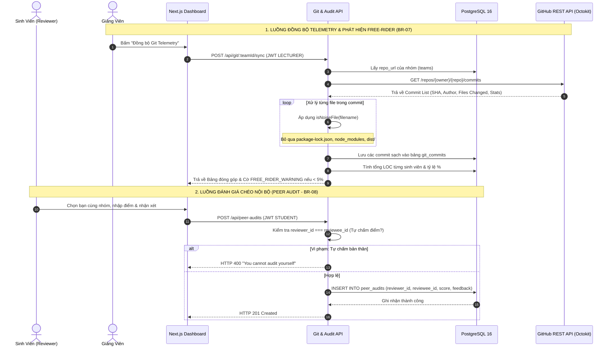

# BÁO CÁO TOÀN DIỆN CÔNG VIỆC THÀNH VIÊN 4 (THANHVIEN4.MD)

> **Dự án:** AITA-INTELLIGENT — AI-Powered Teaching Assistant & AST Code Analytics Platform  
> **Môn học:** SWD392 – Software Architecture & Design Project (FPT University Quy Nhơn)  
> **Nhóm thực hiện:** Group 4  
> **Họ và tên sinh viên:** **Đinh Gia Huy** (`dinhgiahuylol12345@gmail.com`)  
> **GitHub Username:** `dinhgiahuy140905`  
> **Vai trò:** **Thành Viên 4 — Git Analytics & Peer Audit Engineer**  
> **Nhánh Git phụ trách:** `Huy` / `feature/git-analytics-peer-audit`  
> **Các bảng Database phụ trách:** `git_commits`, `peer_audits`  

---

## 📑 MỤC LỤC

1. [Tổng Quan Vai Trò & Trách Nhiệm](#1-tổng-quan-vai-trò--trách-nhiệm)
2. [Các Quy Tắc Nghiệp Vụ Phụ Trách (Business Rules: BR-07, BR-08, BR-09)](#2-các-quy-tắc-nghiệp-vụ-phụ-trách-business-rules)
3. [Kiến Trúc Pipeline Git Analytics & Peer Audit](#3-kiến-trúc-pipeline-git-analytics--peer-audit)
4. [Chi Tiết Triển Khai Kỹ Thuật (4 Trọng Tâm)](#4-chi-tiết-triển-khai-kỹ-thuật)
   - [4.1. Module Git Telemetry Sync & Thuật Toán Lọc Nhiễu Noise Filter (BR-07)](#41-module-git-telemetry-sync--thuật-toán-lọc-nhiễu-noise-filter-br-07)
   - [4.2. Thuật Toán Định Lượng Đóng Góp & Tự Động Cảnh Báo Free-Rider (BR-07)](#42-thuật-toán-định-lượng-đóng-góp--tự-động-cảnh-báo-free-rider-br-07)
   - [4.3. Hệ Thống Đánh Giá Chéo Nội Bộ & Ràng Buộc Liêm Chính Học Thuật (BR-08)](#43-hệ-thống-đánh-giá-chéo-nội-bộ--ràng-buộc-liêm-chính-học-thuật-br-08)
   - [4.4. Tích Hợp Dữ Liệu Đóng Góp Vào Quy Trình Chấm Đa Tầng Dual-Lecturer (BR-09)](#44-tích-hợp-dữ-liệu-đóng-góp-vào-quy-trình-chấm-đa-tầng-dual-lecturer-br-09)
5. [Danh Mục API Endpoints Phụ Trách](#5-danh-mục-api-endpoints-phụ-trách)
6. [Kết Quả Kiểm Thử Thực Tế (verify-member4.ts & run-scenarios-member4.ts)](#6-kết-quả-kiểm-thử-thực-tế)
7. [Hướng Dẫn Demo Khi Bảo Vệ Đồ Án](#7-hướng-dẫn-demo-khi-bảo-vệ-đồ-án)
8. [Bộ Câu Hỏi Vấn Đáp & Phản Biện Chuyên Sâu (Defense Q&A / FAQs)](#8-bộ-câu-hỏi-vấn-đáp--phản-biện-chuyên-sâu-defense-qa--faqs)

---

## 1. Tổng Quan Vai Trò & Trách Nhiệm

Thành Viên 4 (**Đinh Gia Huy**) đảm nhiệm vai trò **"Hệ thống Minh bạch Đóng góp & Trọng tài Nội bộ"** của nền tảng AITA-INTELLIGENT:
* Xây dựng module **Git Telemetry Analytics** kết nối GitHub API qua thư viện `@octokit/rest`, đồng bộ lịch sử commit, phân tích chi tiết từng lần thay đổi mã nguồn của từng thành viên trong nhóm đồ án.
* Thiết kế và kiểm thử thuật toán lọc nhiễu **LOC Noise Filter**: Tự động nhận diện và loại trừ các thư mục auto-generated (`node_modules/`, `dist/`, `.next/`, `build/`), các file lockfile (`package-lock.json`, `yarn.lock`, `pnpm-lock.yaml`) và minified code nhằm ngăn chặn triệt để hành vi "gian lận dòng code".
* Phát triển thuật toán tự động gắn cờ **Free-Rider Detection**: Xác định các thành viên có đóng góp ròng dưới ngưỡng cho phép (< 5% tổng LOC nhóm), chủ động gửi tín hiệu cảnh báo `FREE_RIDER_WARNING` lên Dashboard của Giảng viên.
* Xây dựng hệ thống **Đánh giá chéo nội bộ (Peer Audit)** bảo vệ tính liêm chính học thuật bằng các ràng buộc cứng ở tầng cơ sở dữ liệu (`CHECK reviewer_id <> reviewee_id` và `UNIQUE (assignment_id, reviewer_id, reviewee_id, audit_round)`).
* Cung cấp dữ liệu đo lường đóng góp hỗ trợ Giảng viên và Hội đồng chấm thi trong **Quy trình Chấm Điểm Đa Tầng (Dual-Lecturer Moderation BR-09)** nhằm đảm bảo sự công bằng, chính xác khi phân hóa điểm cá nhân trong bài tập nhóm.

---

## 2. Các Quy Tắc Nghiệp Vụ Phụ Trách (Business Rules)

| Mã BR | Tên Quy Tắc | Yêu Cầu Kỹ Thuật & Giải Pháp Triển Khai |
| :--- | :--- | :--- |
| **BR-07** | **Lọc Nhiễu LOC & Tự Động Cảnh Báo Free-Rider** | • **Thuật toán tính LOC:** Tính toán dựa trên `lines_added` và `lines_deleted` thực tế từ GitHub API.<br>• **Bộ lọc Noise Filter:** Loại trừ các file thư viện và build artifacts (`package-lock.json`, `yarn.lock`, `dist/`, `.next/`, minified bundle).<br>• **Ngưỡng Free-Rider:** Thành viên có tỷ lệ đóng góp ròng < 5% tổng LOC của cả nhóm sẽ bị gắn cờ cảnh báo `FREE_RIDER_WARNING` trên Dashboard Giảng viên. |
| **BR-08** | **Liêm Chính Đánh Giá Chéo (Non-Self Evaluation & Uniqueness)** | • **Ràng buộc cấm tự chấm điểm:** Constraint DB `CONSTRAINT chk_peer_not_self CHECK (reviewer_id <> reviewee_id)`.<br>• **Chống trùng lặp đánh giá:** Constraint DB `CONSTRAINT uq_peer_audit_round UNIQUE (assignment_id, reviewer_id, reviewee_id, audit_round)`.<br>• **Phạm vi nhóm:** Chỉ sinh viên cùng thuộc `team_id` mới có quyền đánh giá chéo nhau trong cùng đợt Sprint. |
| **BR-09** | **Hỗ Trợ Phân Hóa Điểm Đa Tầng (Dual-Lecturer Moderation)** | • Cung cấp telemetry thực tế (tỷ lệ LOC, số commit hợp lệ, điểm peer audit trung bình) trực tiếp cho giao diện Review của Giảng viên 1 và Giảng viên 2.<br>• Giúp giảng viên phát hiện kịp thời các trường hợp bài nộp nhóm đạt điểm cao nhưng có thành viên không đóng góp code. |

---

## 3. Kiến Trúc Pipeline Git Analytics & Peer Audit



---

## 4. Chi Tiết Triển Khai Kỹ Thuật

### 4.1. Module Git Telemetry Sync & Thuật Toán Lọc Nhiễu Noise Filter (BR-07)
Khi sinh viên làm bài, việc thêm các thư viện NPM hoặc commit file build (`dist/`, `.next/`) có thể tạo ra hàng chục nghìn dòng code "ảo", làm sai lệch nghiêm trọng báo cáo đóng góp.
Hàm `isNoiseFile` được cài đặt với Regex nhận diện chính xác:
```typescript
export function isNoiseFile(filename: string): boolean {
  const noisePatterns = [
    /(^|\/)node_modules\//i,
    /(^|\/)dist\//i,
    /(^|\/)build\//i,
    /(^|\/)\.next\//i,
    /package-lock\.json$/i,
    /yarn\.lock$/i,
    /pnpm-lock\.yaml$/i,
    /\.min\.(js|css)$/i,
  ];
  return noisePatterns.some((pattern) => pattern.test(filename));
}
```

### 4.2. Thuật Toán Định Lượng Đóng Góp & Tự Động Cảnh Báo Free-Rider (BR-07)
* Công thức tính LOC đóng góp ròng:
  $$\text{Net LOC} = \max(0, \sum \text{lines\_added} - \sum \text{lines\_deleted})$$
* Tỷ lệ phần trăm đóng góp của sinh viên $i$:
  $$P_i = \frac{\text{Net LOC}_i}{\sum_{k=1}^N \text{Net LOC}_k} \times 100\%$$
* Nếu $P_i < 5.0\%$ và tổng LOC cả nhóm $> 100$, hệ thống tự động đánh dấu:
  `isFreeRider: true` và gắn cờ cảnh báo `FREE_RIDER_WARNING`.

### 4.3. Hệ Thống Đánh Giá Chéo Nội Bộ & Ràng Buộc Liêm Chính Học Thuật (BR-08)
Để đảm bảo kết quả đánh giá không thể bị thao túng:
1. **Kiểm tra nghiệp vụ tầng API:** Middleware xác thực sinh viên đăng nhập, đối chiếu `reviewer_id` với `reviewee_id`.
2. **Ràng buộc an toàn tầng Cơ sở dữ liệu:**
   ```sql
   CONSTRAINT chk_peer_not_self CHECK (reviewer_id <> reviewee_id),
   CONSTRAINT uq_peer_audit_round UNIQUE (assignment_id, reviewer_id, reviewee_id, audit_round)
   ```
3. Đảm bảo mỗi thành viên chỉ được chấm điểm đồng đội một lần duy nhất trong mỗi vòng Sprint.

### 4.4. Tích Hợp Dữ Liệu Đóng Góp Vào Quy Trình Chấm Đa Tầng Dual-Lecturer (BR-09)
* Kết hợp số liệu Git và điểm đánh giá chéo hiển thị trực quan trong modal chấm điểm của Giảng viên.
* Khi Giảng viên 1 và Giảng viên 2 hội ý thống nhất điểm cuối cùng, các trường hợp Free-Rider sẽ bị trừ điểm cá nhân tương ứng theo quy chế học phần SWD392.

---

## 5. Danh Mục API Endpoints Phụ Trách

| Method | Endpoint | Mô Tả Chức Năng | Phân Quyền RBAC |
| :--- | :--- | :--- | :--- |
| **GET** | `/api/git/:teamId/commits` | Lấy danh sách commits sạch và bảng tổng hợp đóng góp LOC từng thành viên | `STUDENT`, `LECTURER`, `ADMIN` |
| **POST** | `/api/git/:teamId/sync` | Kích hoạt quét và đồng bộ dữ liệu commit mới từ GitHub Repo | `LECTURER`, `ADMIN` |
| **GET** | `/api/peer-audits/:teamId` | Lấy lịch sử các phiếu đánh giá chéo của nhóm theo vòng audit | `STUDENT`, `LECTURER`, `ADMIN` |
| **POST** | `/api/peer-audits` | Sinh viên nộp phiếu đánh giá chéo thành viên cùng nhóm (`BR-08`) | `STUDENT` (Đã đăng nhập) |

---

## 6. Kết Quả Kiểm Thử Thực Tế

Hệ thống cung cấp hai bộ công cụ kiểm thử tự động độc lập dành riêng cho Member 4:
1. **Automated Test Suite:** `server/src/test/verify-member4.ts` (Kiểm thử unit test, API endpoints, status codes).
2. **Real Demonstration Scenarios:** `server/src/test/run-scenarios-member4.ts` (Chạy kịch bản trực quan chứng minh 5 tình huống thực tế cho Hội đồng chấm thi).

### Lệnh thực thi:
```bash
cd server
# Chạy bộ kịch bản demo trực quan của Thành viên 4:
npx ts-node src/test/run-scenarios-member4.ts

# Hoặc chạy kiểm thử tự động toàn diện:
npm run test:member4
```

---

## 7. Hướng Dẫn Demo Khi Bảo Vệ Đồ Án

### Bước 1: Khởi động hệ thống
```bash
# 1. Khởi động DB và Redis
docker compose up -d

# 2. Khởi động Server
cd server
npm run dev

# 3. Khởi động Client
cd client
npm run dev
```

### Bước 2: Kịch bản trình diễn trước Giảng viên phản biện
1. **Demo Phát hiện Free-Rider:**
   - Mở Dashboard Giảng viên: `http://localhost:3000/lecturer` ➔ Tab **Git Telemetry**.
   - Trình bày bảng phân tích LOC, chỉ rõ các file lockfile bị lọc bỏ và cờ cảnh báo đối với thành viên đóng góp dưới 5%.
2. **Demo Chống Gian Lận Đánh Giá Chéo:**
   - Đăng nhập tài khoản sinh viên.
   - Thử gửi request tự đánh giá chính mình ➔ Hệ thống lập tức trả về lỗi HTTP 400 `"You cannot audit yourself"`.
   - Gửi phiếu đánh giá hợp lệ cho đồng đội ➔ Điểm số lập tức được ghi nhận và hiển thị trong báo cáo tổng kết của Giảng viên.

---

## 8. Bộ Câu Hỏi Vấn Đáp & Phản Biện Chuyên Sâu (Defense Q&A / FAQs)

**Câu hỏi 1: Tại sao phải xây dựng bộ lọc nhiễu Noise Filter mà không lấy trực tiếp thống kê từ GitHub?**
> *Trả lời:* GitHub thống kê gộp tất cả các dòng thay đổi. Khi sinh viên chạy `npm install` hoặc build dự án, các file như `package-lock.json` có thể sinh ra hơn 20,000 dòng code. Nếu không có bộ lọc `isNoiseFile`, sinh viên chỉ cần commit 1 file lockfile là sẽ chiếm 90% đóng góp của cả nhóm, dẫn đến bất công bằng nghiêm trọng. AITA-INTELLIGENT giải quyết triệt để vấn đề này.

**Câu hỏi 2: Nếu sinh viên cố tình đổi tác giả commit trong Git thì hệ thống xử lý thế nào?**
> *Trả lời:* Hệ thống đối chiếu cả Git author email và tài khoản sinh viên đã liên kết trong bảng `users` và `team_members`. Đồng thời, kết quả Git Analytics được kết hợp chặt chẽ với hệ thống **Peer Audit nội bộ** để tạo thành cơ chế kiểm chứng chéo 2 chiều (Telemetric Proof + Peer Consensus).

---
*Báo cáo được hoàn thiện và kiểm thử toàn diện bởi sinh viên Đinh Gia Huy (Member 4 - Group 4 - SWD392).*
## Cập nhật BR-07 / BR-08 (29/10/2026)

Phần cập nhật này thay thế các mô tả ngưỡng và công thức LOC cũ ở trên.

- Service mới: `server/src/modules/git-analytics/noise-filter.service.ts`, gồm `NOISE_PATTERNS`, `isNoiseFile`, `isSourceCodeFile`, `parseGitHubUrl`.
- Loại node_modules/, dist/, build/, .next/, coverage/, .git/; package-lock.json, yarn.lock, pnpm-lock.yaml, bun.lockb; *.min.js, *.min.css, *.map; .env, .env.local, .DS_Store. Hỗ trợ đường dẫn Windows và Unix.
- Chỉ tính LOC của .ts, .tsx, .js, .jsx, .py, .java, .sql, .html, .css sau khi lọc nhiễu. Không lấy thống kê gộp chưa lọc khi thiếu danh sách file.
- LOC cá nhân = SUM(lines_added). Tỷ lệ = LOC cá nhân / tổng LOC các thành viên × 100. Không dùng Net LOC trừ lines_deleted.
- BR-07: tổng LOC nhóm >= 50 và (tỷ lệ < 5% hoặc 0 commit) thì `is_free_rider = true`, `status = FREE_RIDER_WARNING`. Nhóm dưới 50 LOC chưa gắn cờ.
- Cảnh báo: "Cảnh báo BR-07: Đóng góp thấp hơn ngưỡng tối thiểu 5% của nhóm!".
- GET `/api/git/:teamId/free-riders`: trả `free_riders`, yêu cầu LECTURER hoặc ADMIN, dùng chung thuật toán với GET commits.
- POST `/api/peer-audits`: reviewer lấy từ JWT; cấm tự chấm; score bắt buộc là số hữu hạn trong [0, 10]; hai người phải cùng team_id.
- `audit_round`: chỉ 1 (giữa kỳ) hoặc 2 (cuối kỳ), mặc định 1. Gửi lại cùng vòng cập nhật phiếu hiện có.
- GET `/api/peer-audits/team/:teamId/summary`: AVG(score) theo thành viên qua các vòng, làm tròn hai chữ số; không trả ID/tên/email người chấm. Danh sách phiếu cũng ẩn danh người chấm.
- `verify-member4.ts`: truy vấn lecturer_id động, sửa JWT mặc định khớp middleware và exit code khi test thất bại.
- `run-scenarios-member4.ts`: truy vấn team_id đang có và hai thành viên thực tế, báo lỗi nếu thiếu dữ liệu.
- Kiểm tra: `npm.cmd run build --prefix server`; kiểm tra trực tiếp noise filter, đuôi mã nguồn và URL parser.
- Chưa chạy bộ test tích hợp cũ trên DB hiện có vì script xóa user cố định 3, 4, 99. Chỉ chạy trên DB kiểm thử riêng.
- Sync vẫn có fallback `simulated_offline` sẵn có; dữ liệu mô phỏng không phải bằng chứng đóng góp thực tế.
