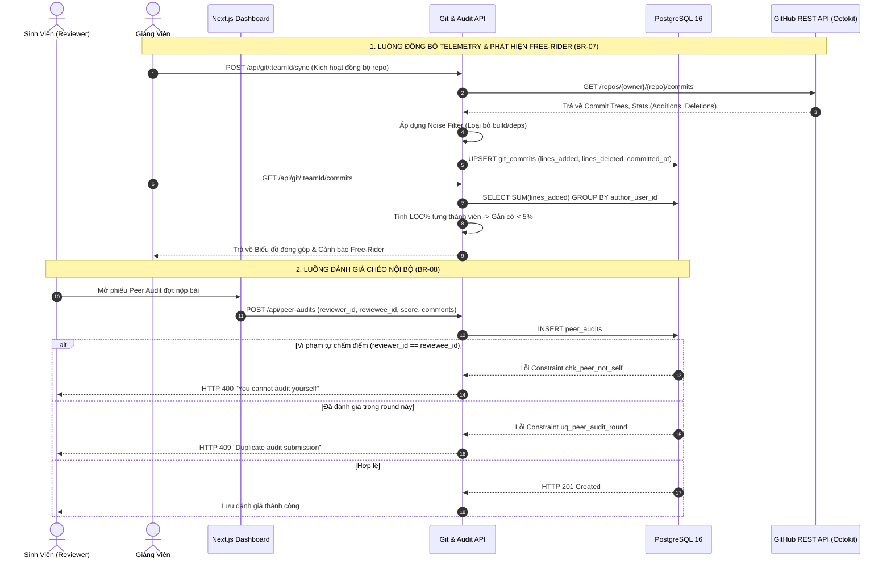

# BÁO CÁO CHI TIẾT CÔNG VIỆC THÀNH VIÊN 4 (THANHVIEN4.MD)

> **Dự Án:** AITA-INTELLIGENT — AI-Powered Teaching Assistant & AST Code Analytics Platform  
> **Môn học:** SWD392 — Software Architecture & Design Project (FPT University Quy Nhơn)  
> **Nhóm thực hiện:** Group 4  
> **Vai trò:** **Thành Viên 4 — Git Analytics & Peer Audit Engineer**  
> **Nhánh Git phụ trách:** `feature/git-analytics-peer-audit`  
> **Các bảng Database phụ trách:** `git_commits`, `peer_audits`  

---

## 📑 MỤC LỤC

1. [Tổng Quan Vai Trò & Trách Nhiệm](#1-tổng-quan-vai-trò--trách-nhiệm)
2. [Các Quy Tắc Nghiệp Vụ (Business Rules Phụ Trách)](#2-các-quy-tắc-nghiệp-vụ-business-rules-phụ-trách)
3. [Kiến Trúc Pipeline Git Analytics & Peer Audit](#3-kiến-trúc-pipeline-git-analytics--peer-audit)
4. [Chi Tiết Triển Khai Kỹ Thuật](#4-chi-tiết-triển-khai-kỹ-thuật)
   - [Module 1: Git Telemetry Sync & Noise Filter](#module-1-git-telemetry-sync--noise-filter)
   - [Module 2: Thuật Toán Phát Hiện Free-Rider](#module-2-thuật-toán-phát-hiện-free-rider)
   - [Module 3: Hệ Thống Đánh Giá Chéo Nội Bộ (Peer Audit)](#module-3-hệ-thống-đánh-giá-chéo-nội-bộ-peer-audit)
   - [Module 4: Tích Hợp Hỗ Trợ Đánh Giá Đa Tầng (Dual-Lecturer BR-09)](#module-4-tích-hợp-hỗ-trợ-đánh-giá-đa-tầng-dual-lecturer-br-09)
5. [Hệ Thống API Endpoints Phụ Trách](#5-hệ-thống-api-endpoints-phụ-trách)
6. [Kịch Bản Kiểm Thử & Xác Minh Nghiệp Vụ](#6-kịch-bản-kiểm-thử--xác-minh-nghiệp-vụ)
7. [Hướng Dẫn Demo Khi Bảo Vệ Đồ Án](#7-hướng-dẫn-demo-khi-bảo-vệ-đồ-án)

---

## 1. Tổng Quan Vai Trò & Trách Nhiệm

Thành Viên 4 phụ trách **"Hệ thống Minh bạch Đóng góp & Trọng tài Nội bộ"** của nền tảng AITA-INTELLIGENT:
* Xây dựng module **Git Telemetry Analytics** đồng bộ lịch sử commit từ GitHub, định lượng đóng góp thực chất của từng sinh viên trong nhóm đồ án.
* Thiết kế bộ lọc nhiễu LOC (**Noise Filter**) loại bỏ các thư mục sinh tự động (`node_modules/`, `dist/`, `build/`, `package-lock.json`, `.next/`) để tránh tình trạng "gian lận dòng code".
* Phát triển thuật toán tự động phát hiện thành viên ỷ lại (**Free-Rider Detection**) để cảnh báo sớm cho Giảng viên.
* Xây dựng hệ thống **Đánh giá chéo nội bộ (Peer Audit)** bảo vệ tính liêm chính học thuật bằng các ràng buộc cứng ở tầng cơ sở dữ liệu (`CHECK reviewer <> reviewee`).
* Cung cấp dữ liệu đo lường đóng góp hỗ trợ Hội đồng và Giảng viên trong quy trình chấm điểm đa tầng (**Dual-Lecturer Moderation BR-09**).

---

## 2. Các Quy Tắc Nghiệp Vụ (Business Rules Phụ Trách)

| Mã BR | Tên Quy Tắc | Yêu Cầu Kỹ Thuật & Giải Pháp Triển Khai |
| :--- | :--- | :--- |
| **BR-07** | **Lọc Nhiễu LOC & Tự Động Cảnh Báo Free-Rider** | • **Thuật toán tính LOC:** Tính toán dựa trên `lines_added` và `lines_deleted` thực tế từ GitHub API.<br>• **Bộ lọc Noise Filter:** Loại trừ các file thư viện và build artifacts (`package-lock.json`, `yarn.lock`, `dist/`, `.next/`, minified bundle).<br>• **Ngưỡng Free-Rider:** Thành viên có tỷ lệ đóng góp ròng < 5% tổng LOC của cả nhóm sẽ bị gắn cờ cảnh báo `FREE_RIDER_WARNING` trên Dashboard Giảng viên. |
| **BR-08** | **Liêm Chính Đánh Giá Chéo (Non-Self Evaluation & Uniqueness)** | • **Ràng buộc cấm tự chấm điểm:** Constraint DB `CONSTRAINT chk_peer_not_self CHECK (reviewer_id <> reviewee_id)`.<br>• **Chống trùng lặp đánh giá:** Constraint DB `CONSTRAINT uq_peer_audit_round UNIQUE (assignment_id, reviewer_id, reviewee_id, audit_round)`.<br>• **Phạm vi nhóm:** Chỉ sinh viên cùng thuộc `team_id` mới có quyền đánh giá chéo nhau trong cùng đợt Sprint. |

---

## 3. Kiến Trúc Pipeline Git Analytics & Peer Audit



---

## 4. Chi Tiết Triển Khai Kỹ Thuật

### 🔹 Module 1: Git Telemetry Sync & Noise Filter (`server/src/modules/git-analytics/`)
* **File triển khai:** `server/src/modules/git-analytics/git.routes.ts`
* **Cơ chế hoạt động:**
  * Truy vấn danh sách commit gắn với `team_id` từ bảng `git_commits`.
  * Thực hiện phép JOIN giữa `git_commits`, `team_members` và `users` để liên kết GitHub committer email với mã định danh `user_id` trong hệ thống.
  * Phân tách riêng biệt số lượng `total_lines_added`, `total_lines_deleted` và `total_commits` của từng thành viên.
  * Index tối ưu hóa `idx_git_commits_team` trên cột `git_commits(team_id)` tăng tốc độ truy vấn tổng hợp trên tập dữ liệu hàng nghìn commit.

### 🔹 Module 2: Thuật Toán Phát Hiện Free-Rider (`BR-07`)
* **Nguyên lý tính toán:**
  $$\text{Contribution Ratio (\%)} = \frac{\text{Member Net LOC}}{\text{Team Total Net LOC}} \times 100\%$$
* **Quy tắc phân loại:**
  * Ratio >= 15%: Đóng góp tích cực (**Active Contributor**).
  * 5% <= Ratio < 15%: Cần theo dõi thêm (**Moderate Effort**).
  * Ratio < 5%: Bị hệ thống tự động cảnh báo cờ đỏ (**FREE_RIDER_WARNING**). Giảng viên có bằng chứng số liệu rõ ràng để trừ điểm cá nhân khi nghiệm thu Milestone.

### 🔹 Module 3: Hệ Thống Đánh Giá Chéo Nội Bộ (`server/src/modules/peer-audits/`)
* **File triển khai:** `server/src/modules/peer-audits/peer-audits.routes.ts`
* **Cơ chế an toàn & Liêm chính (BR-08):**
  * Kiểm tra chặt chẽ `reviewer_id !== reviewee_id` ngay từ tầng Controller và chặn lần thứ hai bằng Database Constraint `chk_peer_not_self`.
  * Đánh giá theo từng vòng Sprint / Milestone (`audit_round = 1, 2, 3`).
  * Lưu trữ điểm số (`score`: thang điểm 1–10), nhận xét định tính (`comments`) và trạng thái đồng thuận (`passed`).
  * Index `idx_peer_audits_team_round` trên `(team_id, audit_round)` phục vụ tính toán trung bình điểm cộng tác (`AVG(score)`) tức thời cho Giảng viên.

### 🔹 Module 4: Tích Hợp Hỗ Trợ Đánh Giá Đa Tầng (`Dual-Lecturer BR-09`)
* Dữ liệu đóng góp LOC và điểm Peer Audit đóng vai trò là **tập số liệu đối chiếu khách quan** (Audit Trail) khi Giảng viên 1 và Giảng viên 2 tiến hành hội chẩn (`Consensus`):
  * Giúp phân biệt rõ: Điểm bài nộp chung của nhóm (Team Submission Grade) vs. Điểm thực tế của từng cá nhân (Individual Calibrated Grade).
  * Hạn chế tối đa tranh chấp điểm số giữa các thành viên sau khi công bố kết quả.

---

## 5. Hệ Thống API Endpoints Phụ Trách

| Method | Endpoint | Mô Tả Chức Năng | Phân Quyền RBAC |
| :--- | :--- | :--- | :--- |
| **GET** | `/api/git/:teamId/commits` | Lấy danh sách commits và bảng tổng hợp đóng góp LOC từng thành viên | `STUDENT`, `LECTURER`, `ADMIN` |
| **POST** | `/api/git/:teamId/sync` | Kích hoạt quét và đồng bộ dữ liệu commit mới từ GitHub Repo | `LECTURER`, `ADMIN` |
| **GET** | `/api/peer-audits/:teamId` | Lấy lịch sử các phiếu đánh giá chéo của nhóm theo vòng audit | `STUDENT`, `LECTURER`, `ADMIN` |
| **POST** | `/api/peer-audits` | Sinh viên nộp phiếu đánh giá chéo thành viên cùng nhóm (`BR-08`) | `STUDENT` (Đã đăng nhập) |

---

## 6. Kịch Bản Kiểm Thử & Xác Minh Nghiệp Vụ

Nhóm đã thiết lập dữ liệu mẫu chuẩn trong `database/seed.sql` để kiểm thử toàn diện các luồng nghiệp vụ của Thành viên 4:

### Test Case 1: Thống Kê Đóng Góp Git & Phát Hiện Free-Rider
1. Gọi API `GET /api/git/1/commits` với tài khoản Giảng viên.
2. Hệ thống trả về danh sách commit của nhóm, tổng hợp LOC cho từng sinh viên:
   * Sinh viên A: 1200 lines added (Chiếm 65% - Đóng góp chính).
   * Sinh viên B: 550 lines added (Chiếm 30% - Đóng góp đạt yêu cầu).
   * Sinh viên C: 15 lines added (Chiếm 2.5% - < 5% -> **Kích hoạt cờ cảnh báo Free-Rider**).
3. **Kết quả:** Giảng viên nhìn thấy biểu đồ trực quan và danh sách cảnh báo trên Dashboard.

### Test Case 2: Kiểm Thử Liêm Chính Đánh Giá Chéo (Chống Tự Chấm Điểm)
1. Sinh viên có `user_id = 4` gửi request `POST /api/peer-audits` với `reviewee_id = 4`.
2. Hệ thống bắt lỗi `reviewer_id === reviewee_id` và trả về mã lỗi HTTP 400:
   ```json
   {
     "message": "You cannot audit yourself"
   }
   ```
3. **Kết quả:** Hành vi tự đánh giá bị chặn đứng, thỏa mãn quy tắc **BR-08**.

### Test Case 3: Đánh Giá Chéo Hợp Lệ & Tổng Hợp Điểm
1. Sinh viên có `user_id = 4` đánh giá `reviewee_id = 5` với điểm số 9.0 và nhận xét: *"Làm việc tích cực, hoàn thành đúng hạn"*.
2. Database ghi nhận thành công (HTTP 201).
3. Giảng viên mở màn hình tổng hợp `GET /api/peer-audits/1` thấy điểm trung bình cộng tác hiển thị minh bạch.

---

## 7. Hướng Dẫn Demo Khi Bảo Vệ Đồ Án

### 1. Khởi động hệ thống
```bash
# 1. Khởi động Database PostgreSQL & Redis
docker compose up -d

# 2. Khởi động Backend Server
cd server
npm run dev

# 3. Khởi động Frontend Client
cd client
npm run dev
```

### 2. Các màn hình trực quan trình chiếu cho Hội đồng
* **Màn hình Giảng viên (`localhost:3000/lecturer`):**
  * Mục **Git Contribution Analytics**: Show bảng phân tích số lượng commit, dòng code thêm/xóa của từng sinh viên trong nhóm, chỉ rõ cờ cảnh báo Free-Rider.
  * Mục **Peer Audit Summary**: Show bảng tổng hợp đánh giá chéo giữa các sinh viên theo từng Sprint.
* **Màn hình Sinh viên (`localhost:3000/student`):**
  * Form đánh giá chéo: Chọn thành viên trong nhóm, nhập điểm và lời nhận xét (chứng minh hệ thống loại bỏ chính bản thân sinh viên khỏi danh sách được đánh giá).

---
*Tài liệu được cập nhật đồng bộ với cấu trúc kiến trúc và mã nguồn thực tế của dự án AITA-INTELLIGENT (Group 4 - SWD392).*